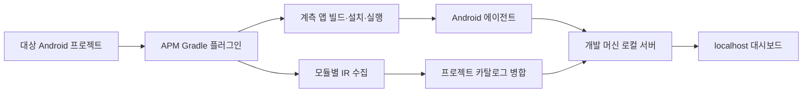

# 시스템 구조

## 구성



| 구성 요소 | 책임 |
| --- | --- |
| Gradle 플러그인 | variant 선택, 모듈 참여, 수집·빌드·실행 작업 연결 |
| Kotlin 컴파일러 플러그인 | IR 분석, 선언과 호출 관계 추출, 후속 계측 지점 연결 |
| 카탈로그 엔진 | 모듈 결과 병합, provider 연결, 전환 후보 해석 |
| Android 에이전트 | 실행 이벤트, 함수·화면·자원·외부 연결 관측 |
| 로컬 서버 | 세션 관리, 결과 수신·보관·조회, 대시보드 제공 |
| 대시보드 | 화면 지도, 경로별 트레이스, 함수·자원 시계열, 구성 탐색 |

Gradle 플러그인·컴파일러 플러그인·Android 에이전트·서버는 Kotlin 구현을 기본 방향으로 한다. 웹 UI의 언어와 프레임워크는 아직 결정하지 않았다.

## 사용자 실행 흐름

1. 프로젝트에 플러그인을 적용하고 대상 앱 variant를 선택한다.
2. APM 실행 작업이 필요한 수집·빌드 작업을 실행한다.
3. 서버를 시작하거나 같은 프로젝트의 실행 중 서버에 연결한다.
4. 선택한 디바이스에 계측 앱을 설치·실행한다.
5. 서버가 카탈로그와 실행 데이터를 결합한다.
6. 사용자가 localhost에서 화면·상태·경로·디바이스를 선택한다.

예시 작업 이름은 다음과 같다. 실제 Gradle API가 아니라 구현할 작업의 제안이다.

| 작업 | 목적 |
| --- | --- |
| `apmCollect<Variant>Entries` | 모듈별 전체 수집용 컴파일 |
| `apmMerge<Variant>Catalog` | 선택한 앱의 카탈로그 연결·병합 |
| `apmRun<Variant>` | 분석·빌드·서버·디바이스 실행 연결 |

플러그인 적용이나 Gradle Sync만으로 앱과 서버를 실행하지 않는다. 명시적인 APM 작업이 실행의 시작점이다.

## 프로세스와 수명

- Gradle은 작업을 조율한다.
- 로컬 서버는 Gradle 빌드 종료 이후에도 결과를 제공하는 별도 프로세스다.
- Android 에이전트는 대상 디바이스의 앱 프로세스에서 동작한다.
- 브라우저는 개발 머신의 서버에 연결한다.
- 서버의 시작·재연결·종료와 포트 충돌 처리 정책을 구현한다.
- 디바이스별 ADB 연결을 명시적으로 선택한다. 자동 실행 경로에서는 전송을 위한 ADB reverse 등을 검증한다.

## 빌드와 수집의 분리

첫 수집기는 IR을 읽어 카탈로그를 만드는 역할부터 구현한다. 함수 계측과 화면 관측 코드는 이후 단계에서 추가한다.

일반 앱 빌드의 증분 컴파일을 유지하고, 전체 목록 생성은 별도 수집용 컴파일에서 수행하는 방식을 기준 구현으로 제안한다. 해당 작업은 동일한 variant의 소스·생성 소스·클래스패스·컴파일러 설정을 반영해야 한다. 공개 빌드 API로 필요한 설정을 재현할 수 있는지는 첫 PoC에서 검증한다.

AGP 9의 내장 Kotlin 환경에 연결한다. `org.jetbrains.kotlin.android`를 무조건 추가 적용하는 방식으로 구현하지 않는다. [AGP 9 변경사항](https://developer.android.com/build/releases/agp-9-0-0-release-notes)

## 카탈로그와 실행 데이터의 연결

```text
프로젝트 / 앱 / variant / 빌드
 ├─ 분석 카탈로그
 │   ├─ entry 등록 선언
 │   ├─ provider 연결
 │   ├─ 전환 후보
 │   └─ 프로젝트 구성
 └─ 디바이스별 세션
     ├─ 화면·상태·전환 관측
     ├─ 함수와 비동기 작업
     ├─ 자원 시계열
     └─ 외부 요청·캐시 이벤트
```

분석 결과의 빌드와 실행 앱의 빌드가 다르면 그대로 결합하지 않는다. 식별자와 카탈로그 지문을 통해 일치 여부를 검증한다.

## 시간과 인과관계

- 디바이스 이벤트에는 단조 증가하는 시간 기준을 사용한다.
- 서버 수신 시각을 함수 시작 시각으로 사용하지 않는다.
- 여러 프로세스·디바이스의 시각을 결합하려면 시계 대응 정보와 오차를 함께 기록한다.
- 함수는 호출 인스턴스별 시작·종료를 기록한다.
- 코루틴은 논리적 작업 관계와 스레드 위 실행 구간을 별도로 표현한다.
- UI 이벤트의 인과 식별자는 코루틴·메시지·탐색 상태 변경으로 전달하는 계측을 검토한다.
- 시간상 인접한 이벤트를 인과관계로 확정하지 않는다.

## 로컬 데이터 처리 제안

- 서버는 기본적으로 loopback에 바인딩한다.
- 프로젝트와 디바이스 세션을 구분하고 전송 재연결 시 중복 이벤트를 처리한다.
- 버퍼 포화·전송 끊김·이벤트 유실 정보를 결과에 포함한다.
- 함수·자원 수집의 오버헤드를 검증하고 샘플링 간격과 계측 범위를 세션에 기록한다.
- 요청 본문, 인증 정보, 화면 입력값 등의 수집 정책은 최소 수집을 기본으로 별도 설계한다.
- 저장 엔진과 전송 프로토콜은 미결정이다. 문서의 논리 데이터 모델을 먼저 고정한다.

## 버전 호환성

AGP, Kotlin 컴파일러, Compose 컴파일러, Nav3, Android OS별 지원 조합을 명시적으로 관리한다. 최초 PoC는 한 조합을 고정한 뒤 확대한다.

Kotlin 컴파일러 플러그인 API는 버전 간 변경될 수 있다. 수집 실패를 빈 카탈로그로 처리하지 않고 호환성 진단을 남긴다. [Kotlin 컴파일러 플러그인](https://kotlinlang.org/docs/custom-compiler-plugins.html)
