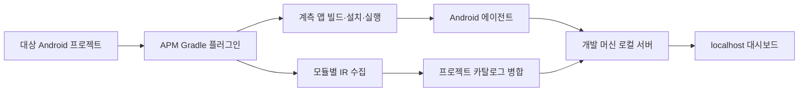

# 시스템 구조

현재 정적 구현은 K2 IR과 SootUp/Heros를 결합한다. 엔진 선택 배경, 실제 Gradle 태스크와 구현 범위는 [분석기 파이프라인](10-sootup-heros-analysis.md)을 따른다. 아래 런타임·서버·관측 구성은 제품 전체 설계이며 모두 구현된 상태를 뜻하지 않는다.

2026-10-15 확정 방향: 제품의 분석·설명은 AI 없이 수행하고, 고객 코드·결과·로그를 고객 통제 환경 안에 보관한다. [전환·접근 경로](12-transition-and-access-path-design.md)는 기존 정적 엔진을 확장하고, [외부 전송 차단 설계](13-local-analysis-security.md)는 Gradle 실행 전부터 적용하는 격리 runner를 정의한다. 아래 프로세스·디바이스·viewer는 모두 이 경계의 적용 대상이다. 일반 plugin 실행이나 localhost만으로 차단이 보장된 상태는 아니다.

## 구성



| 구성 요소 | 책임 |
| --- | --- |
| Gradle 플러그인 | variant 선택, 모듈 참여, 수집·빌드·실행 작업 연결 |
| Kotlin 컴파일러 플러그인 | 전체 Composable·UI 진입점·Nav3 선언, 호출·타입·콘텐츠 전달 관계 추출 |
| 카탈로그 엔진 | 모듈 결과 병합, UI·provider·DI 연결, 화면 분류와 전환 후보 해석 |
| Android 에이전트 | 실행 이벤트, 함수·화면·자원·외부 연결 관측 |
| 로컬 서버 | 세션 관리, 결과 수신·보관·조회, 대시보드 제공 |
| 대시보드 | 화면 지도, 경로별 트레이스, 함수·자원 시계열, 구성 탐색 |

Gradle 플러그인·컴파일러 플러그인·Android 에이전트·서버는 Kotlin 구현을 기본 방향으로 한다. 웹 UI의 언어와 프레임워크는 아직 결정하지 않았다.

## 사용자 실행 흐름

1. 프로젝트에 플러그인을 적용하고 대상 앱 variant를 선택한다.
2. APM 실행 작업이 필요한 수집·빌드 작업을 실행한다.
3. 서버를 시작하거나 같은 프로젝트의 실행 중 서버에 연결한다.
4. 선택한 디바이스에 계측 앱을 설치·실행한다.
5. 서버가 카탈로그와 실행 데이터를 결합한다.
6. 사용자가 localhost에서 화면·상태·경로·디바이스를 선택한다.

작업의 구현 상태는 다음과 같다. 현재 정적 수집기는 unflavored debug와 Kotlin/JVM 입력을 지원하며 일반화된 variant API는 후속 범위다.

| 작업 | 목적 | 상태 |
| --- | --- | --- |
| `apmCompileDebugCatalog` | 실제 compilation 입력을 이용한 별도 전체 IR 수집 | 구현 |
| `apmCollectDebugCatalog` | 성공한 모듈 카탈로그와 읽기용 보고서 공개 | 구현 |
| `apmMergeDebugCatalog` | 선택한 앱의 프로젝트 의존 모듈 연결·병합 | 구현 |
| `apmRun<Variant>` | 분석·빌드·서버·디바이스 실행 연결 | 설계안 |

플러그인 적용이나 Gradle Sync만으로 앱과 서버를 실행하지 않는다. 명시적인 APM 작업이 실행의 시작점이다.

## 프로세스와 수명

- Gradle은 작업을 조율한다.
- 로컬 서버는 Gradle 빌드 종료 이후에도 결과를 제공하는 별도 프로세스다.
- Android 에이전트는 대상 디바이스의 앱 프로세스에서 동작한다.
- 브라우저는 개발 머신의 서버에 연결한다.
- 서버의 시작·재연결·종료와 포트 충돌 처리 정책을 구현한다.
- 디바이스별 ADB 연결을 명시적으로 선택한다. 자동 실행 경로에서는 전송을 위한 ADB reverse 등을 검증한다.

## 빌드와 수집의 분리

현재 수집기는 IR을 읽어 카탈로그를 만든다. 함수 계측과 화면 관측 코드는 이후 단계에서 추가한다.

일반 앱 빌드의 증분 컴파일을 유지하고, 전체 목록은 별도 수집용 컴파일에서 생성한다. 원래 Kotlin compilation의 소스·Java 소스·생성 작업 의존성·클래스패스·friend 경로·컴파일러/플러그인 옵션을 사용한다. 이 구성과 Compose lowering 이전의 수집 순서를 샘플 및 소비 프로젝트에서 검증했다. 추가 variant와 버전까지 지원한다는 의미는 아니다.

컴파일 중간 결과와 병합 입력은 내부 JSON v1으로 보존한다. 사용자에게 보이는 `catalog.json`·`project-catalog.json`은 필요한 UI 관계만 남긴 JSON v2다. 보고서를 축약해도 다음 모듈 병합의 분석 근거가 없어지지 않도록 병합 작업은 항상 내부 v1을 읽는다. 작업별 출력 경로, 캐시와 실패 처리 결정은 [구현 결정](09-catalog-decisions-and-validation.md)에 정리한다.

컴파일러가 완성된 화면 목록이나 NavGraph를 출력한다고 가정하지 않는다. 모듈 IR에서 키·콘텐츠·호출 관계를 수집하고 카탈로그 엔진이 프로젝트 단위로 연결한다. 현재 variant에 포함되지 않은 코드나 외부 바이너리 본문을 앱 모듈 IR만으로 읽을 수 있다고 가정하지 않는다.

후속 최적화는 일반 컴파일의 수집 결과를 파일별 영속 인덱스로 유지하는 방식이다. 변경 파일 결과만으로 전체 목록을 덮어쓰지 않고 삭제·변경·생성 소스·의존 관계를 반영한다. 별도 전체 수집과 결과가 같다는 검증을 통과한 뒤 기본 경로로 전환한다. 현재 기본 수집 방식과 최적화 목표를 구분한다.

AGP 9의 내장 Kotlin 환경에 연결한다. `org.jetbrains.kotlin.android`를 무조건 추가 적용하는 방식으로 구현하지 않는다. [AGP 9 변경사항](https://developer.android.com/build/releases/agp-9-0-0-release-notes)

## 카탈로그와 실행 데이터의 연결

```text
프로젝트 / 앱 / variant / 빌드
 ├─ 분석 카탈로그
 │   ├─ 전체 Composable 선언·콘텐츠 전달 관계
 │   ├─ UI 진입점·구성 관계·화면 후보와 정의
 │   ├─ entry 등록 선언
 │   ├─ provider·host·DI 연결
 │   ├─ 전환 후보
 │   └─ 프로젝트 구성
 └─ 디바이스별 세션
     ├─ 화면·상태·전환 관측
     ├─ 함수와 비동기 작업
     ├─ 자원 시계열
     └─ 외부 요청·캐시 이벤트
```

분석 결과의 빌드와 실행 앱의 빌드가 다르면 그대로 결합하지 않는다. 식별자와 카탈로그 지문을 통해 일치 여부를 검증한다.

카탈로그 생성은 세 정보를 결합한다. 전체 선언 인덱스가 연결되지 않은 콘텐츠를 보존하고, UI 진입점 추적이 루트와 콘텐츠의 관계를 찾고, Nav3 분석이 키·provider·콘텐츠를 연결한다. 마지막으로 화면·상태·컴포넌트를 분류하며, UI 구성 관계와 전환 후보는 별도 그래프로 유지한다. 자세한 연결 규칙은 [화면 발견 설계](03-nav3-entry-discovery.md)에 따른다.

## 시간과 인과관계

- 디바이스 이벤트에는 단조 증가하는 시간 기준을 사용한다.
- 서버 수신 시각을 함수 시작 시각으로 사용하지 않는다.
- 여러 프로세스·디바이스의 시각을 결합하려면 시계 대응 정보와 오차를 함께 기록한다.
- 함수는 호출 인스턴스별 시작·종료를 기록한다.
- 코루틴은 논리적 작업 관계와 스레드 위 실행 구간을 별도로 표현한다.
- UI 이벤트의 인과 식별자는 코루틴·메시지·탐색 상태 변경으로 전달하는 계측을 검토한다.
- 시간상 인접한 이벤트를 인과관계로 확정하지 않는다.

## 로컬 데이터 처리와 외부 전송 차단

필수 경계·실패 정책·비전송 인수 기준은 [13번 설계](13-local-analysis-security.md)를 따른다. tool bundle 준비와 고객 입력 분석을 분리하고, Gradle·KSP/worker·분석 JVM의 자식 프로세스까지 격리한다. 격리를 확인할 수 없으면 입력을 읽기 전에 중단하며 온라인/AI fallback을 하지 않는다. 원격 cache·CI log/artifact·자동 crash upload·동기화 디렉터리도 전송 경로로 취급한다. Linux/WSL2 runner와 합성 비전송 시험의 구현 범위는 [14번 기록](14-offline-transitions-implementation.md)을 따르며 테스트 앱·viewer의 격리는 별도 후속 범위다.

- 서버는 loopback에만 바인딩하고 세션 인증·Host/Origin 검사·CSRF 방어를 적용한다. viewer는 외부 자원을 불러오지 않는다.
- 프로젝트와 디바이스 세션을 구분하고 전송 재연결 시 중복 이벤트를 처리한다.
- 버퍼 포화·전송 끊김·이벤트 유실 정보를 결과에 포함한다.
- 함수·자원 수집의 오버헤드를 검증하고 샘플링 간격과 계측 범위를 세션에 기록한다.
- 요청·응답 본문, 인증 정보, 화면 입력값·캡처는 기본 수집하지 않는다. 관측은 필드 allowlist와 로컬 fixture를 사용한다.
- 저장 엔진과 전송 프로토콜은 미결정이다. 문서의 논리 데이터 모델을 먼저 고정한다.

## 버전 호환성

AGP, Kotlin 컴파일러, Compose 컴파일러, Nav3, Android OS별 지원 조합을 명시적으로 관리한다. 최초 PoC는 한 조합을 고정한 뒤 확대한다.

Kotlin 컴파일러 플러그인 API는 버전 간 변경될 수 있다. 수집 실패를 빈 카탈로그로 처리하지 않고 호환성 진단을 남긴다. [Kotlin 컴파일러 플러그인](https://kotlinlang.org/docs/custom-compiler-plugins.html)
