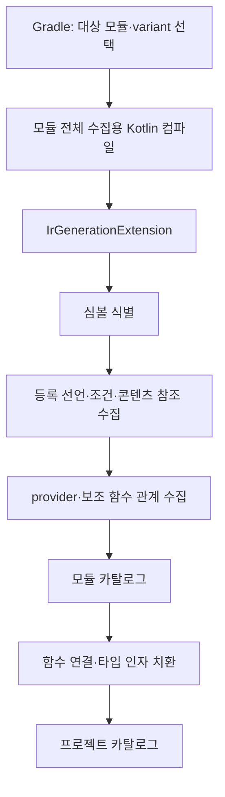

# IR 기반 Nav3 entry 수집

## 목표와 산출물

선택한 variant의 분석 대상 소스에서 Nav3 등록 선언을 수집하고 provider에 연결한다. 앱 실행이나 콘텐츠 렌더링 없이 화면 정의 카탈로그를 만든다.

카탈로그는 선언 발견을 의미한다. 실제 등록 여부, 사용자 접근 가능성, 화면 상태 목록과 UI 캡처는 별도 분석·관측 결과다.



## 컴파일러 확장

`CompilerPluginRegistrar`에서 `IrGenerationExtension`을 등록하고 `generate(moduleFragment, pluginContext)`를 수집 진입점으로 사용한다. 컴파일러 옵션에는 모듈 식별자, variant, 스키마 버전, 출력 staging 위치 등을 전달하는 구성을 제안한다.

수집은 일반적인 인라인 처리와 lowering으로 등록 형태가 바뀌기 전을 목표로 한다. 다른 IR 플러그인과의 실행 순서를 임의로 가정하지 않고 Compose와 함께 테스트한다. 처음에는 원본 IR을 변경하지 않는 수집기로 검증한다. [Kotlin 컴파일러 플러그인 API](https://kotlinlang.org/docs/custom-compiler-plugins.html)

## 내부 구성

| 구성 요소 | 책임 |
| --- | --- |
| `Nav3SymbolMatcher` | 지원 버전의 실제 Nav3 함수·소속 타입·오버로드 식별 |
| `EntryDeclarationCollector` | 등록 타입·키·콘텐츠·조건·소스 위치 추출 |
| `ProviderRelationCollector` | provider receiver, 보조 함수, 호출 지점 연결 정보 수집 |
| `ModuleCatalogWriter` | 결정적인 순서의 모듈 카탈로그 출력 |
| `CatalogLinker` | 모듈 간 함수 연결, 타입·인자 치환, binding 생성 |

컴포넌트 이름은 논리적 책임을 나타낸다. 각각을 별도 Gradle 모듈로 분리해야 한다는 뜻은 아니다.

## 식별할 등록 형태

| 형태 | 해석 |
| --- | --- |
| `entry<Home> { ... }` | 타입 기반 등록 |
| `entry(key = homeKey) { ... }` | 키 기반 등록 |
| `addEntryProvider(...)` | 직접 등록 |
| 등록 보조 함수 호출 | 내부 선언을 수집한 뒤 호출 지점에서 연결 |
| 제네릭 등록 래퍼 | 타입 파라미터를 유지하고 구체적인 호출에서 치환 |

단순 문자열 `entry`가 아니라 해석된 호출 심볼, 소속 타입, receiver, 시그니처, 라이브러리 출처를 확인한다. Nav3의 등록 타입·오버로드는 지원할 배포 버전별 어댑터로 검증한다. 최신 개발 브랜치의 API 형태를 모든 배포 버전의 계약으로 사용하지 않는다. [Nav3 등록 구현](https://github.com/androidx/androidx/blob/androidx-main/navigation3/navigation3-runtime/src/commonMain/kotlin/androidx/navigation3/runtime/EntryProvider.kt)

DSL을 사용하지 않고 `(key) -> NavEntry`를 직접 작성하는 형태는 첫 DSL 수집기와 별도 지원 항목이다. 발견한 직접 provider는 미지원/부분 분석 진단을 남기고 완료된 카탈로그인 것처럼 처리하지 않는다.

## 전체 순회와 표현식 수집

모듈의 함수 본문·람다·프로퍼티 초기화 코드를 순회한다. `entryProvider { ... }` 안에서만 검색하지 않는다. 호출되지 않은 보조 함수에 있는 명시적 등록도 카탈로그에 남긴다.

각 선언에서 다음을 수집한다.

- 모듈, 상대 파일 경로, enclosing symbol, 소스 위치.
- 등록 API와 타입 인자.
- receiver/provider를 가리키는 참조.
- 키 타입, 키 표현식, 정적으로 식별 가능한 상수·객체 참조.
- 콘텐츠 람다 또는 함수 참조와 내부 호출 참조.
- 등록을 둘러싼 조건·반복 구조의 참조.
- metadata/contentKey 등 관련 인자의 정적 표현식.

조건문은 평가해서 실행하지 않는다. 임의의 함수 호출, 객체 생성자, 프로퍼티 getter를 분석을 위해 실행하지 않는다. 정확한 조건 원문을 IR만으로 복원할 수 없으면 표현식 참조와 소스 위치를 남긴다.

콘텐츠 람다의 첫 Composable 호출을 곧바로 화면의 유일한 루트라고 판단하지 않는다. 람다 전체가 등록된 콘텐츠이며 내부 구성과 렌더링은 별도로 해석한다.

## 보조 함수 연결 예시

아래 코드는 관계 설명용 예시다. 키·UI 선언과 import는 생략했다.

```kotlin
fun EntryProviderScope<NavKey>.productEntries(enableReviews: Boolean) {
    entry<Product> { key -> ProductScreen(key.productId) }

    if (enableReviews) {
        entry<Reviews> { key -> ReviewsScreen(key.productId) }
    }
}

val provider = entryProvider<NavKey> {
    productEntries(enableReviews = featureFlags.reviews)
}
```

| 선언 | 등록 조건 | 연결 처리 |
| --- | --- | --- |
| Product | 보조 함수가 호출됨 | receiver를 provider에 연결 |
| Reviews | 보조 함수가 호출되고 인자가 참 | 조건과 전달 인자 관계를 보존 |

동일 보조 함수를 두 provider에서 사용하면 선언은 공유하고 binding은 따로 생성한다. 동일 키 타입이란 이유로 서로 다른 provider의 등록을 합치지 않는다.

제네릭 래퍼의 `entry<T>`는 선언 시점에 `T`를 보존하고, 호출의 타입 인자를 연결해 해석한다. 가상 호출·재귀·동적 함수 목록처럼 해석이 끝나지 않는 부분은 미해결 관계로 남긴다. 분석 깊이나 후보 수에 제한이 있으면 제한에 도달한 사실도 기록한다.

모든 선언을 하나의 실제 Nav3 provider로 합쳐 실행하지 않는다. 정적 카탈로그의 병합과 앱의 등록 실행은 별개다.

## 모듈 산출물

개념적인 모듈 카탈로그 형식이다. 실제 JSON 스키마는 구현 전에 고정한다.

```json
{
  "schemaVersion": 1,
  "moduleId": ":feature:product",
  "variant": "debug",
  "inputFingerprint": "<inputs-hash>",
  "analysisStatus": "COMPLETE_FOR_SUPPORTED_SCOPE",
  "providers": [],
  "entryDeclarations": [],
  "registrationFunctions": [],
  "callRelations": [],
  "diagnostics": []
}
```

`COMPLETE_FOR_SUPPORTED_SCOPE`는 해당 입력에서 지원하는 패턴의 수집 완료다. 프로젝트의 모든 화면이나 모든 실행 가능 경로를 발견했다는 뜻이 아니다. 지원 범위와 미분석 의존성 목록을 별도 필드로 보존한다.

앱의 병합 작업은 Gradle 의존성을 통해 선택된 variant에 맞는 모듈 산출물을 받는다. 앱 IR에 의존 모듈의 모든 함수 본문이 들어 있다고 가정하지 않는다. 외부 바이너리 내부는 해당 라이브러리의 호환 카탈로그 또는 별도 분석이 필요하다.

## 캐시와 결과 확정

첫 구현은 모듈별 전체 수집용 컴파일과 Gradle 작업 캐시를 사용한다. 일반 앱 빌드의 증분 컴파일은 유지한다.

Kotlin 증분 컴파일은 영향받은 파일만 처리할 수 있다. 한 번의 IR 콜백에 나타난 파일 목록을 전체 모듈 목록으로 사용하지 않는다. [Kotlin 컴파일·캐시](https://kotlinlang.org/docs/gradle-compilation-and-caches.html)

작업 입력은 소스·생성 소스, 클래스패스, 컴파일 옵션, 플러그인·어댑터·스키마 버전, variant 설정을 포함한다. 분석 결과에 영향을 주는 인라인 본문·상수·의존 카탈로그 변경을 ABI만으로 무시하지 않도록 입력 추적을 검증한다.

1. 수집 결과를 실행별 staging 위치에 작성한다.
2. 여러 IR 콜백이 있으면 해당 수집 실행의 결과로 모은다.
3. 컴파일이 성공한 경우에만 새 전체 스냅샷을 확정한다.
4. 실패한 실행은 마지막 성공 결과를 새 결과로 위장하지 않는다.
5. 결과 파일을 Gradle 작업 출력으로 등록한다.
6. 병렬 모듈 실행은 서로 다른 출력 경로를 사용한다.

경로는 프로젝트 상대 경로로 저장하고 직렬화 순서를 고정해 재현성과 캐시 이식성을 확보한다. [Gradle 입력·출력 관리](https://docs.gradle.org/current/userguide/incremental_build.html)

파일별 증분 수집은 후속 최적화다. 수정·삭제·이름 변경·등록 0개로 변경·보조 함수 변경·캐시 복원 결과가 전체 수집 결과와 같은지 먼저 검증한다.

## 진단 예시

| 코드 | 의미 |
| --- | --- |
| `UNSUPPORTED_NAV3_VERSION` | 검증하지 않은 API 형태 |
| `UNRESOLVED_PROVIDER` | 등록 선언의 provider 연결 미해결 |
| `UNRESOLVED_KEY_VALUE` | 키 값이 런타임에 결정됨 |
| `EXTERNAL_MODULE_NO_CATALOG` | 의존 바이너리 내부를 분석하지 못함 |
| `CUSTOM_PROVIDER_UNSUPPORTED` | DSL 외 provider를 해석하지 못함 |
| `ANALYSIS_LIMIT_REACHED` | 명시한 분석 한계에 도달 |

등록은 발견했지만 키 값이나 provider 연결을 해석하지 못한 경우에도 등록 선언 자체는 남긴다.
