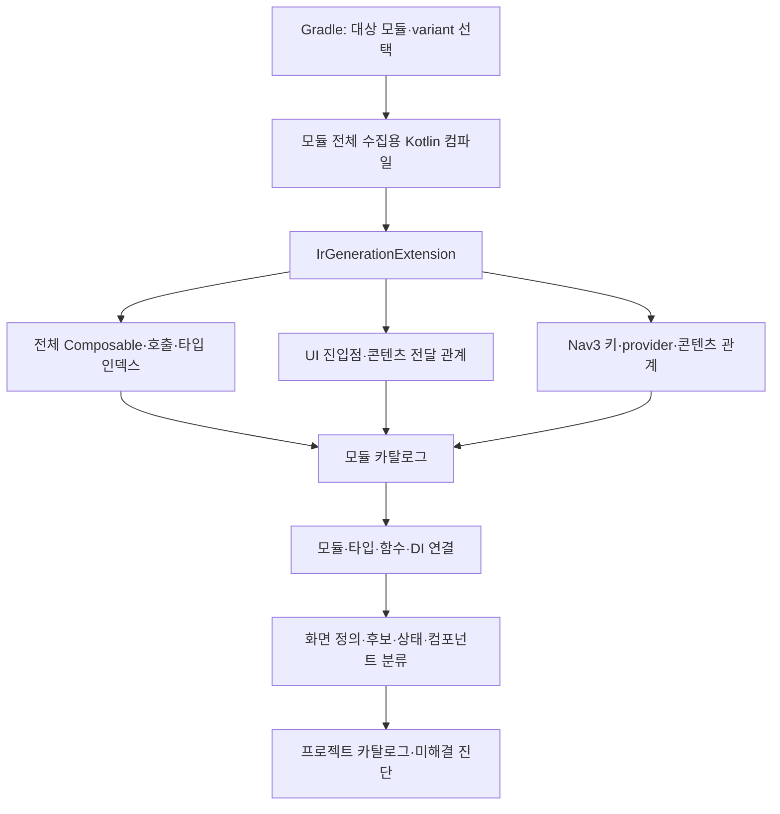

# IR 기반 화면 발견과 Nav3 연결

전체 발견기의 목표 설계다. 현재 구현은 debug/JVM 입력 수집, Nav3·콘텐츠 연결, 모듈 병합과 근거 기반의 부분 역할 분류까지 포함한다. 미연결 진단·사용 문맥별 역할·디자인 대응의 실제 범위는 [11번 문서](11-ui-diagnosis-and-design-matching.md)를 따른다. DI 자동 연결, 모든 화면·상태의 확정 분류와 실행 관측은 후속 범위다.

## 목표와 산출물

선택한 variant의 분석 대상 소스에서 전체 Composable 선언, Compose UI 진입점, Nav3 키·콘텐츠 연결을 수집한다. 세 결과를 결합해 Nav3 안팎의 화면 정의와 후보를 최대한 발견한다. 앱 실행이나 콘텐츠 렌더링은 수집의 전제 조건이 아니다.

수집 대상은 컴파일 과정에서 확인할 수 있는 코드 관계다. Nav3가 완성된 화면 목록을 컴파일 산출물로 제공하는 것은 아니므로, IR의 `키 → 콘텐츠 람다 → Composable` 관계를 직접 연결한다. 실제 등록 여부, 사용자 접근 가능성, 화면 상태 도달과 UI 캡처는 별도 분석·관측 결과다.



## 수집 범위와 세 가지 발견 경로

| 경로 | 수집 대상 | 역할 |
| --- | --- | --- |
| 전체 선언 | 대상 소스·생성 소스의 Composable 함수·람다·함수 참조, 일반 함수의 호출·인자 전달 요약 | 루트에서 연결되지 않아도 선언을 보존 |
| UI 진입점 | Activity의 `setContent`, `ComposeView.setContent`, `AbstractComposeView.Content` 구현 | Nav3 밖 콘텐츠와 host까지의 구성 관계 발견 |
| Nav3 목적지 | DSL 등록, 직접 provider, fallback, 보조 함수·DI로 전달된 등록 | 키·provider·콘텐츠·host 연결 |

MainActivity 한 곳의 호출 그래프만 탐색하지 않는다. 모든 대상 모듈에서 진입점 심볼을 찾고 merged manifest의 Activity 정보와 연결한다. 프레임워크가 호출하는 `AbstractComposeView.Content` 같은 메서드는 앱 코드에 직접 호출이 없어도 루트 후보로 등록한다. 루트 선언 발견과 해당 View·Activity의 실제 사용 여부는 별도 상태다. [Compose 호스팅](https://developer.android.com/develop/ui/compose/migrate/interoperability-apis/compose-in-views), [AbstractComposeView](https://developer.android.com/reference/kotlin/androidx/compose/ui/platform/AbstractComposeView)

전체 선언 인덱스는 도달성 필터를 적용하기 전에 만든다. preview·테스트·운영 소스의 출처를 기록하고 평가 범위를 구분한다. Preview 어노테이션이나 이름만으로 운영 코드에서도 참조하는 함수를 제거하지 않는다. 분석 입력에서 빠진 source set과 바이너리는 별도 공백으로 보고한다.

## 콘텐츠 연결과 화면 분류

루트나 entry 콘텐츠에서 직접 호출뿐 아니라 `content` 슬롯, 함수 참조, 반환된 람다, 프로퍼티, 팩토리, `if`·`when`의 모든 정적 분기를 추적한다. 일반 함수도 콘텐츠를 전달할 수 있으므로 Composable 사이의 직접 호출만 연결하지 않는다. 외부 함수가 슬롯을 호출하는 방식은 버전별 요약으로 해석하고, 요약이 없으면 전달 사실과 미해결 호출 관계를 남긴다.

예를 들어 `setContent → AppTheme → AppRoot` 안에서 `if (signedIn) MainNavigation() else LoginScreen()`을 호출한다면, 조건을 실행하지 않고 두 콘텐츠 분기와 MainNavigation 내부 Nav3 등록을 모두 수집한다. AppTheme의 슬롯 전달을 따라가되 AppTheme 자체를 독립 화면으로 확정하지 않는다.

| 분류 | 판단 근거와 처리 |
| --- | --- |
| Nav3 목적지 정의 | 키와 등록·생성 콘텐츠의 연결을 보존. 콘텐츠 안에 이름 있는 Screen 함수가 없어도 목적지로 식별 |
| Nav3 밖 화면 후보 | 루트·독립 표시 영역의 콘텐츠 교체 분기 등을 수집. 독립 화면 경계의 근거가 확보되면 화면 정의로 분류 |
| 화면 상태 후보 | 같은 화면 내부의 로딩·오류·콘텐츠 등 분기. 분기마다 새 화면을 만들지 않음 |
| 컴포넌트·구성 래퍼 | 테마, 레이아웃, Text, 버튼, 카드 등. 화면 구성 관계에 보존 |
| 미분류 후보 | 경계나 연결을 해석하지 못한 콘텐츠. 위치·조건·미해결 사유와 함께 검토 가능하게 보존 |

분류는 함수 하나의 전역 속성이 아니라 **사용 맥락별**로 저장한다. 같은 Composable이 목적지 콘텐츠이면서 다른 화면의 일부일 수 있다. 같은 함수를 쓰는 서로 다른 키·provider·host를 함수명 기준으로 합치지 않으며, wrapper와 실제 콘텐츠를 중복 화면으로 세지 않는다. 함수명·파일명은 보조 정보이고 단독 확정 근거가 아니다. 자동 분류 규칙과 사용자 보정의 출처를 기록하고 평가에서는 구분한다.

루트가 연결되지 않은 선언도 유지한다. UI 구성 간선은 `호출`, `슬롯 전달`, `조건부 콘텐츠`, `host 포함`, `키·콘텐츠 연결`로 구분하며, 이 간선만으로 화면 전환을 생성하지 않는다. 전환은 [동작과 상태 변경 분석](04-navigation-transition-analysis.md)에서 별도로 도출한다.

## 컴파일러 확장

`CompilerPluginRegistrar`에서 `IrGenerationExtension`을 등록하고 `generate(moduleFragment, pluginContext)`를 수집 진입점으로 사용한다. 컴파일러 옵션에는 모듈 식별자, variant, 스키마 버전, 출력 staging 위치 등을 전달하는 구성을 제안한다.

수집은 일반적인 인라인 처리와 lowering으로 등록 형태가 바뀌기 전을 목표로 한다. 다른 IR 플러그인과의 실행 순서를 임의로 가정하지 않고 Compose와 함께 테스트한다. 처음에는 원본 IR을 변경하지 않는 수집기로 검증한다. [Kotlin 컴파일러 플러그인 API](https://kotlinlang.org/docs/custom-compiler-plugins.html)

## 내부 구성

| 구성 요소 | 책임 |
| --- | --- |
| `ComposableDeclarationCollector` | 전체 Composable 선언·콘텐츠 참조와 소스 출처 수집 |
| `UiRootCollector` | 지원하는 UI 진입점 심볼과 프레임워크 콜백 식별 |
| `ContentFlowCollector` | 호출·슬롯·함수 참조·조건 분기·타입 관계 수집 |
| `Nav3SymbolMatcher` | 지원 버전의 실제 Nav3 함수·소속 타입·오버로드 식별 |
| `EntryDeclarationCollector` | 등록 타입·키·콘텐츠·조건·소스 위치 추출 |
| `ProviderRelationCollector` | provider receiver, 보조 함수, 호출 지점 연결 정보 수집 |
| `ModuleCatalogWriter` | 결정적인 순서의 모듈 카탈로그 출력 |
| `CatalogLinker` | 모듈 간 함수·DI 연결, 타입·인자 치환, content·entry binding 생성 |
| `ScreenClassifier` | 사용 맥락별 화면·상태·컴포넌트 분류와 근거·미해결 보존 |

컴포넌트 이름은 논리적 책임을 나타낸다. 각각을 별도 Gradle 모듈로 분리해야 한다는 뜻은 아니다.

## 식별할 등록 형태

| 형태 | 해석 |
| --- | --- |
| `entry<Home> { ... }` | 타입 기반 등록 |
| `entry(key = homeKey) { ... }` | 키 기반 등록 |
| `addEntryProvider(...)` | 직접 등록 |
| 등록 보조 함수 호출 | 내부 선언을 수집한 뒤 호출 지점에서 연결 |
| 제네릭 등록 래퍼 | 타입 파라미터를 유지하고 구체적인 호출에서 치환 |
| `(key) -> NavEntry` 직접 provider | 키 분기·NavEntry 생성·콘텐츠 참조를 연결 |
| 사용자 정의 fallback | fallback에 도달하는 조건과 콘텐츠·생성 entry를 수집 |
| DI로 모은 등록 함수 집합·맵 | 바인딩·기여 함수·반복 적용·provider receiver 연결 |

단순 문자열 `entry`가 아니라 해석된 호출 심볼, 소속 타입, receiver, 시그니처, 라이브러리 출처를 확인한다. Nav3의 등록 타입·오버로드는 지원할 배포 버전별 어댑터로 검증한다. 최신 개발 브랜치의 API 형태를 모든 배포 버전의 계약으로 사용하지 않는다. [Nav3 등록 구현](https://github.com/androidx/androidx/blob/androidx-main/navigation3/navigation3-runtime/src/commonMain/kotlin/androidx/navigation3/runtime/EntryProvider.kt)

직접 provider도 지원 목표에 포함한다. Nav3는 직접 lambda와 DSL 두 방식을 제공하므로 DSL만 검색해 화면 목록 수집 완료로 판정하지 않는다. fallback이 예외만 던지면 화면을 추가하지 않고, 콘텐츠를 가진 entry를 반환하면 해당 경로를 수집한다. 키 범위가 동적이면 미해결 키 표현식과 발견한 콘텐츠를 함께 유지한다. [Nav3 provider 방식](https://developer.android.com/guide/navigation/navigation-3/basics)

## 전체 순회와 표현식 수집

모듈의 함수 본문·람다·프로퍼티 초기화 코드를 순회한다. `entryProvider { ... }` 안에서만 검색하지 않는다. 호출되지 않은 보조 함수에 있는 명시적 등록도 카탈로그에 남긴다.

각 선언에서 다음을 수집한다.

- 모듈, 상대 파일 경로, enclosing symbol, 소스 위치.
- 등록 API와 타입 인자.
- receiver/provider를 가리키는 참조.
- 키 타입, 키 표현식, 정적으로 식별 가능한 상수·객체 참조.
- 콘텐츠 람다 또는 함수 참조와 내부 호출 참조.
- 등록을 둘러싼 조건·반복 구조의 참조.
- metadata/contentKey 등 관련 인자의 정적 표현식.

조건문은 평가해서 실행하지 않는다. 임의의 함수 호출, 객체 생성자, 프로퍼티 getter를 분석을 위해 실행하지 않는다. 정확한 조건 원문을 IR만으로 복원할 수 없으면 표현식 참조와 소스 위치를 남긴다.

콘텐츠 람다의 첫 Composable 호출을 곧바로 화면의 유일한 루트라고 판단하지 않는다. 람다 전체가 등록된 콘텐츠이며 내부 구성과 렌더링은 별도로 해석한다.

## 보조 함수 연결 예시

아래 코드는 관계 설명용 예시다. 키·UI 선언과 import는 생략했다.

```kotlin
fun EntryProviderScope<NavKey>.productEntries(enableReviews: Boolean) {
    entry<Product> { key -> ProductScreen(key.productId) }

    if (enableReviews) {
        entry<Reviews> { key -> ReviewsScreen(key.productId) }
    }
}

val provider = entryProvider<NavKey> {
    productEntries(enableReviews = featureFlags.reviews)
}
```

| 선언 | 등록 조건 | 연결 처리 |
| --- | --- | --- |
| Product | 보조 함수가 호출됨 | receiver를 provider에 연결 |
| Reviews | 보조 함수가 호출되고 인자가 참 | 조건과 전달 인자 관계를 보존 |

동일 보조 함수를 두 provider에서 사용하면 선언은 공유하고 binding은 따로 생성한다. 동일 키 타입이란 이유로 서로 다른 provider의 등록을 합치지 않는다.

제네릭 래퍼의 `entry<T>`는 선언 시점에 `T`를 보존하고, 호출의 타입 인자를 연결해 해석한다. 가상 호출·재귀·동적 함수 목록처럼 해석이 끝나지 않는 부분은 미해결 관계로 남긴다. 분석 깊이나 후보 수에 제한이 있으면 제한에 도달한 사실도 기록한다.

모든 선언을 하나의 실제 Nav3 provider로 합쳐 실행하지 않는다. 정적 카탈로그의 병합과 앱의 등록 실행은 별개다.

모듈별 등록 함수를 DI의 set/map으로 모아 적용하는 경우에는 기여 지점, qualifier·component, 주입 대상, 반복 호출과 provider receiver를 연결한다. 라이브러리별 바인딩 어댑터로 지원 범위를 명시하며 타입이 같은 모든 등록 함수를 무조건 같은 provider에 붙이지 않는다. 미해결 기여 함수의 선언도 보존한다. [Nav3 모듈화와 DI 등록 예시](https://developer.android.com/guide/navigation/navigation-3/modularize)

## 모듈 산출물

아래는 전체 설계의 개념적인 모듈 카탈로그 형식이다. 공개 보고서 형식과 지원 범위는 [카탈로그 문서](08-catalog-v1.md) 및 [읽기용 JSON v2 Schema](../schema/catalog-report-v2.schema.json)를 따른다. 전체 분석 사실은 내부 v1 중간 파일에 보존한다.

```json
{
  "schemaVersion": 1,
  "moduleId": ":feature:product",
  "variant": "debug",
  "inputFingerprint": "<inputs-hash>",
  "collectionStatus": "COMPLETE_FOR_DECLARED_INPUTS",
  "resolutionStatus": "PARTIAL",
  "scope": {
    "sourceSets": ["main", "debug"],
    "excludedSourceSets": ["test", "androidTest"],
    "adapterVersions": {},
    "unanalysedDependencies": []
  },
  "composableDeclarations": [],
  "uiRoots": [],
  "contentRelations": [],
  "providers": [],
  "entryDeclarations": [],
  "registrationFunctions": [],
  "callRelations": [],
  "typeRelations": [],
  "diBindings": [],
  "screenCandidates": [],
  "diagnostics": []
}
```

`COMPLETE_FOR_DECLARED_INPUTS`는 명시된 입력 범위의 순회를 마쳤다는 뜻이다. 관계 해석 완료나 모든 화면 발견을 뜻하지 않는다. 위 배열과 버전 맵은 형식 예시용 빈 값이며, 실제 수집 결과에는 처리한 source set·어댑터·미분석 의존성 정보를 채운다. 프로젝트 병합 후 content binding, entry binding, host 연결과 화면 분류 결과를 추가한다.

앱의 병합 작업은 Gradle 의존성을 통해 선택된 variant에 맞는 모듈 산출물을 받는다. 앱 IR에 의존 모듈의 모든 함수 본문이 들어 있다고 가정하지 않는다. 외부 바이너리 내부는 해당 라이브러리의 호환 카탈로그 또는 별도 분석이 필요하다.

## 캐시와 결과 확정

첫 구현은 모듈별 전체 수집용 컴파일과 Gradle 작업 캐시를 사용한다. 일반 앱 빌드의 증분 컴파일은 유지한다.

Kotlin 증분 컴파일은 영향받은 파일만 처리할 수 있다. 한 번의 IR 콜백에 나타난 파일 목록을 전체 모듈 목록으로 사용하지 않는다. [Kotlin 컴파일·캐시](https://kotlinlang.org/docs/gradle-compilation-and-caches.html)

작업 입력은 소스·생성 소스, 클래스패스, 컴파일 옵션, 플러그인·어댑터·스키마 버전, variant 설정을 포함한다. 분석 결과에 영향을 주는 인라인 본문·상수·의존 카탈로그 변경을 ABI만으로 무시하지 않도록 입력 추적을 검증한다.

1. 수집 결과를 실행별 staging 위치에 작성한다.
2. 여러 IR 콜백이 있으면 해당 수집 실행의 결과로 모은다.
3. 컴파일이 성공한 경우에만 새 전체 스냅샷을 확정한다.
4. 실패한 실행은 마지막 성공 결과를 새 결과로 위장하지 않는다.
5. 결과 파일을 Gradle 작업 출력으로 등록한다.
6. 병렬 모듈 실행은 서로 다른 출력 경로를 사용한다.

경로는 프로젝트 상대 경로로 저장하고 직렬화 순서를 고정해 재현성과 캐시 이식성을 확보한다. [Gradle 입력·출력 관리](https://docs.gradle.org/current/userguide/incremental_build.html)

파일별 증분 수집은 후속 최적화다. 파일별 영속 인덱스를 두고 변경·삭제된 파일의 이전 선언과 관계를 교체하며, 영향받은 파일 간·모듈 간 연결을 다시 계산한다. 등록 0개로 변경된 파일도 이전 결과를 제거해야 한다. 수정·삭제·이름 변경·보조 함수 변경·캐시 복원 결과가 전체 수집 결과와 같은지 먼저 검증한다.

## 진단 예시

| 코드 | 의미 |
| --- | --- |
| `UNSUPPORTED_NAV3_VERSION` | 검증하지 않은 API 형태 |
| `UNRESOLVED_PROVIDER` | 등록 선언의 provider 연결 미해결 |
| `UNRESOLVED_UI_ROOT` | 콘텐츠와 UI 진입점 사이 연결 미해결 |
| `UNRESOLVED_CONTENT_FLOW` | 슬롯·함수 참조·콘텐츠 반환 관계 미해결 |
| `UNCLASSIFIED_UI_CONTENT` | 화면·상태·컴포넌트 역할 미분류 |
| `UNRESOLVED_DI_BINDING` | DI 구현·기여 함수 연결 미해결 |
| `UNRESOLVED_KEY_VALUE` | 키 값이 런타임에 결정됨 |
| `EXTERNAL_MODULE_NO_CATALOG` | 의존 바이너리 내부를 분석하지 못함 |
| `UNRESOLVED_CUSTOM_PROVIDER` | 직접 provider·fallback의 일부 키·콘텐츠 관계 미해결 |
| `ANALYSIS_LIMIT_REACHED` | 명시한 분석 한계에 도달 |

선언은 발견했지만 루트·키·provider 연결을 해석하지 못한 경우에도 선언과 후보를 남긴다. 화면 정의 발견률 99% 목표는 이러한 원시 선언 개수가 아니라 [검증 계획](06-validation-plan.md)의 정답 화면 정의와 비교해 평가한다.
