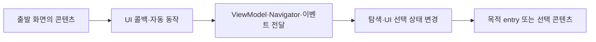

# 화면 전환 관계 분석

## 목표

수집한 화면 정의와 후보를 기반으로, 화면에서 시작한 동작이 어떤 탐색 상태나 UI 선택 상태를 변경하는지 추적해 전환 후보를 만든다. 같은 출발·도착 화면 사이의 서로 다른 접근 방법은 별도로 보관한다.

화면·콘텐츠를 찾는 분석과 전환 경로를 찾는 분석은 독립된 결과다. `AppRoot → LoginScreen` 호출이나 `entry<Product> → ProductScreen` 연결만으로 `Login → Product` 전환을 만들지 않는다. Nav3 밖 콘텐츠도 동작·상태 변경·선택 콘텐츠의 연결 근거가 있을 때 전환 후보를 만든다.

Nav3에서는 앱이 back stack을 소유하며 `NavDisplay`가 이를 표시한다. entry 등록 순서는 화면 전환 순서가 아니다. [Nav3 기본 구조](https://developer.android.com/guide/navigation/navigation-3/basics)



## 분석 구성

| 구성 요소 | 책임 |
| --- | --- |
| `NavHostIndex` | NavDisplay, provider, 탐색 상태의 연결 |
| `StackMutationAnalyzer` | 연결된 탐색 상태의 변경 지점과 변경 내용 식별 |
| `UiSelectionAnalyzer` | Nav3 밖 콘텐츠 분기의 상태 읽기·쓰기와 표시 대상 연결 |
| `CallbackFlowAnalyzer` | 화면 콘텐츠, UI 콜백, 함수·인자 전달 관계 추적 |
| `NavigatorResolver` | 인터페이스 구현, 객체 전달, DI 바인딩과 host별 대상 후보 해석 |
| `TransitionLinker` | 출발·목적·동작·조건을 전환 후보로 연결 |
| `RuntimeNavigationObserver` | 실제 변경과 화면 표시를 관측해 전환 후보에 연결 |

## 1. 탐색 영역 찾기

각 `NavDisplay`의 back stack과 provider를 식별한다. 로컬 변수뿐 아니라 파라미터, 프로퍼티, 반환값, 상태 객체를 통한 참조도 추적 대상으로 잡는다.

```text
mainHost
 ├─ mainStack
 └─ mainProvider
     ├─ Home
     ├─ Search
     └─ Product
```

일반 리스트의 `add` 호출을 전부 화면 전환으로 판단하지 않는다. NavDisplay에 전달되는 탐색 상태에 영향을 주는 변경인지 확인한다. mutable list 변경, 불변 리스트 교체, reducer를 통한 상태 갱신을 구분해 처리한다.

여러 탭·중첩 NavDisplay·동시에 표시되는 탐색 영역은 서로 다른 host와 stack으로 식별한다.

Nav3 밖에서는 UI 루트·표시 영역에서 콘텐츠를 선택하는 상태를 찾는다. 상태 변경이 있어도 버튼 색상 변경 등 화면 구성이 그대로인 경우를 화면 전환으로 세지 않는다. 콘텐츠 분류가 미해결이면 상태·콘텐츠 변경 후보로 남기고 화면 전환으로 확정하지 않는다.

## 2. 콜백과 상태 변경 연결

개념 예시:

```kotlin
entry<Search> {
    SearchScreen(
        onProductClick = { productId ->
            navigator.openProduct(productId)
        }
    )
}

fun openProduct(id: String) {
    backStack.add(Product(id))
}
```

분석 결과는 다음 관계를 보존한다.

```text
Search 등록 콘텐츠
 → onProductClick 콜백
 → openProduct(id)
 → 해당 host의 backStack 변경
 → Product 등록
```

- 호출 대상 심볼과 인자 전달을 모듈별 요약으로 수집한다.
- 람다·함수 참조의 전달과 호출을 연결한다.
- interface/DI의 구현 대상을 확정할 수 없으면 후보 집합 또는 미해결로 남긴다.
- 타입이 정해졌다면 동적 인자 값을 몰라도 목적 화면 후보를 식별할 수 있다.
- 목적 키 타입만으로 등록을 결정하지 않고 해당 provider의 타입·정확한 키 등록 관계를 해석한다.
- callback이 콘텐츠에 전달됐다는 사실만으로 사용자에게 노출되거나 실행 가능하다고 확정하지 않는다.

### Navigator 인터페이스와 DI

`Navigator.openProduct()`의 IR 호출 대상이 인터페이스 선언이어도 분석을 중단하지 않는다. 다음 순서로 호출 대상을 좁힌다.

1. 대상 모듈의 상속·구현·override 관계에서 구현 후보를 찾는다.
2. 생성자, 파라미터, 프로퍼티, 반환값과 람다 캡처를 따라 해당 receiver로 전달될 수 있는 객체를 추적한다.
3. 지원 DI 어댑터로 바인딩·provider 함수·qualifier·component·scope와 주입 지점을 연결한다. 생성 소스 분석 결과도 함께 사용한다.
4. 구현 메서드가 변경하는 stack·UI 상태를 host 또는 표시 영역에 연결한다.
5. 하나로 좁힐 수 없으면 조건을 포함한 후보 집합을 유지한다. 외부 구현·해석 제한이 있으면 후보 집합이 불완전할 수 있다는 진단을 남긴다.

같은 인터페이스의 구현이 여럿이라는 이유만으로 모두 확정 경로로 연결하지 않는다. 사용자 코드나 DI provider를 실제 실행해 구현을 선택하지 않는다. Hilt의 인터페이스 바인딩 등 지원 규칙은 배포 버전별로 검증한다. [Hilt 인터페이스 주입](https://developer.android.com/training/dependency-injection/hilt-android#inject-interfaces)

### 이벤트 스트림과 양방향 추적

`클릭 → ViewModel → Channel/Flow → collector → Navigator → 상태 변경` 경로는 함수 호출 그래프만으로 연결되지 않을 수 있다. 이벤트 생산·전달·소비 관계를 별도 모델로 만들고, 메시지 타입뿐 아니라 같은 채널·스트림 객체의 전달 관계를 확인한다. 서로 다른 스트림의 같은 이벤트 타입을 합치지 않는다. 필터·분기·취소 조건과 연결 미해결 지점을 보존한다.

화면 콜백에서 상태 변경으로 전방 추적하는 방식과, 발견한 상태 변경에서 원인 콜백·이벤트를 역방향 추적하는 방식을 함께 사용한다. 출발 화면이 아직 연결되지 않아도 목적지·변경 지점 후보는 유지한다. 이 분석은 가능한 전달 관계이며 실제 이벤트 처리 여부는 런타임 관측으로 확인한다.

### Nav3 밖 콘텐츠 전환 예시

`if (signedIn) MainNavigation() else LoginScreen()`을 발견하면 먼저 조건부 UI 구성 관계를 저장한다. 이어 로그인 성공 동작이 해당 `signedIn` 상태를 변경한다는 근거를 찾으면 Login에서 MainNavigation이 선택하는 콘텐츠로 향하는 전환 후보를 만든다. MainNavigation의 모든 entry로 직접 이동하는 간선을 만들지 않고 초기·복원된 탐색 상태에 따른 목적지를 해석한다. 목적지를 결정할 수 없으면 선택 영역과 미해결 조건을 남긴다.

## 3. 전환 의미 해석

| 동작 | 저장할 의미 |
| --- | --- |
| push/add | 목적 키를 추가하는 전환 후보 |
| pop/remove | 이전 스택에 따라 목적지가 결정되는 복귀 |
| replace/reset | 탐색 상태 교체 |
| switch | 활성 탭·탐색 영역 변경 |
| 외부 진입 | 딥링크·알림·런처 등 외부 진입점과 목적지 |
| 조건 분기 | 목적지별 조건과 후보 |
| 동적 목적지 | 정적으로 알려진 범위와 미해결 표현식 |

뒤로가기는 앞선 간선을 무조건 반대로 복제하지 않는다. 과거 스택에 의존하는 연산으로 남기고 실제 목적지는 실행 시 연결한다.

초기 스택 `[Home, Product]`가 있다고 `Home → Product`가 실행됐다고 판단하지 않는다. 외부 진입이 처음부터 만든 스택일 수 있다. 프로세스 복원·상태 복구도 사용자 이동과 별도로 기록한다.

조건은 분석에서 제거하지 않는다. 예를 들어 로그인 여부에 따라 로그인 화면 또는 구매 화면으로 이동하면 조건을 가진 각각의 후보를 만든다.

## 4. 실행 중 확인

다음 단계는 서로 다른 이벤트다.

1. 사용자의 행동이나 자동 동작 발생.
2. 탐색·UI 선택 상태 변경 요청.
3. 상태 변경 반영.
4. 표시 콘텐츠 변경. Nav3에서는 Scene과 표시 entry를 함께 관측.
5. 해당 UI의 프레임·준비·완료 관측.

상태를 주기적으로 읽는 것만으로 모든 중간 변경을 기록할 수 있다고 가정하지 않는다. 변경 지점의 계측 이벤트와 관측된 최종 상태를 함께 사용하고, 묶여 반영된 변경이나 유실은 구분한다.

```text
상품 클릭 cause-42
 → 접근 권한 확인 작업
 → push(Product)
 → stack 변경 반영
 → Product 표시
```

코루틴·이벤트 스트림을 경유할 때는 인과 식별자의 전달이 필요하다. 단일 ThreadLocal이나 시간 근접성만으로 연결하지 않는다. 식별자 전달이 끊기면 원인 미확인으로 보존한다.

행동이 발생한 화면과 변경 직전에 보이던 화면은 별도 필드다. 비동기 처리 도중 사용자가 다른 화면으로 이동한 경우 두 값을 혼동하지 않는다.

## Scene·병렬 탐색 처리

Scene은 하나 이상의 entry를 표시할 수 있다. stack의 마지막 원소만으로 현재 화면 전체를 정의하지 않는다. [Nav3 Scenes](https://developer.android.com/guide/navigation/navigation-3/scenes)

- 변경 전·후의 표시 entry 집합을 기록한다.
- 목록·상세 동시 표시, 다이얼로그, 중첩 host를 구분한다.
- predictive back의 미리보기·취소를 확정된 전환과 구분한다.
- 초기 표시, 구성 변경, 재구성만 일어난 경우를 새 사용자 전환으로 잘못 집계하지 않는다.
- 표시와 완료 시점은 별도 이벤트다. 컴포지션 호출 자체를 화면 완료로 간주하지 않는다.

## 전환 카탈로그와 지도

전환 후보에는 출발·목적 화면 또는 콘텐츠 참조, 관련 entry binding, trigger, 호출 지점, 연산, 조건, 인자 전달, host·표시 영역, 분석 상태와 근거 경로를 저장한다. 출발이나 목적지가 미해결인 후보도 보존한다. 실제 관측은 세션·디바이스별 이벤트로 연결한다.

예를 들어 Home에서 Product로 이동하더라도 추천 상품 클릭과 최근 본 상품 클릭은 서로 다른 경로다. 지도에서는 간선을 묶어 표시할 수 있지만 트레이스의 경로 선택에서 분리돼야 한다.

화면 상태까지의 인바운드 경로는 전환 그래프에 상태 분석 결과를 추가해 만든다. entry 수집만으로 로딩·오류·콘텐츠 상태의 전체 도달 조건을 알아냈다고 처리하지 않는다.

정적 후보, 실제 관측, 미해결 관계를 함께 유지한다. 실행되지 않은 후보를 삭제하지 않고, 런타임에서 새로 발견된 전환도 카탈로그 연결 여부와 함께 저장한다.

## 지원 확대 순서

1. 직접 UI 콜백과 stack·UI 선택 상태 변경.
2. 보조 함수·Navigator 경유, DI 바인딩과 모듈 간 호출.
3. ViewModel, 코루틴, 이벤트 스트림 경유.
4. 외부 진입, 탭·중첩 host, 복구·멀티패널 시나리오.

임의의 프로그램에서 모든 경로의 실행 가능성을 완전히 판정하는 것을 초기 구현의 보장으로 두지 않는다. 지원 패턴별 결과와 미해결 범위를 검증 가능하게 제공한다.
