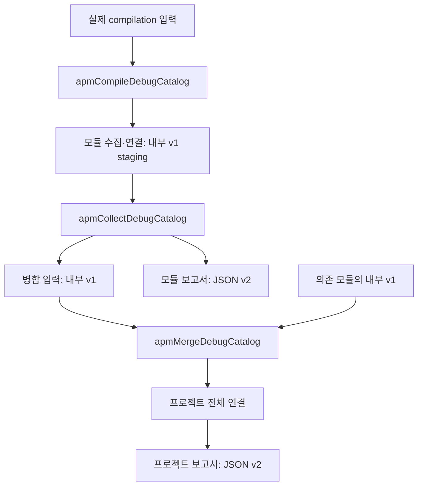

# 카탈로그 구현 결정과 검증

기준일: 2026-10-13. Nav3 연결 수집과 JSON 출력 개선에서 구현한 결정을 정리한다. 전체 제품 방향은 [시스템 구조](02-system-architecture.md), 명령과 스키마는 [카탈로그 사용법](08-catalog-v1.md)을 따른다.

2026-10-14 보완: 이 문서의 수치와 흐름도는 최초 구현 스냅샷이다. 이후 발견한 Lazy/반복 콘텐츠 누락, 공개 목록 필터링 오류와 SootUp/Heros 채택 결정은 [10번 문서](10-sootup-heros-analysis.md)를 따른다.

## 1. 별도 전체 컴파일로 수집한다

일반 증분 컴파일의 마지막 IR 콜백만 저장하면 수정하지 않은 파일이나 삭제된 선언을 포함한 전체 목록을 보장하기 어렵다. 현재는 원래 compilation의 소스·생성 작업·클래스패스·friend 경로·컴파일러 설정을 재사용하는 별도 Kotlin 컴파일을 수행한다. 수집 작업에서만 증분 컴파일을 끄며 앱의 일반 컴파일 설정은 유지한다.

Compose lowering 전에 수집기를 실행해 원본 함수·람다·슬롯과 Nav3 등록 관계를 읽는다. IR을 수정하거나 사용자 함수를 실행하지 않는다. Android의 unflavored `compileDebugKotlin` 및 Kotlin/JVM의 `compileKotlin`을 대상으로 하며 모든 variant·버전의 호환성을 보장하지 않는다.

staging은 `intermediates/android-apm/debug/catalog`, 병합 입력은 `intermediates/android-apm/debug/published`, 공개 파일은 `reports/android-apm/catalog/debug`에 둔다. 다른 작업의 출력 디렉터리에 파일을 추가하지 않는다.

## 2. Nav3 등록과 화면 후보를 구분한다

수집기는 Composable 선언, setContent UI 루트, entry/provider/NavDisplay, 함수·값·호출·콘텐츠 슬롯을 기록한다. 연결기는 모듈별 사실을 모아 함수 참조·제네릭·등록 함수·콘텐츠 저장 객체를 따라 연결한다. 같은 등록 선언을 여러 provider에서 사용하면 binding을 각각 보존한다.

`entry` 안에서 처음 호출한 Composable을 자동으로 화면이라고 확정하지 않는다. 래퍼, 내부 컴포넌트, 동적 render 후보도 함께 발견될 수 있다. `screenCandidates`는 `UNCLASSIFIED`, 연결이 불완전하면 `PARTIAL`을 유지한다. `COMPLETE_FOR_DECLARED_INPUTS`는 지정된 Kotlin 입력의 순회를 마쳤다는 뜻이다.

룰업은 `entry<GenericNavKey>` 한 곳에서 경로 테이블의 `render`를 호출한다. 이 구조에서 entry 1개와 등록 경로 후보 48개는 양립한다. 경로 후보가 발견됐다는 사실을 실제 화면 표시나 전환 경로 확인으로 해석하지 않는다.

## 3. 내부 v1과 읽기용 v2를 분리한다

전체 분석 사실을 공개 JSON에 그대로 쓰면 일반 함수·값·호출 그래프가 대부분의 용량을 차지한다. 이를 버리면 의존 모듈의 콘텐츠 연결 근거도 사라진다. 따라서 내부 v1을 병합 입력으로 보존하고 `CatalogReport`에서 공개용 v2를 만든다.

| 결정 | 결과 |
| --- | --- |
| 2칸 들여쓰기와 일정한 필드·배열 순서 | 파일을 읽기 쉽고 동일 입력의 바이트가 동일함 |
| 경로 인자·content 함수 이름·소스·분류·해석 상태 유지 | 후보와 근거를 확인할 수 있음 |
| Composable 정의는 한 번, 관계는 ID로 참조 | 반복 호출을 줄이고 오버로드는 별개로 보존 |
| 소스는 상대 경로와 줄 번호 | 위치를 찾아갈 수 있으며 절대 프로젝트 경로·offset은 제외 |
| 진단은 코드별 개수와 소스 집계 | 미해결·분석 제한이 축약 과정에서 사라지지 않음 |
| 전체 함수·값·호출·DI 사실은 내부 파일 | 공개 보고서 크기를 줄이면서 모듈 병합 근거를 유지 |
| `schemaVersion: 2`, 기존 출력 경로 유지 | 소비 코드는 v2 스키마로 이전해야 함 |

`contentCalls`는 함수 이름을 빠르게 확인하는 요약이다. 이름 있는 Composable 함수 참조는 해당 함수 이름을 보존하고, 람다는 본문에서 직접 호출하는 Composable 이름을 기록한다. 여러 content 슬롯은 각 슬롯의 직접 호출을 따로 기록한다. 이 목록의 첫 항목이 화면이라는 뜻은 아니다.

`composableIds`는 연결 분석이 도달한 함수 집합이다. 최초 구현은 참조하지 않은 선언을 공개 목록에서 제외했지만, 이것이 미지원 연결을 가진 실제 UI도 숨기는 오류였다. 2026-10-14부터 전체 로컬 선언을 공개하고 `unlinkedComposableIds`로 미연결 상태를 구분한다. `collectedComposables`는 수집 선언 수, `referencedComposables`는 외부 함수까지 포함한 참조 수여서 둘 다 화면 개수로 사용할 수 없다.

## 4. 캐시와 실패 처리

모듈 공개 작업과 병합 작업은 `@CacheableTask`이며 입력·출력을 선언한다. 내용이 같으면 `UP-TO-DATE`, 출력 삭제 후 캐시가 있으면 `FROM-CACHE`를 사용한다. 파일 추가·삭제와 소스가 완전히 없어진 경우에도 전체 스냅샷을 교체해 이전 후보가 남지 않게 한다.

컴파일이 성공해야 공개 작업이 실행된다. 공개 파일은 임시 파일을 쓴 뒤 원자적으로 교체한다. 컴파일 실패 시 마지막 성공 보고서를 유지하며 그 파일을 실패한 실행의 새 결과로 취급하지 않는다. 타임스탬프나 절대 경로를 출력에 추가하지 않는다. pretty 직렬화는 내부 ID 생성에 사용하는 정규 직렬화 순서를 변경하지 않는다.

## 5. 검증 결과

### 플러그인과 샘플

- 플러그인 빌드 및 테스트 20개 통과: catalog 6개, compiler 12개, Gradle 2개.
- Compose 샘플에서 Home/Detail entry 2개, setContent 루트와 NavDisplay 연결 확인 및 debug APK 빌드 성공.
- 정상 재빌드, configuration cache 재사용, build cache 복원, 소스 추가·삭제, 소스 없음, 실패 시 이전 결과 보존 검증.
- JSON v2 스키마, 중복 참조 제거, 오버로드 구분, 복수 content 슬롯 및 함수 참조, 불완전한 상태 보존 검증.

샘플의 고정 조합은 Gradle 9.1.0, AGP 9.0.0, Kotlin/Compose compiler 2.3.21, Nav3 1.0.1이다. CI는 JDK 17을 사용하고 로컬 실제 앱 검증은 Android Studio의 JDK 21 환경에서 수행했다.

### 룰업 로컬 소비 프로젝트

Gradle 9.4.1, AGP 9.2.1, Kotlin compiler 2.3.21, Nav3 1.1.2의 debug 입력을 검증했다. 아래 수치는 이 로컬 입력의 스냅샷이며 일반 성능 보장이나 화면 발견률이 아니다.

| 항목 | 결과 |
| --- | --- |
| 포함 모듈 / Kotlin 소스 파일 | 37 / 687 |
| 수집 Composable 선언 | 690 |
| 공개 보고서 참조 함수 | 759 — 외부 함수 포함 |
| Nav3 entry / 경로 후보 | 1 / 48 |
| UI 루트 / NavDisplay | 1 / 1 |
| 연결 상태 | `PARTIAL` |
| 진단 | 96개: 분석 한도 89, 동적 후보 2, 콘텐츠 흐름 미해결 4, 외부 슬롯 미해결 1 |
| 공개 프로젝트 JSON | 134,222,027 → 343,633 bytes, 99.744% 감소 |
| 재수집 검증 | 기존 후보 ID·entry ID·진단 수 보존, 37개 모듈 v2 스키마 통과, 끊어진 ID 참조 없음 |
| 동일 입력 재실행 | 카탈로그 작업 75개 `UP-TO-DATE`, JSON SHA-256 동일 |

초기 수집 구현 후 소비 프로젝트의 debug APK 빌드도 성공했다. 출력 개선 후에는 카탈로그 재수집·캐시와 샘플 APK 빌드를 검증했다. 소비 프로젝트 검증을 위한 settings/build 스크립트는 실행 후 원래 바이트로 복원했으며 앱 소스와 Manifest를 변경하지 않았다. 디바이스에서 전체 화면을 순회하는 런타임 검증은 수행하지 않았다.

### 디자인 목록과의 대조 범위

사용자가 제공한 룰업 최종 디자인 페이지의 최상위 프레임 124개를 확인했다. 기본 화면 외에 워크쓰루 단계, 상세 탭, 빈 상태, 시트·다이얼로그, 웹 화면, 스토어 이미지가 섞여 있었다. 워크쓰루 3장이나 상세 정보·피드·랭킹은 하나의 경로 안에서 표시될 수 있다.

48개는 코드에 등록된 경로 후보 48개와 대조한 수다. `48 / 124`를 화면 발견률로 계산하지 않으며 디자인 전체와 자동 일대일 매핑을 완료했다고 표시하지 않는다. 다음 평가에서는 기본 화면 / 탭 / 시트·다이얼로그 / 화면 상태 / 외부 산출물 기준으로 정답 목록을 먼저 정해야 한다. 자동 분류 규칙과 정답 목록은 아직 미구현·미확정이다.

## 6. 후속 범위

화면 역할 분류, DI qualifier/component별 자동 연결, 동적 콘텐츠 선택 보완, 전환 정적 분석, 런타임 표시·함수·자원 관측은 남은 작업이다. 추가 flavor·KMP·외부 바이너리 어댑터와 지원 버전 확대도 별도 검증한다. 99% 화면 정의 발견률 목표의 측정은 독립 정답 목록과 분류기를 갖춘 뒤 수행한다.

현재 한도는 함수 흐름 깊이 40, 순회 단계 5,000, 표현식 깊이 24다. 한도 초과는 `ANALYSIS_LIMIT_REACHED`로 남긴다. 구체적인 진단·지원 범위는 [카탈로그 사용법](08-catalog-v1.md)을 따른다.
