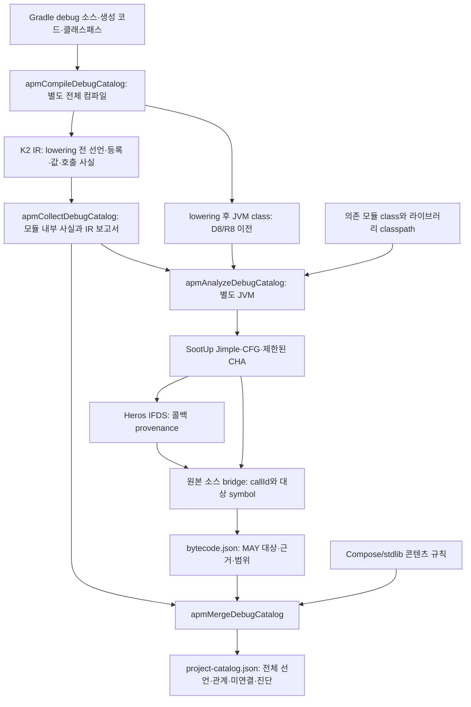
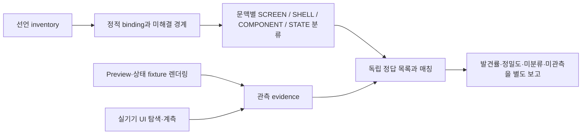

# SootUp/Heros 분석기: 결정 배경과 파이프라인

기준일: 2026-10-14. 이 문서는 [엔진 도입 PR #5](https://github.com/android-apm-tool/android-apm/pull/5) 시점의 룰업 누락 조사, 설계 오류, 오픈소스 엔진 채택 이유와 구현 범위를 기록한다. 이전 카탈로그 검증은 [09번 문서](09-catalog-decisions-and-validation.md), 이후 미연결 진단·분류·디자인 대응 구현과 최신 검증은 [11번 문서](11-ui-diagnosis-and-design-matching.md)에 남긴다.

## 대화에서 확인한 문제

처음에는 Nav3 등록을 모으면 화면 목록에 가까워질 것으로 보았다. 룰업에서는 단일 `entry<GenericNavKey>`와 경로 테이블의 48개 render 등록을 수집했다. 그러나 등록 위치를 아는 것, 그 내부의 모든 UI 함수를 따라가는 것, 함수의 역할을 화면/틀/부품으로 분류하는 것은 서로 다른 문제였다.

디자인 124장을 기준으로 대조하자는 요청 후, 내부 선언에는 있지만 공개 결과에서 빠지는 함수를 확인했다. 주요 반례는 `LazyColumn`/`LazyRow`의 일반 builder 람다, `forEachIndexed`, `repeat`였다. `CategoryChip`, `TemplateSkeleton`, `WatcherRow`처럼 사용 중인 함수도 빠졌다. 수집 입력이나 증분 캐시가 원인이 아니었다. 두 경로는 하위 함수가 빠졌는데도 `RESOLVED`로 표시됐다.

설계 오류는 다음 세 경계에 있었다.

1. **호출 의미:** `@Composable` 매개변수와 소수의 inline 함수만 따라가면 UI 콘텐츠 전체에 도달한다고 가정했다. Lazy builder는 일반 람다 안에서 지연 콘텐츠를 등록한다.
2. **불확실성:** 외부 슬롯의 해석 결과가 비어 있어도 경고 없이 통과했다. “진단이 없으므로 완료”라는 판정에 누락된 분기가 포함되지 않았다.
3. **출력:** 연결된 선언만 공개했다. 연결기가 모르는 실제 UI와 미사용 선언을 구분하지 않은 채 둘 다 숨겼다.

사용자는 반례를 더 찾고, 정석적인 구축법·새로운 접근·오픈소스 활용법과 기술 파이프라인을 비교하도록 요청했다. 이후 “엔진을 후보로만 두지 말고 필요한 부분을 실제로 가져다 쓰자”는 방향을 선택했다. 따라서 이번 변경은 이름 규칙을 계속 추가하는 데 그치지 않고, 바이트코드 분석을 실행하는 독립 모듈을 도입한다. 라이브러리가 해결하지 않는 Compose 의미는 명시적 어댑터로 남긴다.

## 채택한 구성과 이유

| 계층 | 채택 | 이유와 비용 |
| --- | --- | --- |
| 원본 선언·등록·소스 | 기존 K2 IR collector | Compose lowering 이전 함수/람다/키를 보존한다. Kotlin 컴파일러 버전 결합은 유지된다. |
| JVM 본문·타입·가상 호출 | SootUp 3.0.1 | 클래스 파일을 Jimple/CFG로 변환하고 CHA를 재사용한다. CHA는 가능한 구현 집합이며 실제 수신 객체의 증명은 아니다. |
| 콜백 값 전달 | Heros 1.2.3 IFDS | 유한한 callback provenance를 지역 변수, 인자, 반환값에 전파한다. 전이 규칙·seed·분석 경계는 우리가 제공한다. |
| 원본과 바이트코드 연결 | APM source bridge | package, SourceFile, 메서드 이름, 소스 줄을 대조한다. 모호한 오버로드/람다는 임의로 고르지 않는다. |
| UI 의미 | APM ContentSemantics | Kotlin 반복/스코프 함수와 Compose Lazy builder/content 슬롯을 정의한다. 클릭 콜백을 composition 경로로 일반화하지 않는다. |
| 공개 결과 | 기존 JSON v2 확장 | 전체 로컬 선언, 연결 여부, 엔진 실행 통계를 보존한다. 런타임 관측과 혼동하지 않는다. |

SootUp의 `java.bytecode.frontend`와 `analysis.interprocedural`을 의존성으로 사용하고 core/java.core/callgraph를 함께 가져온다. Heros도 실제 solver를 실행한다. 분석 알고리즘을 복사해 유지보수하지 않는다. upstream 수정이 필요한 재현 사례가 생기면 해당 모듈의 수정과 upstream 기여를 별도 결정한다. 라이선스·출처는 [THIRD_PARTY_NOTICES](../THIRD_PARTY_NOTICES.md)에 기록한다.

KSP는 함수 본문의 표현식·문장 분석을 제공하지 않아 이 문제의 대체 엔진으로 선택하지 않았다. Joern/FlowDroid를 동시에 연결하면 IR과 식별자·빌드 입력을 두 벌 관리해야 한다. 이번 단계에서는 JVM bytecode와 IFDS를 한 경로로 연결하는 SootUp/Heros를 채택한다. Preview Scanner/Roborazzi/Compose Test/UI Automator는 실행 관측 단계에서 쓸 수 있으나 정적 엔진을 대체하거나 이번 구현에 포함한 것으로 표시하지 않는다.

## 실제 실행 파이프라인



`apmCollectDebugCatalog` 단독 실행은 `IR_ONLY`다. `apmMergeDebugCatalog`는 의존 모듈 수집과 `apmAnalyzeDebugCatalog`를 먼저 실행한다. 엔진을 적용하려면 별도의 플래그 없이 merge 작업을 실행하면 된다. `assembleDebug`를 매번 전체 분석으로 바꾸지 않는다.

엔진은 프로젝트 Kotlin 컴파일의 별도 class 디렉터리를 Application, 라이브러리 클래스패스를 Library로 읽는다. CHA의 본문 확장은 분석 대상 application 메서드로 제한한다. 라이브러리 본문·reflection·동적 로딩을 전체 확장했다고 주장하지 않는다. Java 소스 별도 컴파일 산출물을 자동 등록하는 기능은 아직 없다.

라이브러리는 소비 앱의 Gradle 클래스패스 순서를 우선하고 의존 모듈의 추가 입력을 뒤에 둔다. 경로 이름으로 재정렬하지 않는다. 모든 application class는 library보다 먼저 등록하며 중복 application class는 실패로 처리한다.

분석기 의존성을 Kotlin compiler plugin이나 Gradle daemon에 섞지 않고 독립 JVM에서 실행한다. 입력은 모듈 사실·class 디렉터리·라이브러리 classpath·분석기 runtime classpath다. Gradle 작업은 이들을 입력으로 선언한다. 컴파일이나 엔진 실행 실패 시 병합을 중단하고 마지막 성공 파일을 유지한다. 같은 입력에서는 분석 태스크도 `UP-TO-DATE`/`FROM-CACHE`를 사용할 수 있다.

## 실제 사용한 엔진 기능

### 가상 호출

SootUp CHA가 생성한 호출 지점별 대상 집합을 이용한다. adapter의 ICFG는 선언된 interface 메서드 하나가 아니라 해당 지점의 실제 CHA edge들을 Heros에 제공한다. 분석 대상이 아닌 라이브러리 본문은 열지 않는다.

source bridge가 호출 위치와 대상 선언을 각각 유일하게 연결할 수 있을 때 `analysisCallTargets`를 만든다. linker는 이 사실을 실제 콘텐츠 순회에 사용한다. 단순히 엔진 통계를 출력하는 부가 기능이 아니다. 샘플의 `RenderSlot(renderer) → Renderer.Content → SampleRenderer.Content → DispatchedItem`이 이 경로의 회귀 사례다.

### 콜백 전달

IFDS 사실은 `(지역 값, 콜백 구현 메서드)`다. 모든 분석 대상 메서드 시작점을 zero fact로 seed하여 앱 실행 도달성을 가정하지 않고 구조적 후보를 찾는다.

- 할당·cast: 우변의 사실을 좌변으로 복사하며 덮어쓴 지역 값의 이전 사실을 제거한다.
- 호출: 실제 인자와 수신 객체의 사실을 피호출 함수의 형식 매개변수/this로 전달한다.
- 반환: 반환 지역 값의 사실을 호출문의 결과 값으로 전달한다.
- 분기 합류: 가능한 사실의 합집합을 유지한다.
- `LambdaMetafactory`의 메서드 핸들과 지원하는 callback 객체의 allocation에서 구현 메서드 후보를 만든다.
- `invoke/run/get/accept/apply/Content`의 수신 값에 도달한 사실을 호출 대상 근거로 추출한다.

SootUp의 CHA는 `invokedynamic` 대상 확장을 제공하지 않으므로 LambdaMetafactory를 어댑터가 다룬다. 모든 bootstrap, captured field, heap alias를 해결한 것은 아니다. 콜백 대상 메서드를 찾더라도 캡처된 값·실제 상태·호출 횟수가 확정되는 것은 아니다.

## 콘텐츠 규칙과 출력 계약

규칙 버전은 `compose-slots-stdlib-v1`이다. `let/run/with/also/apply`, `repeat`, `forEach/forEachIndexed/map/mapIndexed`는 해당 callback 매개변수만 따라간다. `times`나 collection receiver를 함수로 해석하지 않는다. LazyColumn/Row/Grid/StaggeredGrid의 `content` builder를 따라가며 내부의 composable item 슬롯을 수집한다. 지연 목록 항목이 실제로 화면에 나타났다는 의미는 아니다.

알 수 없는 외부 composable 슬롯이나 내용 없는 동적 호출은 `PARTIAL`과 진단을 남긴다. 엔진이 제시한 CHA/IFDS 대상도 `BYTECODE_MAY_TARGETS`로 표시한다. 함수 선언에 본문이 없으면 `UNAVAILABLE_FUNCTION_BODY`, 가상 호출을 엔진 근거 없이 따라가면 `UNRESOLVED_VIRTUAL_DISPATCH`다. 원본 식별자를 연결하지 못한 엔진 후보는 `BYTECODE_SOURCE_BRIDGE_GAPS`로 집계한다.

지원하지 않는 일반 builder도 전달된 콜백에 UI가 포함된다는 근거가 있으면 `UNMODELED_CALLBACK_CONTENT`를 남긴다. 이때 콜백이 실제 호출된 것으로 연결하지 않고 전체 선언과 미연결 상태를 보존한다. 따라서 새로운 builder의 이름이 규칙에 없다는 이유만으로 조용히 성공 처리하지 않는다. 콜백 자체를 식별할 수 없는 경우까지 완전하게 경고한다는 보장은 아니다.

`composables`에는 모든 수집 로컬 선언과 연결에서 참조한 외부 함수를 둔다. `unlinkedComposableIds`는 어느 binding에도 연결하지 못한 로컬 선언이다. 이는 미사용 코드라는 판정이 아니다. Preview·부품·미지원 루트·실제 화면이 섞일 수 있다. `referencedComposables`는 기존 의미대로 연결에서 참조한 함수 수다. `unlinkedComposables`와 엔진 버전·범위·통계를 공개 JSON에 추가한다. 상세 바이트코드 근거는 `intermediates/android-apm/debug/analysis/bytecode.json`에 둔다.

`RESOLVED`는 모델 안에서 해당 관계의 순회를 완료했다는 뜻이다. 화면 역할, 실제 표시, 앱 전체 발견률을 뜻하지 않는다. 전체 상태는 entry뿐 아니라 root/candidate/host의 부분 해석과 진단도 반영한다.

## 트레이드오프와 남은 반례

| 반례/비용 | 현재 동작 | 다음에 필요한 것 |
| --- | --- | --- |
| mutable field, captured receiver, callback 객체를 heap에 저장 후 호출 | 제한 사항을 공개하며 정확한 binding을 주장하지 않음 | heap/points-to abstraction과 capture adapter |
| 라이브러리 선언 인터페이스·opaque 반환값·미지원 builder | 제한된 엔진 scope와 IR 슬롯 규칙만 적용 | 라이브러리 signature/summary 확대와 회귀 자료 |
| 같은 파일·줄의 여러 lambda, SMAP inline, mangled/bridge 메서드 | 유일하게 매칭되지 않으면 연결하지 않음 | descriptor/SMAP/Kotlin metadata 기반 identity bridge |
| AbstractComposeView.Content, 네이티브 dialog, WebView/SDUI | 전체 Composable 선언 보존만으로 루트·네이티브 UI를 확보할 수 없음 | 루트/네이티브 모델과 별도 관측 |
| 조건부 UI, 탭, 빈 상태, loading/error, offscreen Lazy item | 코드상 도달 후보를 보존 | 상태 fixture와 렌더링·디바이스 관측 |
| CHA가 실제보다 많은 구현을 선택 | MAY로 유지, PARTIAL 표시 | 수신 객체 points-to와 관측으로 좁히기 |
| 별도 전체 컴파일 + 바이트코드 변환의 시간/메모리 | 입력 변경 시 비용 발생, 재실행은 Gradle 캐시 사용 | benchmark, 더 작은 분석 scope와 안전한 증분 갱신 |

분류는 함수에 영구적인 SCREEN 라벨 하나를 붙이는 방식보다 사용 문맥(binding)을 기준으로 진행한다. 동일 함수가 독립 화면과 sheet 내용으로 함께 쓰일 수 있기 때문이다. Preview/스크린샷은 테스트에 제공된 상태를 렌더링했다는 증거이며 전체 상태 발견의 증명이 아니다. 함수 실행, composition commit, 화면의 실제 가시성도 별도 관측값이어야 한다.

## 이후 전체 파이프라인 — 설계, 아직 미구현

후속 갱신: 아래 단계 중 미연결 진단, 사용 문맥별 부분 역할 분류, 디자인 후보 검색과 수동 근거 재검증은 [11번 구현](11-ui-diagnosis-and-design-matching.md)에 추가됐다. 렌더링·실기기 관측과 전체 화면 발견률 평가는 여전히 미구현/미측정이다.



정답 목록은 먼저 디자인 124장을 기본 화면/탭/overlay/상태/외부 산출물로 나누고 코드와 독립적으로 확정해야 한다. 등록 경로 48개, 발견된 함수 수, 디자인 프레임 수를 같은 분모로 나누지 않는다. 실패한 패턴을 사후에 지원 범위 밖으로 빼서 99%를 만들지 않는다. 이번 PR은 정적 엔진 도입과 누락 보존 단계이며 분류기·렌더링 실험실·런타임 agent·99% 측정 완료를 포함하지 않는다.

## 검증

재현 명령과 체크: `./gradlew build`, `python scripts/verify-catalog.py`, `python scripts/verify-bootstrap.py`. 단위/통합 테스트 25개가 통과했다. 실제 Java class fixture에서 인터페이스 구현 두 개와 함수 참조의 인자/반환값 전달, 모호한 소스 연결 거부를 검사한다. Compose 샘플에서는 Lazy/반복/가상 호출과 미연결 선언을 검사한다. 지원하지 않는 일반 builder는 연결을 만들어내지 않고 경고하는 회귀 테스트도 포함한다.

샘플 debug/release 빌드, probe 활성/비활성, configuration cache, `UP-TO-DATE`, `FROM-CACHE`, 소스 추가·삭제·전체 삭제, 실패 시 이전 결과 보존이 통과했다. 소스가 모두 없어졌을 때 엔진의 application class 수도 0이 된다. SootUp/Heros 출력과 공개 JSON도 캐시에 포함된다.

### 룰업 검증 스냅샷

소비 앱은 Gradle 9.4.1 / AGP 9.2.1 / Kotlin 2.3.21 / Nav3 1.1.2, JDK 21에서 확인했다. 기존 감사의 수작업 소스 673개는 해시가 모두 동일했다. 수집 파일 수 687에는 해당 compilation의 생성 소스가 포함된다.

| 항목 | 이전 | 보완 후 |
| --- | --- | --- |
| 모듈 / 수집 파일 | 37 / 687 | 37 / 687 |
| 수집된 로컬 Composable 선언 | 690 | 690 — 모두 공개 보존 |
| binding에 연결된 로컬 함수 | 457 | 566 — 109개 증가 |
| 외부 포함 참조 함수 | 759 | 882 |
| 미연결 로컬 선언 | 공개 목록에서 숨김 | 124개를 별도 ID 목록으로 보존 |
| Nav3 entry / 경로 후보 | 1 / 48 | 1 / 48 |
| 이전에 연결됐던 함수 손실 | — | 0 |
| 전체 연결 상태 | PARTIAL | PARTIAL |

엔진은 application class 3,586개, 메서드 27,648개를 읽었다. 원본에 매핑한 메서드는 2,722개이며 생성 메서드도 분모에 포함되므로 이 비율을 화면 발견률로 사용하지 않는다. CHA edge는 30,191개, IFDS callback invocation fact는 75개, 원본 호출 ID에 연결된 추가 대상의 호출 지점은 521개였다. 이 역시 화면 수가 아니다. 소스 매핑 실패와 미지원 heap/라이브러리 경계는 남아 있다.

독립적으로 확인했던 Lazy 관련 누락 함수 16개와 `CategoryChip`(대상 선택 화면), `TemplateSkeleton`, `WatcherRow`(감시자 목록 화면)를 모두 binding에서 확인했다. 같은 이름의 다른 파일 함수를 대신 세지 않도록 파일명과 함수 이름을 함께 검증한다. 재현:

```powershell
python scripts/verify-consumer.py C:\path\to\RuleUp
python scripts/verify-ruleup-catalog.py C:\path\to\RuleUp\app\build\reports\android-apm\catalog\debug\project-catalog.json
# 이전 보고서를 두 번째 인자로 주면 기존 참조 손실과 증가한 로컬 참조도 검사한다.
```

전체 로컬 선언 보존, 끊어진 composable ID 없음, 공개 JSON v2 스키마를 확인했다. 검증 스크립트가 임시 적용한 settings/root build는 원래 바이트로 복원했다. 앱 소스·Manifest를 변경하거나 디바이스에서 UI를 순회한 검증은 아니다. 독립 정답 목록과 화면 역할 분류가 아직 없으므로 19개 회귀 사례의 복구를 99% 발견률이나 전체 화면 수집 완료로 표현하지 않는다.

## 공식 참고 자료

- [SootUp 프로젝트와 라이선스](https://github.com/soot-oss/SootUp), [call graph](https://soot-oss.github.io/SootUp/latest/callgraphs/), [IFDS/IDE 분석 작성](https://soot-oss.github.io/SootUp/latest/write_analyses/)
- [SootUp 3.0.1 배포 모듈](https://repo.maven.apache.org/maven2/org/soot-oss/sootup.analysis.interprocedural/3.0.1/)
- [Heros IFDS/IDE solver](https://github.com/soot-oss/heros)
- [KSP의 분석 범위](https://kotlinlang.org/docs/ksp-overview.html), [Kotlin compiler plugin API](https://kotlinlang.org/docs/custom-compiler-plugins.html)

웹의 latest 예제와 배포 버전 API가 다를 수 있어 3.0.1 sources JAR와 실제 컴파일 테스트를 기준으로 연결했다.
