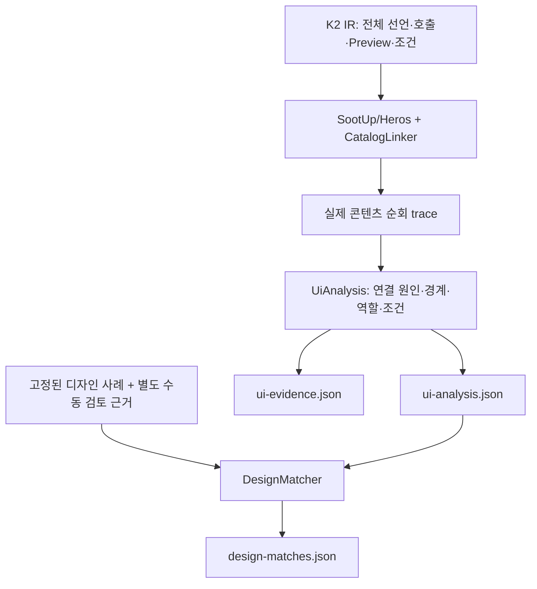

# UI 연결 진단·문맥별 분류·디자인 대응

기준일: 2026-10-14. [SootUp/Heros 분석기](10-sootup-heros-analysis.md) 뒤에 실제로 실행되는 진단·분류·디자인 대응 단계를 추가한다. 함수 수와 화면 수, 코드 존재와 디자인 상태 구현, 정적 연결과 실제 표시를 별도로 보고한다.

## 결정 배경

룰업의 로컬 Composable 690개 중 566개는 기존 binding에 연결됐고 124개는 미연결이었다. 이 숫자만으로 화면 누락을 판정할 수 없었다. 따라서 미연결 원인, 사용 문맥별 역할, 디자인과 코드의 대응을 각각 근거와 함께 남긴다. 같은 함수가 페이지와 시트에 재사용될 수 있고, Preview에서도 운영 UI를 호출할 수 있기 때문에 선언에 영구적인 화면/Preview 전용 라벨을 붙이지 않는다.

이전 공개 JSON의 함수 집합으로 원인을 역추측하지 않는다. 기존 linker가 수행한 실제 순회를 기록한다. `CALL`, `SLOT`, `INVOKE`, `BYTECODE_TARGET`, `SEED` 관계마다 binding, 원본 호출, 함수 값 문맥, 조건, source와 STRUCTURAL/MAY를 남긴다. 구조적 관계는 실행 도달성의 증명이 아니다.

대화에서 요구한 것은 세 가지였다. 첫째, “Composable은 있지만 왜 연결되지 않았는가”를 설명할 것. 둘째, “그 함수가 화면인가, 틀인가, 부품인가”를 실제 사용 위치에서 판단할 것. 셋째, 디자인 124장과 비교하되 코드 이름을 찾은 결과를 화면 발견률로 바꾸지 않을 것. 다음 선택은 이 요구와 반례에서 나왔다.

| 결정 | 검토한 대안 | 선택 이유와 남는 비용 |
| --- | --- | --- |
| 실제 순회 trace를 보존 | 공개 함수 목록에서 원인 역추정 | 어떤 호출에서 끊겼는지 검토할 수 있다. 세부 근거 저장 비용이 추가된다. |
| 선언과 usage를 분리 | 이름의 `Screen`/`Content`/`Preview` suffix로 전역 분류 | 같은 함수의 페이지·시트·Preview 사용을 동시에 표현한다. 문맥 수가 많아지고 UNKNOWN도 남는다. |
| 이벤트 참조와 콘텐츠 호출을 분리 | 콜백을 받는 모든 함수를 호출 경로로 연결 | 클릭 이후 UI를 잘못 연결하지 않는다. 전역 토스트·다이얼로그 이벤트는 후속 분석이 필요하다. |
| 자동 후보와 검토 근거를 별도 출력 | 기존 수동 매핑을 자동 매칭의 정답으로 사용 | 입력에 정답이 새는 것을 막는다. 코드가 확인되어도 자동 확정·발견률은 비어 있을 수 있다. |
| 원본 조건을 보존하고 실행 가능성은 미판정 | 조건 개수나 문구를 화면 상태 개수로 사용 | 모순 조건·중복 분기·대체 경로를 실제 상태라고 오인하지 않는다. 상태 실행과 렌더 검증이 남는다. |
| 보고서와 상세 evidence를 분리 | 모든 usage에 표현식을 반복 삽입 | 읽기용 결과의 중복을 줄이고 참조로 추적성을 유지한다. 상세 검토에는 두 파일이 필요하다. |

## 실행 경로



```powershell
.\gradlew.bat :app:apmMergeDebugCatalog
.\gradlew.bat :app:apmMatchDebugDesign -Papm.designSpec=C:/path/design-cases.json
```

병합은 `project-catalog.json`과 함께 `reports/android-apm/catalog/debug/ui-analysis.json`을 만든다. 상세 근거는 `intermediates/android-apm/debug/analysis/ui-evidence.json`에 저장한다. 디자인 입력은 별도 캐시 입력이므로 디자인만 바뀌면 컴파일·바이트코드·병합을 재사용한다. 잘못된 디자인 입력은 실패하며 이전 성공한 매칭 파일을 보존한다.

일반 `assembleDebug`에 전체 분석을 강제로 붙이지 않는다. 분석은 위 태스크로 명시적으로 실행하며, 같은 입력은 Gradle의 up-to-date/build cache를 재사용한다. 규칙 구현은 태스크 클래스패스에, 디자인은 매칭 태스크의 파일 입력에 포함된다. 파일은 각각 임시 파일에서 원자적으로 교체한다. 여러 출력 전체를 하나의 트랜잭션으로 교체하는 기능은 없으므로 외부 독자는 성공한 태스크의 출력만 읽고 `catalogFingerprint`가 같은지도 확인해야 한다.

| 산출물 | 주요 정보 | 용도 |
| --- | --- | --- |
| `ui-analysis.json` | declarations, boundaries, usages, scenarios, coverageDiagnostics | 미연결 원인과 문맥별 역할 검토 |
| `ui-evidence.json` | 관계·문제·원본 조건의 ID와 근거 | 보고서의 evidenceRefs/conditionRef 추적 |
| `design-matches.json` | automatic, reviewed, issues, evaluation | 후보 검색과 source 검토·상태·관측 수준을 분리 |

모든 새 산출물은 schemaVersion 1을 사용한다. `rulesVersion`, `matcherVersion`, `catalogFingerprint`, `designFingerprint`로 적용 규칙과 입력을 식별한다. 기존 공개 카탈로그 v2는 유지한다.

## 수집과 판정 계약

- 선언에 annotation 이름, 사용자 정의 annotation을 통한 Preview 여부, 반환 타입, override, enclosing function, source set을 추가한다. Preview 검사에는 순환 방지와 깊이 제한이 있다. 외부 annotation 정보의 완전성을 보장하지 않으므로 Preview가 아니라는 이유만으로 운영 전용이라고 판정하지 않는다.
- `if/when` 조건은 선택한 test와 앞선 분기의 제외 조건을 함께 기록한다. `else`를 조건 없는 true 상태로 바꾸지 않는다. 이 표현식의 실행 가능성은 풀지 않는다.
- 경로 인자가 immutable 임시 변수로 내려간 경우, 유일한 상수로 해석될 때만 복원한다. mutable 값이나 여러 후보는 임의로 선택하지 않는다.
- 기존 공개 카탈로그의 연결된 선언/미연결 선언 분류와 새 보고서의 집합이 같은지 검증한다. Preview 경로를 발견해도 운영 binding 연결 숫자를 늘리지 않는다.

### 미연결 원인

운영 binding 순회와 Preview 순회를 분리한다. 콜백 참조·lexical nesting·변수 초기값의 함수 참조는 진단용 참조 그래프로만 사용한다. 이 그래프에 경로가 있다고 콘텐츠가 실행된 것으로 연결하지 않는다. 역참조 순회는 순환을 보존하면서 종료한다.

| 코드 | 의미 |
| --- | --- |
| `LINKED_TO_BINDING` | 하나 이상의 기존 콘텐츠 binding에서 경로를 기록함. 완전성·실행 도달성은 별도 |
| `PREVIEW_REACHABLE` | Preview에서 구조적 콘텐츠 경로가 확인됨. Preview 전용 판정이 아님 |
| `ROOT_NOT_MODELED` | `AbstractComposeView.Content`의 직접 override 근거가 있으나 기존 루트 연결이 없음 |
| `TEST_SOURCE` | 테스트 source set의 선언. 런타임 사용 여부와 별도 |
| `ANALYSIS_TRUNCATED` | 관련 함수의 순회가 예산에서 중단됨 |
| `CALLBACK_FLOW_UNRESOLVED` | 관련 함수 값을 가진 미지원 builder/콜백 단절 |
| `LIBRARY_MODEL_MISSING` | 외부 콘텐츠 슬롯 의미가 불완전함 |
| `SOURCE_BRIDGE_AMBIGUOUS` | 바이트코드 source gap이 원본 호출에 유일하게 대응됨 |
| `VIRTUAL_DISPATCH_UNRESOLVED` | 가상 호출의 콘텐츠 대상을 결정하지 못함 |
| `FUNCTION_BODY_UNAVAILABLE` | 관련 함수의 본문이 분석 입력에 없음 |
| `REFERENCE_PATH_NOT_RESOLVED` | 연결된 코드의 참조 경로는 있지만 콘텐츠 호출 경로가 확인되지 않음 |
| `UNROOTED_REFERENCE_GROUP` | 참조 묶음은 있지만 알려진 시작점에 연결되지 않음 |
| `NO_REFERENCE_IN_SCOPE` | 현재 입력에서 참조를 찾지 못함 |
| `UNKNOWN` | 다른 원인을 입증할 근거가 부족함 |

정확한 owner/call의 문제와 콜백 뒤에 참조된 함수의 잠재적 문제를 `association`으로 구분한다. 바이트코드 gap은 파일이 같다는 이유로 전파하지 않고 path/line/column이 일치하는 호출이 하나일 때만 연결한다. 나머지 공백은 전체 coverage diagnostics로 남긴다.

모든 선언은 `unusedStatus=NOT_PROVEN`이다. Preview 1회 관측이나 호출자 부재를 미사용 확정으로 바꾸지 않는다. 대표 원인은 집계용이며 전체 `reasonCodes`, findings, evidenceRefs를 함께 보존한다.

### 경계·역할·상태

등록된 목적지, 루트 영역, 콘텐츠 저장 후보, Preview, 검증된 Compose Dialog/ModalBottomSheet/Popup API 경계를 구분한다. 경로 문자열이 있는 생성자만으로 목적지라고 확정하지 않는다. 같은 원본 overlay가 여러 binding에서 사용되면 경계도 문맥별로 생성되므로 이 개수는 제품 화면 수가 아니다.

역할 우선순위는 호스트, 명시적 슬롯 전달 틀, 목적지 직접 콘텐츠, overlay 콘텐츠, 알려진 비시각 helper, 시각적 하위 부품, UNKNOWN이다. `Header`와 `Feed`가 이름 없는 목적지 람다의 직접 콘텐츠이면 두 함수가 같은 하나의 목적지 경계에 기여한다. 임의로 대표 함수를 고르거나 화면 두 개로 세지 않는다. 콘텐츠 저장 후보의 직접 콘텐츠는 `BOUNDARY_CONTENT_CANDIDATE`로 남긴다.

`COMPONENT_IN_CONTEXT`에는 알려진 Text/Icon/Image/Canvas/AndroidView 등의 시각적 호출 근거가 필요하다. 아직 요약이 없는 UI는 UNKNOWN으로 남을 수 있다. 결과에는 `roleStatus=RULE_INFERRED/UNCLASSIFIED`와 `certainty=STRUCTURAL/MAY`가 있다. 전역 함수명 suffix나 호출 빈도는 확정 근거로 쓰지 않는다.

조건부 콘텐츠 근거는 `scenarios`에 별도로 저장한다. 이는 원본 조건의 기록이며 제품의 로딩/오류/탭 상태를 모두 의미적으로 해석한 목록이 아니다. `feasibility=NOT_SOLVED`이며 여러 incoming edge의 조건을 모두 AND로 합치지 않는다. 관련 경로는 evidence에서 조회한다. 탭의 독립 화면성이나 앱의 의미를 확정할 근거가 없으면 자동으로 화면을 늘리지 않는다.

같은 경계 안의 동일 조건은 하나의 scenario로 묶고 `conditionRef`로 원본 표현식을 참조한다. 영향받는 호출의 근거는 모두 보존한다. scenario 개수는 이 중복 제거 규칙에 따른 조건 기록 수이며, 제품 상태 수가 아니다. usage의 조건은 각 incoming edge에서 추적한다.

## 디자인 대응

입력은 버전이 있는 `cases` 배열이며 frameId와 scenario를 보존한다. 한 프레임이 여러 선언·경계에 대응하고 여러 프레임이 같은 코드를 사용할 수 있다.

자동 단계는 디자인 이름/텍스트와 코드의 문구·경로·심볼로 후보를 검색한다. 문맥별 문서 빈도를 이용한 rank score는 후보 정렬값이며 확률이 아니다. 유사도만으로 대응을 확정하지 않는다. 수동 검토의 함수명·경로·판정은 자동 검색 입력에 섞지 않는다.

검토 근거 단계에서는 이름+파일(선택적으로 선언 ID·줄)로 원본을 유일하게 식별하고, 기대 경로의 binding 포함 여부를 다시 검사한다. 같은 이름의 다른 파일 선언을 대신 인정하지 않는다. 기대 경로 자체를 해석하지 못했으면 `BOUNDARY_IDENTITY_UNRESOLVED`이며 함수 누락으로 세지 않는다. 이벤트로 공통 루트에서 표시하는 UI는 `EVENT_FLOW_NOT_EVALUATED`로 따로 둔다.

명시적 condition evidence ID가 해당 코드 문맥에 속하는지도 확인할 수 있다. 이것은 조건 근거를 참조했다는 뜻이며 디자인 상태의 실제 표시를 증명하지 않는다. 코드 존재, 디자인 시나리오 구현, 픽셀 일치, 실제 표시를 각각 구분한다. 현재 렌더링/디바이스 관측은 `NOT_OBSERVED`다.

`prepare-design-input.py`는 고정된 Figma snapshot과 기존 감사 파일을 변환한다. 기존 검토의 근거 수준(이미지+소스/텍스트+소스/프레임명+소스)과 한계를 보존한다. 121개 프레임에서 함수 이름을 찾았다는 이유로 121개 화면을 검증했다고 표시하지 않는다.

### 평가

`DiscoveryEvaluator`는 독립 정답 목록을 요구하며 같은 정답에 대한 중복 자동 확정은 FP로 계산한다. 자동 미확정은 정답이 있는 평가에서 FN으로 남고, 수동 보정은 자동 TP에 넣지 않는다. 정답 목록이 없는 룰업 매칭 보고서의 recall/precision은 null이다.

## 반례와 트레이드오프

| 반례 | 처리·대가 |
| --- | --- |
| 운영에서도 사용하는 Preview | 양쪽 경로 보존. Preview 전용이라고 단순 제외할 수 없음 |
| 사용자 정의 Multipreview | 실제 annotation 정의 추적. 외부 metadata 공백은 남음 |
| 같은 이름의 다른 파일 함수 | 원본 식별과 문맥을 함께 검증. source 이동 후 보정 갱신 필요 |
| onClick에 넘긴 UI 관련 callback | 참조 근거만 보존. 클릭 실행과 콘텐츠 호출은 같지 않음 |
| 서로 호출하는 미연결 함수 | 유한 역참조 그룹으로 종료. 미사용 확정은 하지 않음 |
| 전체 화면과 시트에 재사용한 함수 | 문맥별 역할과 경계. 결과 크기가 커짐 |
| 조건·탭·overlay 조합 | 원본 조건을 보존하지만 상태 조합 전체를 실행하지 않음 |
| mutable/captured callback | 기존 SootUp/Heros 한계를 유지, 단절 근거 표시. 모든 heap 흐름을 풀지 않음 |
| Canvas·네이티브·서버 UI | 일부 알려진 시각/경계 요약만 존재. Composable만으로 전체 화면을 증명할 수 없음 |
| 오래된 디자인 또는 검토 | snapshot·근거 수준과 별도 source 재검증. 함수 존재는 디자인 최신성과 별개 |
| 이름·이미지가 비슷한 다른 화면 | 자동 후보로만 제시. 자동 확정률보다 잘못된 확정을 줄이는 선택 |

## 재현과 인수 검증

```powershell
.\gradlew.bat build --no-daemon
python scripts/verify-catalog.py
python scripts/verify-ui-analysis.py
python scripts/prepare-design-input.py frames.json design-input.json legacy-audit.json
python scripts/verify-consumer.py C:/path/RuleUp :app:apmMatchDebugDesign -Papm.designSpec=C:/path/design-input.json --no-daemon
python scripts/inspect-ui-results.py C:/path/RuleUp summary.json
```

실제 Kotlin compiler fixture에서 사용자 정의 Preview와 else 제외 조건을 검증한다. 실제 Compose 샘플에서는 Preview 자식, 운영 겸용 Preview, Dialog, 조건부 콘텐츠, 미참조 선언을 검사한다. 기존 샘플 APK·소스 추가/삭제·전체 삭제·실패 격리·캐시 회귀를 함께 실행한다. 디자인 변경만으로 컴파일이 재실행되지 않는지, 잘못된 디자인이 기존 결과를 덮어쓰지 않는지도 검사한다.

스키마뿐 아니라 선언 ID·경계 ID·evidenceRefs의 무결성과 공개 카탈로그의 미연결 집합 일치를 검사한다. 소비 앱 검증은 설정을 임시 연결한 뒤 원래 바이트로 복원한다.

## 2026-10-14 검증 결과

### 샘플과 반례

루트 `build`의 테스트 51개가 통과했다. 이 중 UI 진단 14개와 디자인 대응·평가 11개는 Preview와 운영 사용의 공존, suffix 오판, 이벤트 참조, 미연결 순환, 미지원 루트·builder, 페이지·시트 재사용, 이름 없는 목적지 콘텐츠, immutable/mutable 경로, 같은 이름의 다른 파일, 오래된 검토, 다른 경계의 조건, 수동 근거의 자동 검색 유출, 중복 예측·판정 보류를 검사한다. 실제 compiler 테스트는 Multipreview annotation과 else 제외 조건을 검사한다.

실제 Compose 샘플 APK와 기존 카탈로그 회귀 10단계가 통과했다. 새 UI 회귀는 최초 실행, 동일 입력 재실행, 디자인만 변경, 중복 디자인 ID 실패, 원래 입력 복원을 모두 통과했다. 동일 입력에서 configuration cache를 재사용하고 출력 바이트가 같았다. 디자인 변경 시 `apmCompileDebugCatalog`와 `apmMergeDebugCatalog`는 `UP-TO-DATE`였다. 실패한 매칭이 이전 성공 결과를 덮어쓰지 않았다.

샘플은 로컬 선언 16개 중 운영 연결 12개, Preview 경로의 미연결 선언 3개, 미참조 선언 1개를 보고했다. 디자인 사례 3개 중 source 검토 대상 2개를 확인하고 존재하지 않는 결제 영수증 사례는 자동 후보 없이 남겼다. source 존재를 시나리오 구현으로 확정하지 않았다.

### 룰업 연결 진단

로컬 룰업 debug 입력 37개 모듈·687개 소스 파일에서 분석·매칭 태스크가 성공했다. 로컬 Composable 690개 중 운영 binding 연결은 566개이고, 미연결 124개는 다음과 같다.

| 미연결의 확인된 근거 | 선언 수 |
| --- | ---: |
| Preview annotation이 있는 선언 | 108 |
| Preview에서 콘텐츠 경로로 도달하는 추가 선언 | 12 |
| 현재 입력에서 참조를 찾지 못한 선언 | 4 |

마지막 4개는 `TtiCompose.kt:206`의 `TtiEmptySpanEffect`, `AppSettingsOpener.kt:11`의 `rememberAppSettingsOpener`, `RoomSections.kt:236`의 `Dot`, `ExploreListScreen.kt:192`의 `TotalCountLabel`이다. 같은 이름인 다른 파일의 `Dot`과 혼동하지 않는다. 모두 `NO_REFERENCE_IN_SCOPE`이며 미사용 확정은 아니다.

기존에 독립적으로 찾은 누락 19개는 계속 연결되어 있다. Preview 경로를 추가해 운영 연결 수를 부풀리지 않았다. 경계 234개, usage 6,420개, 중복 제거한 조건 기록 5,557개를 생성했다. 경계에는 Preview·overlay·저장 후보가 섞여 있어 화면 수로 해석할 수 없다. usage 역할은 후보 직접 콘텐츠 48, 부품 2,186, 호스트 1, 목적지 직접 콘텐츠 1, 틀 241, UNKNOWN 3,943개다. 이 역시 함수 수가 아닌 문맥별 사용 수다.

검증 전후 추적 대상 소스·설정 1,183개 파일의 SHA-256이 동일했다. 임시 연결한 settings/root build는 원래 바이트로 복원했다. Manifest와 앱 소스는 수정하지 않았다.

동일 입력으로 룰업을 다시 실행했을 때 445개 작업이 모두 up-to-date였고, 앱의 분석·병합·디자인 매칭도 `UP-TO-DATE`였다. 공개 JSON 네 파일의 바이트가 이전 성공 결과와 같았다.

### 룰업 디자인 대응

2026-10-13에 고정한 Figma 페이지 `1134:2`의 디자인 사례 124개와 기존 검토를 입력했다. 이번 검증에서 새 Figma 이미지 검사나 디바이스 UI 순회를 수행한 것은 아니다. 과거 검토는 이미지형 프레임 49개 중 5개의 스크린샷만 직접 확인했고 나머지에 프레임명·소스 근거가 포함되므로, 이 한계를 입력과 출력에 보존한다.

| 결과 축 | 건수·판정 |
| --- | --- |
| 자동 검색 후보가 있는 사례 | 121 |
| 자동 확정 매칭 | 0 |
| 기존 검토 anchor의 source 식별 재검증 성공 | 121 |
| 코드 anchor가 없는 기존 외부 산출물 사례 | 3 |
| 기대 composition 경로의 확정된 연결 공백 | 0 |
| 전역 이벤트 표시 연결을 평가하지 못한 사례 | 3 |
| 디자인 상태·렌더링 검증 완료 | 0 |
| 화면 발견률·정밀도 | 독립 정답 목록이 없어 null |

자동 후보가 없는 3건은 `1570:2` 스플래시·강제 업데이트, `1570:7` 전역·스낵바, `1570:8` 전역·토스트다. 이들은 source anchor가 있어도 이름/텍스트 검색이 찾지 못한 사례다. 코드 anchor가 없는 외부 산출물 3건(카카오 공유 카드, 외부 웹 랜딩, 스토어 자산)과 서로 다른 집합이다.

전역 이벤트 미평가 3건은 `1134:824` 이의·완료, `1570:15` 약관·동의 변경 실패 다이얼로그, `1570:83` 알림 설정·변경 실패 다이얼로그다. 공통 루트의 토스트/다이얼로그 표시 함수를 찾았어도 특정 화면의 이벤트에서 그 표시까지 이어지는 경로는 아직 증명하지 않는다.

기존 검토의 구현 대응 112, 변형 미확정 1, 표현 변경 6, 관련 구현 2, 외부 산출물 3이라는 분류도 출처와 함께 보존한다. 이번 자동 분석이 새로 판정한 구현 상태는 아니다. 홈 경로의 immutable 임시 인자를 상수로 복원해, 해석되지 않은 경로를 코드 누락으로 오인하던 공백을 해소했다.

### 출력 크기와 공개 범위

동일 룰업 결과에서 `ui-analysis.json`은 조건 표현식의 반복을 분리한 뒤 36,000,753 → 7,981,532 bytes로 줄었다. `ui-evidence.json`은 46,037,783 bytes이며 상세 호출 근거를 유지한다. 이 수치는 읽기용 파일의 축소이며 모든 산출물의 합계가 8MB라는 뜻은 아니다. 최종 공개 카탈로그는 424,387 bytes, 디자인 대응 파일은 498,061 bytes다.

저장소에는 분석 구현, 스키마, 합성 샘플, 재현 스크립트와 이 집계 결과를 기록한다. 소비 앱 소스, 디자인 원본과 룰업 전체 결과 JSON은 로컬 검증 산출물로 유지한다. CI는 루트 빌드·샘플 회귀를 실행하고 로그를 artifact로 남기며, 로컬 룰업 경로에 의존하지 않는다.

## 다음 단계의 판정 기준

1. 전역 이벤트 연결: emit/send → collector → 표시 호스트를 별도 그래프로 연결한다. 이벤트를 composition edge로 합치지 않으며 scope·구독 생명주기·조건이 불명확하면 MAY/미해결로 남긴다.
2. 디자인 정답 목록: 코드 탐색 결과를 보지 않고 기본 화면·탭·overlay·상태·외부 산출물의 단위를 먼저 확정한다. 현재의 과거 검토 anchor를 독립 정답으로 재사용하지 않는다.
3. 상태와 표시: 명시한 입력 상태에서 Compose 테스트/스크린샷·디바이스 관측을 수집한다. 코드 존재, 조건 참조, 실제 표시를 각각 검증하고 관측하지 못한 상태는 남긴다.
4. 자동 판정 확대: 독립 정답에서 오탐·누락을 측정한 뒤 규칙을 확대한다. 후보가 있다는 이유만으로 CONFIRMED를 추가하거나 124장을 곧바로 발견률 분모로 사용하지 않는다.
