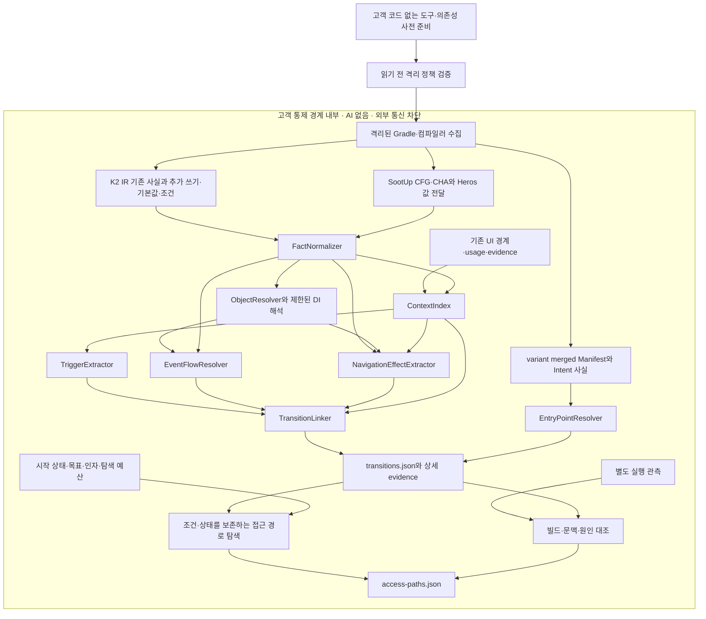

# AI 없는 화면 연결과 접근 경로 상세 설계

수정일: 2026-10-15. 설계 출발점은 PR #6의 `82af184`다. 이 문서는 전체 목표와 인수 기준을 유지한다. **구현 범위·실행 방법·검증 결과·미지원 capability는 [14번 초기 구현 기록](14-offline-transitions-implementation.md)과 [15번 경로 발견 범위 개선](15-access-path-coverage.md)에 구분해서 기록한다.** 현재 카탈로그 결과는 [11번 문서](11-ui-diagnosis-and-design-matching.md), 상위 요구는 [04번 문서](04-navigation-transition-analysis.md)를 따른다. 실행 격리와 데이터 보관의 필수 계약은 [13번 보안 설계](13-local-analysis-security.md)에 정의한다.

목표는 특정 화면에 대해 출발 화면·행동·전달 과정·탐색 상태 변경·목적지·필요 조건을 설명하고, 지정한 시작점에서의 접근 순서를 제시하는 것이다. 기존 K2 IR, SootUp/Heros, 콘텐츠 trace와 식별자를 재사용한다. 임의의 앱에서 모든 실행 경로가 가능하거나 불가능하다는 완전한 증명은 제공하지 않는다.

## 0. 확정한 실행 방향과 엔진 책임

코드와 분석 근거의 처리 위치를 고객이 통제해야 하므로 제품의 수집·연결·경로 탐색·설명에는 AI 추론을 넣지 않는다. LLM API, 외부 임베딩·reranker, AI 에이전트의 코드 조사, 클라우드 fallback을 의존성이나 실행 단계로 추가하지 않는다. 설명은 규칙 ID, 근거 위치, 인자 전달과 조건에서 결정적으로 생성한다. 이 문서의 `모델`은 프레임워크 동작을 명시한 분석 규칙을 뜻하며 학습 모델을 뜻하지 않는다.

사용자가 허용한 유일한 향후 AI 검토 범위는 **정보를 외부로 전송하지 않는 자체 모델**이다. 이번 설계에는 모델 실행기·가중치·endpoint 설정을 넣지 않는다. 향후 별도 설계와 검증이 있어도 자체 모델의 제안만으로 정적 판정을 확정하거나 미해결을 숨기는 변경은 허용하지 않는다.

### 0.1 오픈소스 재사용 범위

| 구성 | 채택 상태 | 제공하는 것 | APM이 구현할 것 |
| --- | --- | --- | --- |
| Kotlin 컴파일러 K2 IR | 기존 사용 유지 | lowering 전 선언·심볼·표현식 | Compose·기본값·DI·조건·쓰기 사실 collector |
| SootUp 3.0.1 | 기존 의존성 유지·분석 확장 | class → Jimple, CFG, 타입 계층, CHA | 분석 scope, source bridge, 객체 추상화, Android/Compose 요약 |
| Heros 1.2.3 | 기존 solver 유지·flow function 확장 | IFDS/IDE의 함수간 고정점 계산 | 유한 provenance 사실, seed, 호출·반환·필드 전달 함수 |
| APM 규칙·상태 탐색 | 후속 구현 | 동일 객체·host·이벤트·stack·guard를 연결 | 전환 판정, 제한된 조건 검사, 경로 탐색, 근거 설명 |
| JADX | 선택적 APK 검증 단계, 아직 미도입 | DEX·클래스·메서드·Manifest 확인 | 빌드 대응, 정확한 메서드/명령 식별, 결과 adapter와 검증 |
| Ghidra | 네이티브 경계가 필요한 후속 단계, 아직 미도입 | 바이너리 디컴파일·참조·스크립팅 | JNI 연결 근거와 managed/native 식별자 연결 |
| REA | 제품 의존성에 미채택 | 여러 도구의 CLI/MCP 조사 인터페이스 | 이번 제품은 각 엔진을 직접 호출하므로 불필요 |
| FlowDroid | 별도 비교 실험 후보, 기본 경로에 미채택 | Android/Java 데이터 흐름 분석 | Soot 기반 결과와 현재 SootUp 식별자의 별도 adapter가 필요 |

SootUp과 Heros는 실제 사용하는 라이브러리다. parser·CFG·고정점 solver를 다시 만들지 않고, 이들이 요구하는 분석 문제와 UI 의미를 구현한다. Heros가 제공하는 solver와 사용자가 제공하는 ICFG/flow function의 경계는 [Heros 공식 설명](https://github.com/soot-oss/heros)을 따른다. SootUp의 기능은 [공식 문서](https://soot-oss.github.io/SootUp/latest/)를 참고하되, 배포된 3.0.1 API와 실제 fixture로 지원 범위를 고정한다.

REA는 CLI로도 사용할 수 있어 그 자체를 외부 전송 도구로 단정하지 않는다. 다만 AI 조사 인터페이스는 이번 제품 요구에 필요하지 않으며, REA의 APK 구성요소 그래프는 화면 전환 그래프를 제공하지 않는다. [REA Android 계약](https://github.com/morluto/rea/blob/main/docs/android-analysis.md)

[JADX](https://github.com/skylot/jadx)와 [Ghidra](https://github.com/NationalSecurityAgency/ghidra)는 엔진 자체의 로컬 API/CLI를 선택적으로 사용한다. 디컴파일 텍스트를 AI나 정규식에 넣어 화면 관계를 확정하지 않는다. source/class가 있는 기본 분석은 기존 IR 경로를 사용한다. [FlowDroid](https://github.com/secure-software-engineering/FlowDroid)는 별도의 Soot 기반 분석이므로 SootUp의 대체 클래스처럼 끼워 넣지 않는다.

### 0.2 실행 경계와 도입 결정

기본 배포 목표는 고객이 통제하는 PC/사내 실행 환경의 **격리 분석**이다. 대상 입력을 읽기 전에 runner가 네트워크·프로세스·저장소 정책을 적용하고, Gradle 수집부터 최종 결과까지 같은 경계 안에서 실행한다. 격리를 설정하거나 확인할 수 없으면 입력을 열지 않고 중단한다. 단순한 플러그인 실행을 외부 전송 차단 모드로 표시하지 않는다.

분석이 끊기면 사람이 근거를 검토하고 버전이 있는 규칙·adapter 또는 명시적 수동 사실을 추가한다. 자동 분석과 수동 입력의 출처는 분리한다. 룰업의 세 가지 첫 검증은 Home→Detail, 비로그인 딥링크의 보류·로그인·재개, 같은 이벤트 타입의 서로 다른 Channel 오연결 방지다. REA를 도입하기 위한 실험 대신, 같은 사례를 고정된 엔진과 규칙으로 반복 재현한다.

## 1. 질문과 판정 계약

서로 다른 질문을 독립적으로 답한다.

| 질문 | 산출물 | 성공의 의미 |
| --- | --- | --- |
| 어떤 행동이 어느 화면을 열 수 있는가 | Transition | 코드·어댑터 안에서 행동→효과→목적지의 근거가 연결됨 |
| 특정 시작점에서 어떻게 접근하는가 | AccessPath | 시작 상태, 행동 순서, 인자 전달, 조건을 가진 경로 후보 |
| 현재 조건으로 막힌 부분은 무엇인가 | Blocker | 해당 경로의 구체적인 모순·미해결·외부 전제 |
| 실제로 이 경로가 실행됐는가 | Observation | 특정 빌드·세션에서 원인과 상태 반영·표시를 관측함 |

`HomeContent → Card` 구성 관계는 화면 이동이 아니다. `navigateTo` 호출은 이동 요청이며, 이벤트 전달·상태 반영·표시는 각각 별도 사실이다. 정적 경로는 가능한 전달 관계이고 실제 접근 성공을 보장하지 않는다.

분석 결과는 확률 하나로 축약하지 않는다.

| 축 | 값과 의미 |
| --- | --- |
| 연결 해석 | `RESOLVED_IN_MODEL`: 지원 규칙으로 대상·경로를 연결, `MAY`: 대안 존재, `UNRESOLVED`: 필수 연결 공백 |
| 조건 판정 | `CONTRADICTED`: 지원하는 동일 상태 버전의 조건이 모순, `NO_KNOWN_CONTRADICTION`: 제한 검사에서 모순 없음, `UNKNOWN`: 미지원/불투명 조건 |
| 실제 관측 | `NOT_OBSERVED`, `REQUEST_OBSERVED`, `STATE_APPLIED`, `DISPLAY_OBSERVED`; 단계별 이벤트 보존 |
| 탐색 범위 | `WITHIN_DECLARED_BOUNDS`, `TRUNCATED`, `INCOMPLETE_MODEL`; 적용 범위·제한·미지원 목록 포함 |

모순을 찾지 못한 것을 SAT나 접근 가능 확정으로 바꾸지 않는다. 경로가 안 나오면 `NO_PATH_FOUND_IN_EXPLORED_MODEL`이며 접근 불가 확정이 아니다. 모순은 해당 경로·입력에만 적용한다. 모든 경로에 대한 불가능 판정은 초기 범위에 없다. 관측된 경로도 다른 계정·서버 상태에서의 성공을 보장하지 않는다.

## 2. 현재 입력의 재사용 범위

| 기존 입력 | 재사용 방식 | 주의점 |
| --- | --- | --- |
| 함수·Composable·람다 ID와 source | 출발 콘텐츠, 콜백, 호출, 원본 근거 식별 | 소스 이동 후 ID가 바뀔 수 있으므로 빌드 fingerprint로 격리 |
| `callRelations`와 인자·수신 객체 표현식 | 실제 인자→형식 인자, 함수 참조 전달, 이동/이벤트 API 호출 seed | 호출 목록만으로 실행 순서를 추정하지 않음 |
| `values`의 초기값·반환식 | 상수·경로·함수 값과 객체 전달의 출발점 | 재할당·heap 갱신 전체를 표현하지 못함 |
| root/host/provider/entry/candidate | 목적지 후보와 표시 호스트의 인덱스 | 저장된 콘텐츠 후보를 자동으로 등록 목적지로 승격하지 않음 |
| 콘텐츠 `usageTrace`와 `ui-evidence` | 동작이 어느 콘텐츠 사용 문맥에 속하는지 역추적 | Preview 출처·조건·MAY를 유지; 이벤트를 콘텐츠 호출로 합치지 않음 |
| 사용 문맥별 경계·역할 | 페이지·overlay·region의 대상 참조 | UNKNOWN도 유지; 화면 분류 미해결을 전환 누락으로 숨기지 않음 |
| 기존 조건 표현식 | 경로 조건의 원본 근거 | 상태 버전·CFG·인자 치환을 추가해야 연쇄 조건 검사 가능 |
| SootUp의 Jimple·CFG·CHA, Heros callback provenance | 함수간 값 전달·가상 호출 후보 계산 기반 | 현재 `bytecode.json`은 대상 후보·통계 위주; 필요한 흐름 사실의 별도 출력 추가 필요 |
| DI 함수 선언 | 바인딩 해석의 시작점 | 현재 annotation 이름·타입만으로 주입 객체 동일성을 확정하지 않음 |
| 진단·fingerprint·캐시 계약 | 미해결 원인, 결과 출처, 입력 일치와 재사용 | 전환 결과에도 같은 근거/버전 계약 적용 |
| 디자인–코드 대응 | 디자인에서 코드 후보를 선택하는 별도 색인 | 디자인 유사도로 전환 간선이나 접근 가능성을 만들지 않음 |

룰업의 기존 기준은 37개 모듈·687개 소스, 로컬 Composable 690개, 운영 연결 566개, 콘텐츠 후보 48개다. 234개 경계와 5,557개 조건 기록은 화면·제품 상태의 개수가 아니다. 바이트코드의 호출 대상 연결 521개도 전환 간선 521개라는 뜻은 아니다.

기존 읽기용 `project-catalog.json`만으로 분석하지 않는다. 인자와 값 전달을 보존한 **모듈 내부 카탈로그 + 추가 흐름 사실**을 분석 입력으로 쓰고, 읽기용 UI 결과는 문맥·근거 참조로 연결한다.

## 3. 추가 수집 정보

P0는 룰업의 직접·Navigator·채널 경유 전환까지 연결하기 위한 필수 입력이다. P1은 외부 진입과 접근 조건의 확장이다. 런타임 관측은 별도 계측 단계다.

| 우선순위 | 추가 사실 | 수집 위치 | 필요한 이유 |
| --- | --- | --- | --- |
| P0 | 문장/블록 ID, 정상·예외 successor, 호출/반환 위치, branch predicate | SootUp CFG + 원본 source bridge | 호출 순서, 조기 return, 예외로 이동이 취소되는 경로 구분 |
| P0 | 실제/형식 인자 위치, dispatch/extension receiver, 생략 인자, 기본값 식, 가변 인자 | K2 IR | 이름에 의존하지 않는 인자 연결과 기본값 복원 |
| P0 | 지역/필드 읽기·쓰기, 생성 위치, 생성자 인자→필드 대입, 캡처와 반환 provenance | IR + Jimple | Navigator·channel·backStack·route 인스턴스 구분 |
| P0 | 연산자·피연산자·형 변환·상수 타입, 조건의 분기와 원본 위치 | K2 IR | 현재의 CALL/REFERENCE를 비교·논리 조건으로 정규화 |
| P0 | 클릭·submit·gesture·자동 effect의 callback 연결, enabled, lifecycle 조건 | signature 기반 API 모델 + 기존 호출/콘텐츠 trace | 행동과 화면 문맥 연결; 인자 이름 `onClick`만으로 확정하지 않음 |
| P0 | 클래스/생성자/필드 annotation 값, qualifier, component, scope, 주입 지점 | IR + 분석 범위 내 Hilt/Dagger 생성 코드 | 같은 타입의 서로 다른 DI 객체를 합치지 않기 위함 |
| P0 | route/key 생성·직렬화·필드 조회·맵 조회·render 선택의 관계 | 기존 사실의 정규화 + 생성자/필드 연결 | GenericNavKey 하나를 경로별 콘텐츠로 구분 |
| P0 | stream 생성, adapter, 송신·수신·filter·map·collect, payload 필드·타입, scope | 호출 사실 + coroutine/Flow 모델 | ViewModel→채널→호스트의 전달 관계 |
| P0 | 탐색 상태 객체, 초기값, 별칭, 변경 연산·순서·조건 | CFG/값 전달 + host 입력 | 일반 리스트 수정과 실제 백스택 변경을 구분 |
| P1 | 상태의 읽기·쓰기·reducer/copy 갱신과 콘텐츠 선택의 의존성 | IR/Jimple + Compose/StateFlow 모델 | 탭·sheet·dialog·로그인 분기 등 Nav3 밖 변화 |
| P1 | variant별 merged Manifest, 컴포넌트·alias·exported·permission·launchMode·intent-filter | Gradle Android Components의 해당 버전 artifact API | 실제 빌드의 외부 진입 선언; 소스 Manifest만으로 단정하지 않음 |
| P1 | Intent/PendingIntent의 대상·action·URI·extra·flags, onCreate/onNewIntent 분기 | IR/Jimple + Android API 모델 | 알림·외부 링크·warm/cold start 차이 |
| P1 | 저장·복원된 stack, pending route, remember/rememberSaveable/SavedState의 owner/key | 기존 값 + 프레임워크 모델 | 새 진입·복원·보류 후 재개를 구분 |
| P1 | label/contentDescription/testTag/resource ID와 조건 | IR + variant 리소스 | 사람이 읽을 행동 설명과 후속 테스트 연결; 좌표는 추정하지 않음 |
| 런타임 | cause/event/host/entry 인스턴스 ID, 요청·수신·반영·표시, 취소·실패 | 선택적 Android 계측/test instrumentation | 실제 접근 경로 확인과 정적 모델의 반례 수집; AI agent가 아님 |

추가 필드는 capability 목록으로 버전 관리한다. 새 분석은 필수 capability가 없는 오래된 카탈로그를 최신 사실로 간주하지 않는다. 필수 입력은 재수집을 요구하고, 선택 capability 공백은 `PARTIAL`로 명시한다. 기존 공개 카탈로그 v2는 유지한다.

기본값의 출처는 `EXPLICIT`, `DEFAULT_EXPRESSION`, `UNRESOLVED_DEFAULT`로 기록한다. 룰업 후보 48개 중 `isLoginRequired` 명시 인자는 2개뿐이며 선언 기본값은 true다. 인자 생략을 false로 바꾸면 접근 조건이 틀린다. 기본값이 앞선 인자·receiver를 참조하면 치환해서 해석하고, 부수효과가 있는 사용자 코드를 실행하지 않는다.

## 4. 데이터 모델과 식별자

원시 사실, 콘텐츠 구성, 행동/전달, 탐색 효과를 별도 관계로 보존한다. 화면 지도는 이 관계들을 투영한 뷰다. 구분 없이 모든 함수를 잇는 그래프를 화면 지도라고 부르지 않는다.

| 엔티티 | 필수 필드·의미 |
| --- | --- |
| `ScreenContext` | 기존 boundary/binding 참조, host/region, registration, route discriminator, 인자 패턴, 역할·미확정 상태 |
| `ObjectIdentity` | 생성/DI 출처, receiver·호출 문맥, component/owner 후보, alias 근거와 정확도 |
| `Trigger` | 사용 문맥, 등록 callSite, kind, callback, payload, 표시·enabled·실행 guard, 사용자/시스템/자동 출처 |
| `EntryPoint` | launcher/link/notification/restore 종류, component, 전달 조건, 초기 상태, parser 결과, 외부 전제 |
| `EventTransfer` | producer, stream object, adapter chain, consumer, payload mapping, 전달 의미·조건·정확도 |
| `NavigationEffect` | host/state 객체, 요청 지점, 순서 있는 원시 변경, push/pop/reset/switch 등 의미, 대상·인자·guard |
| `Transition` | originContexts, trigger, transfer/effect refs, targetContexts, 조건·인자 매핑, 단계별 해석 상태, evidence |
| `AccessPath` | query/start, transition 순서, 상태 단계, 필요 입력·환경 가정, blocker, 탐색 제한·관측 참조 |
| `Observation` | build/session/device, cause/event, origin 당시 화면, 반영 직전 화면, host/entry 인스턴스, 단계·시각 |

`ScreenContext`는 함수 ID만으로 식별하지 않는다. 같은 함수를 다른 경로·host·overlay에서 쓰면 문맥이 다르다. 동적인 challengeId 같은 값은 화면 정의를 무한히 늘리지 않고 인자 패턴으로 보존한다. 개별 화면 인스턴스는 런타임에서 구분한다.

같은 A→B라도 서로 다른 버튼·자동 effect·외부 진입의 전환은 별도 ID다. ID는 입력 snapshot, 호출 위치, 문맥, 연산 종류를 기반으로 결정한다. 위치 이동을 넘어선 영구 ID는 보장하지 않으며, 오래된 review/observation의 결합은 fingerprint 검사 후 별도 대응표로 처리한다.

## 5. 기술 파이프라인



위 runner와 격리는 신규 구현 대상이다. 원본·class·카탈로그·질의·근거·관측 파일은 모두 보호 대상이다. 도구 준비는 입력이 없는 별도 환경에서 끝내고, 결과 표시도 외부 script/font/telemetry가 없는 로컬 viewer에서 수행한다. 데이터 경계와 실패 정책은 13번 문서가 정의한다.

선택적 엔진 결과는 `producer/version/configDigest`, `artifactDigest`, `subjectId`, `sourceBridgeStatus`, `coverage`, `limitations`, `evidenceRefs` 계약으로 정규화한다. APK는 동일 빌드의 변환 정보·mapping과 연결하고, 다른 빌드나 R8 변환으로 대응이 모호하면 별도 근거로 보존한다. `.so` 파일이 존재한다는 사실만으로 JNI 호출 간선을 만들지 않는다. 새 엔진의 일치 건수를 기존 근거와 중복 집계하거나 MAY를 확정으로 승격하지 않는다.

### 5.1 FactNormalizer와 ContextIndex

실제 인자→형식 인자, 기본값, 생성자→필드, 반환값을 공통 표현으로 정규화한다. 구체적인 경로 문자열, 유한한 대안, 동적 표현식, UNKNOWN을 구분한다. 유한 집합의 상한을 넘기면 임의의 값 일부만 유지하지 않고 UNKNOWN 대안과 `VALUE_SET_WIDENED`를 남긴다.

기존 content trace에서 action 등록 위치까지의 문맥을 구한다. 여러 incoming edge는 대안이며 전부 AND하지 않는다. 서로 다른 경로의 인자·조건 조합에는 `choiceGroupId`를 붙여 합류 후에도 상관관계를 유지한다. 식별자 변경 없이 단순 Cartesian product로 route와 payload를 조합하지 않는다.

룰업의 `GenericNavKey.path → appRouteByPath[path] → AppRoute.render(args)`를 데이터 흐름으로 좁힌다. AppRoute의 문자열 path만 보고 모든 후보를 모든 host에 연결하지 않는다. 실제 provider의 맵 조회·render 호출까지 근거가 있으면 해당 host에 연결하고, 없으면 `DESTINATION_BINDING_UNRESOLVED`로 남긴다. 이 부분이 기존 후보→실제 목적지 문맥을 연결하는 추가 분석이다.

### 5.2 ObjectResolver와 DI

기존 [SootUp](https://soot-oss.github.io/SootUp/latest/)의 CFG·CHA와 [Heros](https://github.com/soot-oss/heros)의 IFDS solver를 그대로 쓴다. 초기 구현은 수신 객체와 이동에 필요한 값의 흐름으로 분석 범위를 제한한다. 새로운 전역 분석 엔진을 동시에 도입하지 않는다.

추가하는 유한 사실은 생성 출처·콜백·route 값·stream 출처의 provenance다. 호출·반환이 짝지어진 전파를 수행하고, 1단계 호출 문맥과 제한된 field access path를 기본 출발점으로 둔다. 숫자는 설정과 성능 검증으로 조정하며 예산을 넘으면 정확도를 낮춘 근거를 기록한다. IFDS에 임의의 조건식/heap 관계를 넣어 분배성이 유지된다고 가정하지 않는다. 조건 상관관계는 별도의 경로 단계가 담당한다.

객체는 allocation site, 전달 receiver, DI key(type+qualifier), component, owner를 조합해 추상화한다. 같은 allocation site에서도 인스턴스가 여러 개 생길 수 있으므로 단일 후보 집합만으로 MUST_ALIAS를 부여하지 않는다. 같은 최종 참조나 동일 component의 scoped binding처럼 모델이 보증하는 근거에만 동일성을 부여한다.

쓰기 대상이 유일하고 해당 프로그램 지점의 객체를 정확히 식별할 때만 이전 값을 대체하는 strong update를 적용한다. 별칭·공유 인스턴스가 불확실하면 기존 가능성을 유지하는 weak update를 적용한다. field 경로 상한이나 캡처 연결 실패는 UNKNOWN 출처로 전파한다. 원본과 bytecode는 JVM owner·descriptor, SourceFile/SMAP·줄 정보, IR signature를 대조하는 방향으로 source bridge를 확장하고, 모호한 대응을 가까운 줄의 호출로 임의 연결하지 않는다.

Hilt는 binding, qualifier, component·scope와 생성 코드를 연결한다. 싱글턴은 해당 component 문맥에 한정한다. Activity·ViewModel owner가 다르면 같은 클래스도 다른 객체 후보다. scope와 component lifetime을 함께 모델링하는 이유는 [Hilt 공식 문서](https://developer.android.com/training/dependency-injection/hilt-android)의 binding 범위에 따른다. 멀티바인딩·Provider/Lazy·커스텀 factory를 지원하지 못하면 타입이 같다는 이유로 임의 결합하지 않는다.

### 5.3 TriggerExtractor

출발점은 알려진 Compose 입력 API의 callback 슬롯이다. 정확한 심볼·signature 모델로 클릭, long click, submit, back, gesture를 분류한다. 사용자 wrapper는 본문을 따라 알려진 슬롯으로 위임되는지 검사한다. 이름 `onClick`만 붙어 있는 미호출 인자는 trigger로 확정하지 않는다.

자동 동작은 별도 종류로 저장한다. 예: LaunchedEffect, lifecycle callback, 외부 Intent. LaunchedEffect의 key, 취소/재시작 가능성, 콘텐츠 조건은 실행 전제로 남긴다. Preview/test의 행동도 원본에는 남기되 운영 경로 질의의 기본 시작점에서 제외한다.

룰업의 `singleClickable`은 `clickable → SingleClickHelper.run → pass → callback`이다. enabled·throttle·global guard를 보존한다. 시간 조건의 구체값을 풀지 못해도 guard가 있다는 사실을 지우지 않는다. 목록 아이템 callback은 item ID를 symbolic payload로 두며 데이터를 임의로 만들어 클릭 가능한 것으로 처리하지 않는다.

### 5.4 EventFlowResolver

송신과 수신은 이벤트 타입뿐 아니라 **동일 stream provenance**가 필요하다. `Channel → receiveAsFlow → collect`의 adapter 경로를 추적한다. 공통 기반 ViewModel에 선언된 `_effect`도 receiver가 다른 두 ViewModel 사이에서 합치지 않는다.

| 모델 | 연결 계약 |
| --- | --- |
| 직접 callback | 대응하는 함수 값과 실제 인자를 따라 호출; 외부 callback 계약은 버전 모델 필요 |
| Channel/receiveAsFlow | 송신 결과, 버퍼·close, 수신자 활성 조건을 보존; 복수 collector는 경쟁하는 대안 |
| SharedFlow | replay/buffer/overflow, 구독 상태와 broadcast 의미 보존 |
| StateFlow/Compose state | 최신 상태 선택 관계로 처리; 모든 write가 별도 표시나 이벤트 전달을 뜻하지 않음 |
| map/filter/collectLatest | payload 변환·필터 조건·취소 의미를 보존; 미지원 operator에서 공백 표시 |
| 불투명 callback/stream | 후보와 끊긴 위치를 보존; 수신자를 타입 이름으로 만들어내지 않음 |

`receiveAsFlow`의 원소는 하나의 collector에 전달되므로 호스트 두 개가 모두 같은 이벤트를 받는 것으로 연결하면 안 된다. 취소로 처리되지 않을 수 있는 조건도 남긴다. [Kotlin receiveAsFlow 계약](https://kotlinlang.org/api/kotlinx.coroutines/kotlinx-coroutines-core/kotlinx.coroutines.flow/receive-as-flow.html)

SharedFlow는 구독·replay 조건을 별도로 가지며, StateFlow는 빠른 중간 업데이트가 생략될 수 있다. 각각 다른 모델을 쓰는 근거다. [SharedFlow](https://kotlinlang.org/api/kotlinx.coroutines/kotlinx-coroutines-core/kotlinx.coroutines.flow/-shared-flow/), [StateFlow](https://kotlinlang.org/api/kotlinx.coroutines/kotlinx-coroutines-core/kotlinx.coroutines.flow/-state-flow/)

룰업의 singleton NavigationHelper binding, AppRoot의 CompositionLocal 공급, AppNavHost의 receiver까지 연결해 채널 동일성을 검증한다. 같은 타입이라는 근거만 있으면 MAY다. `GoToDestPage(route)`와 `ReplaceStack(route)`는 payload variant와 인자를 함께 전파한다. trySend 성공도 처리 완료는 아니므로 송신 수락·수신·효과를 분리한다.

새 adapter는 심볼·signature·적용 라이브러리 버전, receiver/인자 역할, 값 전달, 효과·guard, 실패/취소, 검증 fixture를 계약으로 가진다. 현재 SDK/앱 classpath에 맞는 모델만 적용한다. 공개 문서의 최신 signature를 현재 고정 버전의 구현에 무조건 적용하지 않는다. 일반적인 사용자 함수는 본문에서 요약을 도출하며 룰업 함수명으로 전환을 하드코딩하지 않는다.

규칙 묶음은 `ruleId`, `schemaVersion`, 적용 artifact/버전·signature, `requiresCapabilities`, `transfer`, `guards`, `failureModes`, 출처, 정·반례 fixture와 digest를 가진다. AI가 실행 중 규칙을 생성하거나 웹에서 코드를 조회하지 않는다. 사용자 설정은 검증 가능한 선언형 데이터만 허용하고 `eval`, 임의 script, 외부 URL import를 금지한다. 복잡한 adapter는 검토·배포된 코드로 runner 안에서 실행하며 source/규칙 provenance와 수동 추가 여부를 결과에 기록한다. 미지원 버전에서는 규칙을 억지로 적용하지 않고 `UNSUPPORTED_SEMANTICS`를 남긴다.

### 5.5 NavigationEffectExtractor와 TransitionLinker

상태 변경에서 역방향으로 NavDisplay의 stack·표시 region과 동일한 객체인지 확인한다. 일반 리스트의 add는 전환이 아니다. 변경 지점에서 원인 trigger로 역추적하는 경로와 trigger에서 변경 지점으로 전방 추적하는 경로를 결합한다. 출발점을 못 찾은 효과도 `ORIGIN_UNRESOLVED`로 보존한다.

| 효과 | 의미와 기록 |
| --- | --- |
| `PUSH` | 같은 host의 stack에 목적 key 추가, 인자·중복 억제 조건 포함 |
| `POP` | 기존 stack에 의존하는 반환; 이전 간선을 반대로 복제하지 않음 |
| `RESET` / `REPLACE_STACK` | 새 stack 표현식과 순서 보존 |
| `SWITCH_REGION` | 활성 탭/host/선택 콘텐츠 변경; 실제 구현의 stack 교체가 있으면 함께 기록 |
| `SHOW_OVERLAY` / `DISMISS_OVERLAY` | sheet/dialog region과 이를 선택하는 상태 변경 |
| `SHOW_TRANSIENT` | 토스트·스낵바 표시 효과; 탐색 목적지 수에 합산하지 않음 |
| `NO_OP` / `REJECTED` | 같은 key, 알 수 없는 route, enabled false 등으로 상태 변화가 없음 |

룰업의 host handler는 isRoot, isBottomTab, 현재 마지막 key와 route의 동등성에 따라 달라진다. navigate 요청을 일괄 PUSH로 바꾸지 않는다. `clear + addAll` 같은 순서는 primitive 효과도 남기고 지원하는 제어 흐름에서만 composite 연산으로 요약한다. 외부 관측·suspend·예외가 끼어 있으면 원자적 교체로 가정하지 않는다.

상태 기반 overlay는 동일한 state 객체의 write와 콘텐츠 선택 read를 연결한다. 이벤트의 origin 화면과 실제 표시 region이 다를 수 있다. 예를 들어 약관 화면의 실패가 공통 RootComposable의 dialog 상태를 변경할 수 있다. 이때 약관→Root 전체 화면 이동이 아니라 약관에서 발생한 dialog 표시 효과다.

Nav3의 Scene은 여러 entry를 표시할 수 있으므로 `visibleContexts`는 집합이다. stack 마지막 항목만으로 표시를 확정하지 않는다. 지원하지 않는 SceneStrategy는 `SCENE_SELECTION_UNMODELED`로 둔다. [Nav3 Scene 계약](https://developer.android.com/guide/navigation/navigation-3/scenes)

### 5.6 EntryPointResolver

launcher, implicit link, explicit Intent/notification, activity alias, 초기 표시, saved-state 복원을 각각 생성한다. 코드의 URI parser가 받아들인다는 사실만으로 OS에서 그 URI를 앱에 전달할 수 있다고 판정하지 않는다. Manifest 선언, component/permission, Intent 경로, parser, 접근 정책을 순서대로 연결한다. Manifest 일치도 실제 OS 선택·App Link 검증을 보장하지 않는다. [Android 딥링크 처리](https://developer.android.com/training/app-links/create-deeplinks)

룰업 소스의 parser에는 `/app/...` 처리가 있지만 현재 읽은 소스 Manifest의 웹 링크 필터는 `/inv`, `/c`, `/w`다. 따라서 `/app/...`를 자동으로 외부 웹 진입점으로 만들면 안 된다. 구현 검증에서는 variant merged Manifest로 다시 판정한다. 명시적 Intent로 Activity에 전달하는 경로는 implicit filter 검사와 별도로 분석한다.

cold start는 onCreate→pending route 저장→Splash 검사 경로를, warm start는 onNewIntent의 검사 경로를 가진다. PendingDeepLink는 같은 객체의 set/get/consume과 파괴적 읽기·clear를 모델링한다. 최초 상태에 목적지를 먼저 넣거나 로그인 후 항상 Home으로 보낸다고 가정하지 않는다. 복원된 `[Home, Detail]`도 과거에 Home→Detail 클릭이 있었다는 증거가 아니다.

로그인 요구 metadata와 실제 guard 실행 지점은 별도 필드다. `isLoginRequired=true`라는 선언만으로 모든 내부 이동에 인증 검사가 시행된다고 주장하지 않는다. enforcement 근거가 부족하면 `POLICY_ENFORCEMENT_UNRESOLVED`를 남긴다.

## 6. 접근 경로 탐색 알고리즘

화면 ID만 방문 표시하는 BFS를 쓰면 로그인 전후·서로 다른 stack 상태를 합쳐 잘못된 경로를 만들 수 있다. 다음 추상 상태를 사용한다.

```text
State = (
  host별 stack와 알 수 없는 prefix,
  active regions / visible context 후보,
  버전이 있는 관련 state 값,
  pending route / 관련 event 후보,
  lifecycle·환경 조건,
  경로 제약과 미해결 목록
)
```

1. 질의의 시작점·초기 사실·목표 문맥·허용 행동을 고정한다. 초기 사실과 전 구간에서 유지할 invariant를 구분한다. `authenticated=false`로 시작하더라도 로그인 행동으로 true가 될 수 있다.
2. 목표·조건에 영향을 주는 효과에서 역방향으로 slice를 만들고, 시작점에서 전방 탐색한다. 조건을 바꿀 수 있는 준비 행동·데이터 의존성을 slice에 포함한다. 제외·미해결 정보는 보고한다.
3. trigger의 화면 문맥·표시 조건·enabled·event 전달 guard를 확인한다. 사용자 행동, 자동 작업, 외부 응답을 각각 한 단계로 표현한다. 서버 성공을 사용자에게 수행 가능한 버튼 행동으로 바꾸지 않는다.
4. 인자를 현재 상태에 치환하고, guard와 primitive/composite 효과를 순서대로 적용한다. 일반 호출/반환은 대응 문맥을 유지하며 event 경계를 동기 호출로 축약하지 않는다.
5. 상태 변경에는 새 버전을 부여한다. 로그인 전 `auth@0=false`와 후 `auth@1=true`는 모순이 아니다. suspend나 외부 변경으로 값이 달라질 수 있으면 영향받는 상태를 UNKNOWN으로 넓히고 과거 read와 이후 read를 동일시하지 않는다.
6. 상수·동일 버전의 null/enum/Boolean/문자열 동등성·명확한 분기 모순만 제거한다. 불투명 함수·시간·서버값·미지원 숫자 연산은 원래 조건과 함께 유지한다. 정수 overflow나 부동소수점 의미를 실수 대수로 바꾸지 않는다.
7. 목표 context와 인자 조건에 도달한 경로 후보에 단계별 상태·요구 입력·가정·미해결을 붙인다. 알 수 없는 stack prefix의 POP 목적지는 UNKNOWN이지 임의의 과거 화면이 아니다.
8. 여러 대안은 모델 근거가 명확한 순서, 외부 가정이 적은 순서, 사용자 행동 수 순서로 정렬한다. 이 순서는 성공 확률이 아니다. 같은 화면 쌍의 서로 다른 trigger는 별도로 유지한다.

SCC/반복은 상태 요약으로 처리한다. 합류 시 같은 추상 상태와 동등한 제약만 병합하고 대안의 guard를 OR로 보존한다. 증명할 수 없는 포함 관계로 경로를 삭제하지 않는다. 예산을 넘는 상태는 widening·frontier·중단 사유와 함께 남기고 음성 판정에 쓰지 않는다.

초기 탐색 설정안은 경로 5개, 경로당 전환 단계 20개, 상태 10,000개, 정확한 stack suffix 8개다. 이는 성능 측정 전의 조정 가능한 예산이며 완전성 기준이 아니다. top-K, 단계·상태·시간 제한 중 무엇이 탐색을 멈췄는지 출력한다. 정적 순환 그래프에서 모든 경로를 열거하지 않는다.

첫 버전은 전용 SMT 의존성을 추가하지 않는다. 현재 요구는 경로와 잔여 조건을 설명하는 것이며, 단순 모순 제거의 지원 범위를 명확히 한다. 향후 SMT가 필요하면 별도 선택 모듈에서 버전·입력·timeout을 고정한다. 모델 내부 SAT도 실제 서버 응답·이벤트 전달·표시의 성공 증명이 아니다.

화면·버튼 설명은 `trigger 종류 + 로컬 label 참조 + 목적지 + 잔여 조건`의 템플릿으로 생성한다. 미확인 API 응답, reflection, dynamic feature, 외부 상태는 `UNRESOLVED`/`UNKNOWN`을 유지한다. 이름 유사도·자연어 해석으로 간선을 보충하지 않으며, 디자인 매칭 결과도 접근 가능성의 증거가 아니다.

## 7. 제안 출력과 Gradle 계약

아래 이름은 구현 예정 계약이다. 현재 실행 가능한 명령으로 취급하지 않는다.

| 단계 | 입력 | 출력 |
| --- | --- | --- |
| 신규 격리 runner의 사전 검사 | 고정 도구 bundle·격리 정책·저장소·입력 경로 목록 | 보호 경계 수립 결과 또는 입력 열기 전 실패 |
| 기존 `apmCompileDebugCatalog` / `apmCollectDebugCatalog` 확장 | Kotlin/클래스패스·collector | 기존 내부 facts + 새 capability |
| 기존 `apmAnalyzeDebugCatalog` 확장 | class·facts·엔진/모델 버전 | 기존 bytecode.json + 전환에 필요한 flow-facts.json |
| `apmCollectDebugEntryPoints` 신규 | merged Manifest·artifact metadata | entry-points.json |
| `apmLinkDebugTransitions` 신규 | 내부 facts·flow facts·UI 문맥·진입점·규칙 설정 | transitions.json, transition-evidence.json |
| `apmFindDebugAccessPaths` 신규 | transitions·query JSON·탐색 예산 | access-paths.json |
| 관측 대조 단계 | graph와 동일 build의 관측 | 별도 transition-observations.json 및 대조 결과 |

SootUp의 JavaView·CFG를 한 분석 JVM에서 재사용하고, 전체 앱을 화면마다 다시 분석하지 않는다. 메서드 요약을 해당 실행 안에서 재사용한다. 최초 증분 범위는 Gradle 태스크 단위다. 메서드 단위 영속 캐시는 classpath·override·alias 의존성의 정확한 무효화가 구현되기 전에는 약속하지 않는다.

디자인 변경은 전환 재분석 입력이 아니다. 질의의 시작 상태·목표만 바뀌면 경로 탐색만 실행한다. Manifest 변경은 진입점과 그 후속 단계, 모델 설정 변경은 관련 분석 태스크를 무효화한다. 일반 assemble에 전체 분석을 붙이지 않으며 프로젝트를 수정해 캐시를 강제로 깨는 방식도 사용하지 않는다. 격리 모드의 캐시는 같은 고객·프로젝트 경계의 로컬 저장소만 허용한다. 초기 안전 경로는 Gradle task-output cache를 끄고 로컬 `UP-TO-DATE`를 유지하며, 검증된 local-only cache는 후속 최적화로 둔다.

새 결과는 예쁘게 들여쓴 JSON과 ID 참조를 사용한다. 출력 헤더에는 schema, facts capability, rules/adapter/engine 버전, variant, source/bytecode/manifest fingerprints, 예산·coverage를 기록한다. 예산과 모델 버전도 캐시 입력이다. 로그에는 필요한 최소 위치·집계만 남기고 상세 근거는 evidence 파일로 분리한다.

`analysis-manifest.json`에는 입력·도구·규칙 digest와 capability를, 별도 `execution-policy.json`에는 해당 실행의 `aiMode`, `boundaryRef`, `policyDigest`, `enforcementStatus`, `networkAuditRef`, `storageAuditRef`를 둔다. 이름은 신규 계약이다. 파일 경로는 프로젝트 상대 경로 또는 로컬 artifact ID를 사용하고, API key·실제 계정/URI query 값은 로그·관측에 기록하지 않는다. 보안 정책·직렬화 schema·규칙 digest는 캐시 namespace에도 반영한다. 과거 캐시를 읽었다는 사실로 이번 실행의 격리를 입증하지 않으며, 실행 정책 기록은 매번 새로 검증한다.

결과는 generation 디렉터리에 모두 작성·검증한 후 완료 인덱스를 원자적으로 교체한다. 중간 실패가 이전 성공 세대를 덮어쓰지 않게 한다. 독자는 인덱스와 파일 fingerprint를 확인한다. 오래된 성공 결과를 최신 실패 실행의 결과로 표시하지 않는다.

전환의 논리 형태 예시다. ID는 설명용이며 실제 분석 결과가 아니다.

```json
{
  "id": "transition:home-card-detail",
  "originContextRefs": ["context:home"],
  "triggerRef": "trigger:home-card-click",
  "transferRefs": ["transfer:navigation-channel"],
  "effectRef": "effect:main-stack-append",
  "targetContextRefs": ["context:challenge-detail"],
  "arguments": {"challengeId": {"kind": "SYMBOLIC", "from": "trigger.item.challengeId"}},
  "conditionRefs": ["guard:card-present", "guard:click-accepted", "guard:collector-active", "guard:key-not-top"],
  "linkage": "RESOLVED_IN_MODEL",
  "conditions": "UNKNOWN",
  "observation": "NOT_OBSERVED",
  "evidenceRefs": ["evidence:click", "evidence:send", "evidence:collect", "evidence:stack-write"]
}
```

접근 경로는 위 전환들을 순서대로 참조하며 `requiredInputs`, `initialFacts`, `assumptions`, `blockers`, `unresolvedRefs`, `exploration`을 추가한다. 미해결 target은 빈 배열로 숨기지 않고 symbolic target과 이유를 함께 남긴다. 모든 참조는 같은 세대 안에서 검증한다.

### 실행 관측의 결합

첫 관측 구현은 Compose 샘플의 테스트 계측에서 시작한다. `TRIGGERED → SEND_ATTEMPT/ACCEPTED → RECEIVED → STATE_APPLIED → DISPLAY_OBSERVED`에 cause/event ID를 연결하고 실패·취소를 별도 이벤트로 남긴다. 동기 호출과 coroutine context의 원인 전달을 구분한다. 시간 근접성이나 단일 ThreadLocal만으로 비동기 인과관계를 확정하지 않는다.

채널 경계의 정확한 인과 추적에는 송신과 수신 양쪽에서 같은 event ID를 보존하는 계측 계약이 필요하다. 샘플에서는 opt-in envelope/adapter로 이를 검증한다. 일반 앱의 이벤트 타입·채널 계약을 자동으로 바꾸거나, 동일 payload 객체라는 이유로 반복 송신을 같은 이벤트로 합치지 않는다. ID를 전달할 수 없는 경계는 원인 UNKNOWN으로 두며 시간상 상관관계만 별도 표시한다.

빌드 fingerprint, host/entry 인스턴스, trigger 당시 origin과 상태 반영 직전 화면을 함께 기록한다. Scene에서 실제 선택·표시한 entry 집합과 composition/frame 단계도 구분한다. 정적 모델과 다른 관측은 `MODEL_MISS`로 보존하고 정적 간선의 확정도를 몰래 바꾸지 않는다. 실제 테스트의 성공은 그 입력·세션의 경로 증거이며 일반적인 서버·계정 조건의 증명이 아니다.

관측은 기본 정적 분석과 별도 선택 단계다. 고객 통제 테스트 디바이스/에뮬레이터에서도 앱과 SDK의 외부 통신을 차단하고 로컬 fixture/mock을 사용한다. 로그인 서버·App Link 검증이 필요해도 분석기가 실제 endpoint를 호출하지 않는다. 해당 가정은 `EXTERNAL_PRECONDITION_UNVERIFIED`로 남기며 fixture로 통과한 것을 실제 서비스 접근 성공으로 표현하지 않는다. ADB·viewer·저장소 경계와 최소 수집은 13번 문서를 따른다.

## 8. 룰업에서 기대하는 검증 결과

### 홈에서 챌린지 상세

`HomeScreen의 카드 → OpenChallenge(id) → HomeViewModel → navigateByRoute → GoToDestPage → 같은 NavigationHelper 채널 → AppNavHost → handleNavRoute → GenericNavKey(path,args) → 경로 맵의 render`를 하나의 증거 경로로 설명해야 한다.

기대 입력은 실제 카드의 challengeId다. 카드가 나타나는 데이터 조건, singleClickable 가드, 채널 전달·수신 활성, 목적 key 중복 억제를 보존한다. 목적지 인자만 안다고 카드 존재나 API 성공까지 확인된 것은 아니다. 단순 타입 호출 그래프만 연결된 경우는 MAY로 남긴다.

### 비로그인 상태의 외부 진입

Manifest/explicit Intent 진입 → URI 해석 → PendingDeepLink 저장 → Splash/인증 상태 판정 → 로그인 화면 → 로그인 성공 → pending 소비 → synthetic stack 적용 → 목적지라는 경로와 실패·보류 대안을 만든다. source 기준 cold/warm 경로의 접근 정책·계정 제한 검사는 각각 따라간다.

같은 state 저장소의 쓰기·소비를 증명하지 못하면 단절 위치를 보여준다. `compareAndSet`의 경쟁, 인증 결과, 계정 상태, 서버 응답은 지원 모델/환경 전제가 없으면 UNKNOWN이다. 구현에 있는 검사를 모든 경로에 자동 복제하지 않는다.

### 전역 다이얼로그·토스트

약관/알림 설정 실패 → MessageHelper effect → 같은 메시지 stream → RootComposable collector → dialog state 또는 toast/snackbar 표시를 연결한다. 이전 보고서의 이벤트 표시 미평가 3건을 회귀 대상으로 삼는다. 실제 분석 결과를 보고 완료 수를 정하며 사전에 3건 모두 해결됐다고 가정하지 않는다. 디자인 텍스트 매칭 실패와 이벤트 전달 미해결은 별도 지표다.

## 9. 반례와 필수 처리

| 반례 | 잘못된 결과 | 설계의 처리·검증 |
| --- | --- | --- |
| 서로 다른 두 Channel<NavSignal> | 모든 송신→모든 수신 연결 | 객체 provenance와 adapter 경로 일치; 불명확하면 MAY/미해결 |
| 같은 ViewModel 클래스 두 인스턴스 | 다른 화면의 effect를 혼합 | ViewModel owner·receiver 문맥 분리 |
| 같은 singleton 채널을 두 host가 수신 | 둘 다 이동했다고 확정 | 경쟁 수신 대안·host 인스턴스 조건 보존 |
| trySend 실패 또는 수신 후 취소 | 요청을 실제 전환으로 계산 | 요청·수락·수신·반영·표시 단계 분리 |
| SharedFlow 무구독/replay, StateFlow 합쳐진 갱신 | 과거 모든 이벤트/중간 상태 표시 | stream별 전달·상태 선택 모델 |
| 이름만 onClick이고 호출 안 됨 | 존재하지 않는 사용자 행동 | 실제 알려진 입력 슬롯까지 위임 경로 검증 |
| enabled=false, throttle로 클릭 차단 | 버튼이 보이면 접근 가능 | 표시·enabled·실행 guard 별도 |
| 보통 리스트의 add | 잘못된 화면 이동 | NavDisplay 상태와 동일 객체인지 확인 |
| 동일 함수가 Home·Search·sheet에서 재사용 | 출발 화면 혼합 | 콘텐츠 사용 문맥과 payload의 상관관계 보존 |
| 다른 host의 같은 route 문자열 | 잘못된 목적지 선택 | host/provider/registration 포함 식별자 |
| dynamic map lookup 또는 기본 인자 생략 | 전부 연결하거나 false 처리 | 유한 map/기본값 해석; 모르면 UNKNOWN |
| 로그인 전 false, 후 true | 정상 로그인 경로를 모순으로 제거 | 상태 버전과 효과 순서 적용 |
| 서로 다른 분기의 route·args | 실제로 없는 route/ID 조합 | choice 상관관계 보존; 임의 Cartesian product 금지 |
| 백스택 reset 후 back | 이전 이동 간선의 역방향으로 복귀 | stack 연산으로만 POP 해석 |
| 초기/복원 stack에 여러 key | 사용자가 순서대로 방문했다고 표시 | INITIAL/RESTORE 상태로 표현 |
| parser가 지원하지만 외부 filter가 없는 URI | 웹에서 바로 진입 가능 | Manifest·explicit Intent·parser 경로 분리 |
| 로그인 metadata는 있으나 guard가 일부 경로에만 있음 | 모든 내부 이동이 보호됨 | 선언과 enforcement 근거 분리 |
| callback 이후 사용자가 다른 화면으로 이동 | 현재 화면을 원인으로 오인 | trigger origin과 반영 직전 화면 분리 |
| 뒤로가기 미리보기 취소, 다중 Scene | 취소된 전환/한 화면만 기록 | 확정 이벤트와 visible entry 집합 사용 |
| reflection·SDUI·외부 서비스 결정 | 근거 없는 목적지 또는 누락 은폐 | 동적 target·외부 조건·미지원 진단 보존 |
| 분석 제한으로 경로가 없음 | 접근 불가 선언 | frontier·예산·NO_PATH_FOUND_IN_EXPLORED_MODEL |
| 격리 실행에서 외부 로그인/서버 응답이 없음 | 원래 앱에서도 접근 불가라고 판정 | 외부 전제 미검증과 정적 경로를 분리; 로컬 fixture 관측 범위 명시 |
| 미지원 callback을 이름이나 AI 설명으로 연결 | 근거 없는 확정 간선 | 규칙·값 전달 근거가 없으면 미해결; 수동 사실은 출처를 분리 |
| 다른 빌드의 APK/native 분석 결과 | 현재 source의 호출로 잘못 결합 | artifact/build/bridge 검사; 불일치 evidence는 별도 보관 |

## 10. 선택한 방식과 트레이드오프

| 선택 | 얻는 것 | 비용·한계 |
| --- | --- | --- |
| 현재 IR + SootUp/Heros 확장 | 기존 ID·근거·캐시와 실제 엔진 재사용 | source bridge와 Compose/Android 의미 모델은 계속 필요 |
| 객체·문맥을 구분하는 제한 분석 | 다른 채널·host의 거짓 연결 감소 | 비용 증가; 추상화된 heap·외부 factory에서 MAY 유지 |
| 전환 구조와 조건 탐색 분리 | 조건·질의만 바꿔 재사용, 결과 설명 용이 | 상태 상관관계 보존을 별도로 구현해야 함 |
| 목표 중심 slice + 상한 있는 탐색 | 큰 앱에서 결과와 진단을 제한된 비용으로 제공 | 모든 경로·최단 실제 경로·접근 불가를 보장하지 않음 |
| 원시 근거와 읽기용 JSON 분리 | 추적 가능성을 유지하며 보고서 중복 감소 | 상세 검토 시 evidence 접근 필요 |
| 정적 분석 우선, 관측 별도 결합 | 실행하지 않은 경로 후보도 유지 | 정적 후보만으로 실제 표시를 확정할 수 없음 |
| API 버전별 모델 + 사용자 코드 분석 | 새 wrapper도 본문에서 확장 가능 | 지원 operator·프레임워크 버전 테스트 비용 |
| 수동 보정·앱별 adapter의 출처 명시 | 처리하기 어려운 계약도 설명 가능 | 룰업 특화 지식을 자동 분석 정확도로 계산할 수 없음 |
| AI 없는 분석·설명 | 판정 근거와 입력/규칙 버전의 재현 가능성 | 새 framework·동적 계약은 규칙 개발 또는 미해결로 남음 |
| 도구 준비와 격리 실행 분리 | 코드가 있는 프로세스의 외부 통신 차단 | 도구 bundle 관리, 격리 환경, 디스크·컴파일 비용 |
| 로컬 출력·캐시와 네트워크 없는 관측 | 결과·로그·테스트 데이터도 동일 경계에 보관 | 원격 캐시 이점과 실제 외부 서비스 검증을 포기 |
| JADX/Ghidra를 필요한 입력에만 적용 | APK·네이티브 근거 확장 가능 | 변환/식별자 연결·별도 버전·시간 비용; 도입만으로 누락 해결 아님 |

단순 호출 그래프나 route 문자열 검색만으로는 동일 객체·이벤트 전달·상태 순서를 다루기 어렵다. 앱 전체를 처음부터 일반 symbolic execution으로 실행하면 Android 환경 모델과 상태 폭발 비용이 커진다. 위 설계는 전환에 필요한 slice와 기존 분석 근거를 우선 사용하고 남은 조건을 결과에 노출한다.

## 11. 구현 순서와 인수 기준

| 단계 | 변경 책임 | 완료 기준 |
| --- | --- | --- |
| 0. 실행 경계 | 신규 runner, bundle/정책 계약, 로컬 출력 | 13번의 오프라인 입력 준비·프로세스/파일/네트워크 차단·실패/취소 반례 통과; 미지원 환경에서 입력을 열기 전에 중단 |
| A. 사실 계약 | compiler collector, analysis source bridge, 내부 schema | 기본값·대입·CFG·receiver·DI annotation fixture가 원본과 일치; 기존 51개/샘플 회귀 유지 |
| B. 직접 전환 | catalog의 ContextIndex, TriggerExtractor, effect/linker | callback→동일 stack→목적지와 일반 리스트·미호출 callback 반례 통과 |
| C. 룰업 핵심 전달 | 제한 객체/DI 해석, Channel·Flow 모델 | Home→Detail의 전체 증거 경로, 다른 채널·owner·경쟁 collector의 오연결 방지 |
| D. 접근 경로 | entry collector, 상태·조건 탐색, 질의 태스크 | cold/warm·보류 후 로그인·POP/reset·URI 외부 진입 반례와 조건별 결과 |
| E. 상태/표시 확장 | reducer·overlay 모델, runtime/test observer | 전역 메시지 표시 회귀와 origin/표시 구분; 실제 관측을 별도 대조 |
| F. 선택적 바이너리 근거 | JADX adapter, 필요한 경우 Ghidra adapter | source/class로 풀리지 않은 고정 사례에서 추가 근거와 오연결을 측정; 기본 의존성으로 자동 추가하지 않음 |

룰업을 대상으로 한 첫 유용한 릴리스는 B만으로 완료 처리하지 않는다. 채널을 경유하는 C와 적어도 launcher 기반 D가 포함되어야 홈에서 상세까지의 접근 설명을 제공할 수 있다. 외부 진입·상태 영역의 미지원 범위는 capability별로 명시한다.

기능 구현은 합성 fixture로 진행할 수 있지만 고객 코드에 대한 격리 분석 릴리스는 0단계가 선행 조건이다. 모델 정확성과 외부 전송 차단은 서로 다른 인수 축으로 평가한다. AI API 호출이 없다는 코드 검색만으로 보안 인수를 통과시키지 않는다.

테스트는 다음 계층으로 구성한다.

- 순수 모델 fixture: 위 반례별 예상 간선·간선 부재·상태·진단을 검사한다. 불확실성 증가 시 확정이 강해지지 않는 성질도 검사한다.
- 실제 compiler/bytecode fixture: 동일 Kotlin 코드의 기본값·lambda capture·DI/stream·예외 흐름을 수집해 source bridge와 추상 모델 사이 손실을 확인한다.
- Compose 샘플: 서로 다른 host·동일 route·탭·dialog·disabled action·복원·callback 전달·이벤트 실패를 구성한다. 정적 예상과 scripted runtime trace를 각각 비교한다.
- 룰업: Home→Detail, cold/warm 링크, 로그인 후 pending 소비, root/tab reset, 메시지 표시 3건을 소스에서 독립적으로 정의한 정답과 대조한다. source·설정의 검증 전후 hash를 유지한다.
- 증분/실패: 동일 입력 byte 동일, query만 바꾸면 경로 탐색만 재실행, Manifest/모델 변경의 올바른 무효화, 실패·취소 시 이전 성공 세대 보존, 근거 ID 무결성.
- 격리/비전송: 네트워크 차단 상태에서 샘플·룰업 분석, 악성 테스트 빌드 script의 DNS/HTTP/IPv6/child-process 전송 시도, 원격 cache/CI log/동기화 디렉터리/외부 viewer 자원 반례를 13번 기준으로 검사한다. 합성 canary만 사용하고 고객 데이터를 외부 수신기로 보내는 시험은 하지 않는다.

지표는 전환 TP/FP/FN, 출발·목적·trigger·host·조건·인자 매핑의 일치, MAY/미해결 비중, 조건별 경로 설명의 정확성, 실행 관측과의 차이, 시간·메모리·산출물 크기로 분리한다. 정답 집합은 분석 결과를 보기 전에 고정하고, 자동 결과와 수동 adapter/보정 결과를 별도 평가한다. 전체 프로그램의 모든 경로를 분모로 하는 발견률은 제시하지 않는다.

이 문서의 전체 인수 항목이 모두 구현되었다는 뜻은 아니다. 구현은 직접 전환, 제한된 객체·채널 전달, launcher 경로, Linux 격리부터 제공한다. 런타임 관측, 인증·pending 상태 머신, 모든 외부 진입의 cold/warm 해석은 별도 capability이며 미지원 상태를 결과에 남긴다. 실제 검증과 한계는 14번 기록을 따른다.
