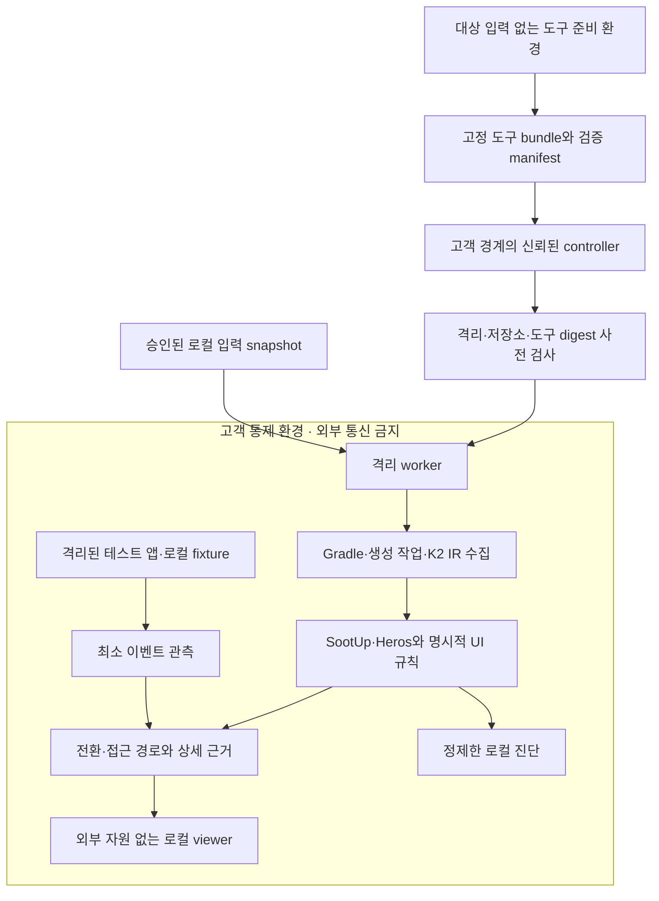

# AI 없는 로컬 분석과 외부 전송 차단 설계

수정일: 2026-10-15. 이 문서는 [화면 연결·접근 경로 설계](12-transition-and-access-path-design.md)의 필수 실행 계약이다. Linux/WSL2 x86-64의 namespace·seccomp runner, bundle 검사, 독립 syscall 감사와 합성 비전송 시험을 추가했다. **검증 범위는 [14번 구현 기록](14-offline-transitions-implementation.md)에 한정한다.** 일반 Gradle 태스크 실행, Windows 네이티브 실행, viewer·Android 디바이스까지 격리 검증을 마쳤다는 의미는 아니다.

## 1. 요구사항과 보장 범위

제품은 AI 없이 수집·정적 분석·경로 탐색·설명을 수행한다. 코드·class/APK·카탈로그·경로·질의·근거·로그·실행 관측을 고객이 통제하는 경계 밖으로 자동 전송하지 않는다. 분석 실패·미해결·버전 미지원 때에도 외부 AI, 검색, 원격 디컴파일, 지원 서버로 우회하지 않는다. 완전한 분석이 불가능하면 해당 범위와 이유를 보고한다.

고객 통제 경계는 관리자가 승인한 PC/사내 실행 호스트, 격리 worker, 전용 로컬 저장소, 로컬 viewer와 선택한 테스트 디바이스다. `사내 주소`라는 이유로 모든 내부 서비스에 통신을 허용하지 않는다. 초기 엄격 모드는 원격 분석 서비스·원격 캐시·외부 SaaS를 지원하지 않는다. 사용자 환경 밖에서 실행되는 hosted CI도 이 경계에 포함하지 않는다.

요구는 세 가지로 나누어 인수한다.

| 요구 | 확인해야 하는 것 | 부족한 증거 |
| --- | --- | --- |
| AI 미사용 | runtime 의존성·실행 경로에 LLM/embedding/AI agent가 없음 | AI API key가 설정되지 않았다는 사실 |
| 외부 전송 차단 | 입력을 읽는 모든 프로세스와 저장소의 외부 경로가 차단됨 | `--offline`, localhost, 방화벽 UI 표시만 확인 |
| 판정 재현성 | 입력·엔진·규칙·예산이 같을 때 의미 결과와 근거가 일치 | 같은 화면 이름이 다시 출력됨 |

사용자가 허용한 향후 AI 검토는 외부 전송 없는 자체 모델에 한정한다. 현재 제품에는 자체 모델도 넣지 않는다. 향후 모델을 추가하려면 가중치 준비, inference·로그·telemetry 경로, 프로세스 격리를 별도 검증해야 하며 외부 endpoint로 설정만 바꿔 연결되는 확장 지점은 이번에 만들지 않는다.

호스트 관리자·커널·하이퍼바이저가 침해된 상황, 승인된 사용자의 고의 반출, 전력/시간 같은 물리적 부채널까지 막는 제품이라고 주장하지 않는다. 신뢰하는 호스트/OS와 지정된 저장소라는 전제를 명시한다. 반면 빌드 script·compiler plugin·입력 parser의 자식 프로세스나 일반적인 외부 통신 시도는 방어 범위에 포함한다.

## 2. 현재 구현과 필요한 변경

기준 구현은 `82af184`다. 아래는 코드에서 확인한 실행 구조이며 전체 의존성 보안 감사 결과는 아니다.

| 현재 상태 | 필요한 변경 |
| --- | --- |
| `AnalyzeCatalogTask`가 `ExecOperations.javaexec`로 분석 JVM 실행 | 입력을 읽기 전에 전체 수집·분석을 격리하는 runner 추가 |
| 별도 Kotlin 수집 컴파일이 기존 variant의 생성 작업·compiler plugin을 사용 | Gradle 설정 평가, buildSrc, KSP/KAPT·worker·daemon까지 같은 격리 안에서 실행 |
| 카탈로그·분석 태스크가 `@CacheableTask` | 기존 Gradle 원격 캐시로 결과가 갈 수 있으므로 격리 실행의 캐시 계약 분리 |
| `build/reports`·`intermediates`·temporaryDir에 결과와 입력 경로 저장 | 전용 비동기화 저장소, 상대 경로/ID, 접근 권한·보존·오류 정책 추가 |
| 공개 저장소 CI에 verification report 업로드 단계 존재 | 공개 합성 fixture CI와 고객 코드 분석 runner를 분리 |
| 소스 분석 범위에서 외부 AI 연동을 발견하지 않음 | 의존성·실행·실패 경로와 실제 네트워크 검증을 추가; 발견하지 못한 것을 비전송 보장으로 바꾸지 않음 |

동기화 폴더 아래의 작업 디렉터리나 일반 Android Studio 빌드를 격리된 고객 분석 환경으로 간주하지 않는다. 고객 원본을 이미 동기화 폴더에서 관리하는 경우 분석기가 과거 전송을 되돌릴 수 없다. 엄격 분석의 새 입력 복사본과 모든 산출물은 승인된 비동기화 경계에서 취급한다.

## 3. 데이터 흐름과 신뢰 경계

도구 준비 환경에는 고객 소스·내부 카탈로그·로그·빌드 설정을 마운트하지 않는다. controller는 도구 반입과 실행 제어만 담당하며 결과를 원격 서비스로 중계하는 API를 제공하지 않는다. worker→controller 출력 채널도 승인된 파일/프로토콜만 허용한다. 단순히 파일 이름에 `local`을 붙이는 방식으로 신뢰 경계를 만들지 않는다.

| 데이터 | 수집·보관 원칙 | 외부 처리 |
| --- | --- | --- |
| 소스·생성 코드·class·APK·Manifest | 승인한 입력 snapshot; 원본은 읽기 전용, 빌드는 격리 복사본 | 업로드·검색·외부 모델 입력 없음 |
| IR·Jimple·route/조건·자원 문자열 | 정적 의미 해석에 필요한 값은 내부 evidence에 보존 | 내부 문자열도 기밀로 취급 |
| 공개용 JSON·화면 지도·질의 | 프로젝트 상대 경로/ID, 인자 구조·symbolic 값 | 명칭이 `report`여도 자동 공유 없음 |
| 실행 이벤트 | cause/event/host ID, 단계·종류·결과·유실 건수 | 계정/토큰/입력값/URL query/요청·응답 본문 기본 미수집 |
| stdout/stderr·실패 진단·dump | worker 안에서 제한 저장; 외부 controller에는 고정 오류 코드·집계 | 원문 log 자동 업로드/지원 첨부 없음 |
| 캐시·임시 파일·상세 근거 | 동일 고객/프로젝트 경계, 권한 제한 | 공유 cache·백업·동기화·CI artifact 전송 없음 |

route 상수·리소스 문자열에는 업무 정보나 실수로 포함된 비밀이 있을 수 있다. 정적 분석 전에 전부 지우면 의미 분석이 틀어질 수 있으므로 내부 사실과 화면 표시용 projection을 분리한다. projection은 허용 필드만 생성한다. 비밀 문자열 정규식 제거를 완전한 익명화라고 주장하지 않는다. 해시·패키지명·경로 개수도 자동 외부 telemetry 대상으로 삼지 않는다.

## 4. 도구 준비와 실행 분리

### 4.1 도구 bundle

JDK·Gradle distribution·Android SDK·Kotlin/Compose compiler·APM·SootUp/Heros·규칙 묶음과 필요한 의존성을 고정한다. 선택적 JADX/Ghidra는 필요할 때만 버전을 고정해 추가한다. manifest에는 구성 요소 버전·artifact hash·검토된 출처·라이선스·서명 검증 결과·규칙 schema를 기록한다. hash 일치는 선택한 바이트와의 동일성 검사이며 코드의 무해함을 보장하지 않는다.

동적 버전·SNAPSHOT 자동 갱신·wrapper/toolchain/SDK 자동 다운로드는 분석 단계에서 금지한다. 의존성 lock과 검증 metadata는 검토된 bundle과 함께 공급한다. Gradle의 [버전 고정](https://docs.gradle.org/current/userguide/dependency_locking.html)과 [의존성 검증](https://docs.gradle.org/current/userguide/dependency_verification.html)은 사용할 수 있지만 파일을 자동 생성했다는 사실만으로 신뢰를 부여하지 않는다.

고객 프로젝트를 인터넷 연결 상태에서 빌드해 cache를 데우는 절차는 기본 준비 방법이 아니다. 그때도 script가 실행되고 내부 dependency 좌표가 노출될 수 있다. 고객은 기존 승인된 사내 저장소/오프라인 패키지에서 bundle을 준비한다. 필요한 내부 artifact 목록은 경계 안에 남기며 누락 의존성을 공개 저장소에 자동 질의하지 않는다. 준비 환경이 네트워크를 쓸 때도 고객 입력과 내부 식별자 접근을 분리한다.

### 4.2 실행 절차

1. 신뢰된 controller가 정책·도구 digest·저장소 승인을 검사한다. 경로 metadata 검사 외 대상 파일 내용은 아직 읽지 않는다.
2. worker 격리, 외부 통신 차단, 출력·임시 저장소, 자식 프로세스 제어를 먼저 설정한다. 실패하면 `ISOLATION_UNAVAILABLE`로 중단한다.
3. 승인된 입력을 격리 영역으로 읽고 snapshot/digest를 고정한다. 실행 중 원본 변경은 다른 분석 세대로 취급한다.
4. 전용 Gradle User Home·JDK·SDK·TEMP를 사용해 수집한다. 사용자 전역 init script, 공유 daemon, 개인 계정 자격 증명, SSH/cloud/AI key, proxy 설정을 상속하지 않는다. 필요한 환경변수만 allowlist로 전달한다.
5. 고정 dependency cache를 이용해 오프라인 컴파일·분석한다. 누락이면 `DEPENDENCY_NOT_PREPARED`로 중단하고 로컬 목록만 제공한다. 다운로드 재시도나 격리 완화는 하지 않는다.
6. 정적 분석·경로 탐색을 수행하고 새 generation 안에서 스키마·ID·fingerprint를 검사한다. 보안 상태와 완료 인덱스까지 검증한 결과만 정상 결과로 공개한다.
7. 실패·취소 시 모든 descendant 종료와 격리 자원 상태를 확인한다. 확인할 수 없으면 `CLEANUP_INCOMPLETE`로 기록하고 worker를 재사용하지 않는다. 격리를 해제한 채 살아 있는 프로세스를 남기지 않는다.

수집 컴파일은 사용자 build script와 compiler plugin을 실행한다. 정적 분석기가 앱의 함수 본문을 실행하지 않는다는 사실과 이 빌드 실행을 구분한다. Gradle 설정을 읽고 나서 plugin 내부에서 네트워크를 막으면 이미 늦을 수 있으므로 차단 책임은 plugin보다 바깥의 runner에 있다.

## 5. 외부 통신을 차단하는 실행 구조

### 5.1 OS 수준 격리

정적 worker는 외부 네트워크 인터페이스/경로, host proxy·Docker socket·SSH agent·임의 host IPC를 갖지 않는다. IPv4/IPv6, DNS, TCP/UDP, HTTP proxy, 자식 executable과 실패 보고 경로를 함께 다룬다. 환경변수나 Java 함수 후킹만으로 이 경계를 구현하지 않는다.

| 호스트 | 구현 기준 | 주의점 |
| --- | --- | --- |
| Windows | 격리 VM을 기준으로 NIC·공유 서비스·clipboard·drive redirection을 제한하고 승인된 입출력만 제공 | Job Object는 프로세스 수명 관리 수단이며 네트워크/파일 보안 경계를 대신하지 않음; 검증되지 않은 플랫폼은 실행 거부 |
| Linux | 별도 network/mount namespace 또는 VM, network 없음, 최소 권한·capability 제거·파일 mount 제한 | container에 host network/socket/과도한 권한을 주지 않음; 악성 입력 대비 강한 경계는 VM 선택 |
| 사내 CI | 위와 같은 전용 격리 worker와 고객 내부 controller·저장소 | self-hosted라는 이름만으로 안전하지 않음; SaaS CI controller로 stdout/artifact가 전달되는 구성은 금지 |

구현 시 사용할 수 있는 원시 기능은 [Docker의 network none](https://docs.docker.com/engine/containers/run/#network-settings)이나 [Windows Sandbox 설정](https://learn.microsoft.com/en-us/windows/security/application-security/application-isolation/windows-sandbox/windows-sandbox-configure-using-wsb-file) 등이다. 이 문서는 특정 기능 하나로 보장이 완성된다고 가정하지 않는다. 지원 OS별 backend와 host 통합 경로를 구현·실측한 조합만 지원 표에 올린다. Windows Sandbox 기본 설정도 검증된 제품 구성으로 간주하지 않는다.

Gradle의 내부 통신이 필요하면 격리 namespace 내부의 해당 프로세스 사이에만 허용한다. worker의 loopback에서 host 프록시나 외부로 중계하는 서비스에 접근할 수 없어야 한다. 외부 제어면과는 file/pipe 등 제한된 채널을 사용하며 controller에 임의 URL fetch·shell 실행 기능을 노출하지 않는다.

### 5.2 Gradle과 캐시

`--offline`은 dependency resolution에 대한 정책이며 임의 build script의 네트워크 호출을 차단하는 보안 장치가 아니다. 필요한 artifact가 없으면 실패한다. [Gradle offline 계약](https://docs.gradle.org/current/userguide/dependency_caching.html#sec:offline-mode)

초기 격리 모드는 task-output build cache를 끄고 전용 workspace의 `UP-TO-DATE`를 유지한다. 원격 cache read/push, Build Scan·telemetry, 자동 crash/report 업로드, source map·심볼 업로드, 원격 테스트 장치와 build distribution을 금지한다. build script가 이 설정을 우회해도 OS 경계가 전송을 차단해야 한다. [Gradle build cache](https://docs.gradle.org/current/userguide/build_cache.html)는 태스크 출력을 로컬 또는 원격에 저장할 수 있으므로 캐시 히트도 보호 대상이다.

수집 workspace는 고객·프로젝트·variant·도구 bundle별로 격리해 보존할 수 있다. 검증된 동일 입력에서는 `UP-TO-DATE`를 사용하고, 원본 소스를 건드리거나 매번 `clean`해 분석을 강제하지 않는다. 이전 프로세스는 종료하고 새 실행의 격리는 다시 검증한다. 보존 공간의 source snapshot·권한·정책이 다르면 해당 입력을 무효화한다.

후속 local-only cache는 동일 고객·프로젝트 경계에서만 사용한다. `input/tool/rule/schema/policy` digest를 포함하고 격리 밖에서 만든 결과를 보안 검증된 결과로 받아들이지 않는다. cache를 잘못 무효화하지 않도록 분석 결과와 실행 정책 기록을 분리한다. 실행 정책 기록·audit는 매번 다시 생성하며 과거의 네트워크 검증을 재사용하지 않는다.

### 5.3 로컬 viewer와 출력

초기 제품은 로컬 JSON 조회만으로 동작할 수 있어야 한다. viewer를 제공하면 JS/CSS/font/그래프 renderer를 함께 배포하고 CDN, analytics, error tracking, 원격 source map, 외부 이미지/링크 자동 조회를 넣지 않는다. 이름·label·URI·코드 조각은 신뢰하지 않는 텍스트로 표시하고 HTML/script로 실행하지 않는다. 출력 schema에 임의 HTML을 허용하지 않는다.

로컬 서버는 loopback에만 바인딩하고 세션 인증, Host/Origin 검사, CSRF·DNS rebinding 방어를 적용한다. 로컬 인증 토큰을 URL query·접근 로그에 넣지 않는다. CSP와 worker/WebSocket까지 포함한 외부 연결 정책을 적용하고 서버에는 일반 URL proxy가 없어야 한다. `localhost` 자체는 다른 웹페이지나 같은 호스트 프로그램으로부터의 인증 경계가 아니다.

엄격 모드는 전용 viewer 환경을 사용하며 승인하지 않은 확장 프로그램·cloud sync·브라우저 crash upload를 허용하지 않는다. 일반 브라우저/IDE로 결과를 여는 행동은 승인된 고객 경계 안에서만 허용한다. 이 도구들이 외부 AI 기능으로 파일을 읽을 수 있으면 비전송 보장 범위로 표시하지 않는다.

## 6. 저장소와 보존

민감 산출물은 고객이 승인한 전용 디렉터리에 두고 현재 사용자/서비스 계정만 접근하도록 권한을 설정한다. 소스·evidence·임시 파일·heap dump·로그·dependency 분석 캐시를 같은 정책으로 취급한다. OS 암호화 디스크와 고객의 보존 정책을 사용할 수 있게 하고 원격 백업·동기화 대상에서 제외한다.

OneDrive/Dropbox 같은 알려진 경로와 symlink/junction/reparse point 우회, network drive, 공용 temp, 다른 사용자 읽기 권한을 검사한다. 경로 문자열 검사만으로 모든 동기화 에이전트를 탐지할 수 없으므로 관리자가 지정한 전용 volume과 OS 정책을 신뢰 조건으로 둔다. 확실하지 않으면 `STORAGE_BOUNDARY_UNVERIFIED`로 중단한다. 파일을 열 때의 최종 해석 경로·권한도 검사해 사전 검사 이후 경로 바꿔치기를 다룬다.

기본적으로 자동 업로드·자동 공유·원격 지원 묶음을 제공하지 않는다. 지원 진단은 고정 오류 코드와 민감하지 않도록 검토한 집계만 로컬 파일로 생성한다. 상세 증거를 포함하는 내보내기는 로컬 대상만 선택하고 preview·파일 목록·민감도 경고를 표시한다. 고객 경계 밖으로 반출하는 별도 제품 기능은 이번 범위에 없다.

임시 파일은 성공/실패/취소 시 정리하고 보고서는 명시된 보존 기간에 따라 제거한다. 갑작스러운 종료 이후 남은 worker 저장소는 다음 실행 전에 검사·정리한다. SSD·백업의 복제본까지 파일 삭제로 완전 소거됐다고 주장하지 않는다. cryptographic erase 등이 필요하면 고객 저장소 정책으로 다룬다.

## 7. 실행 관측과 외부 서비스

정적 분석은 디바이스 실행 없이 완료된다. 실제 화면 관측은 별도 기능이며 테스트 앱·SDK가 생성하는 네트워크 트래픽까지 고객 경계 밖으로 나가지 않도록 해야 한다. APM 모듈의 HTTP client를 제거하는 것만으로 앱 전체의 분석·광고·crash SDK 통신을 막을 수 없다.

초기 관측은 외부 네트워크가 없는 에뮬레이터/테스트 디바이스와 로컬 fixture/mock으로 수행한다. 기본 transport는 고객 통제 호스트의 USB ADB 또는 검증된 격리 에뮬레이터 통로다. ADB server는 외부 interface에 공개하지 않으며 wireless ADB·원격 device farm을 사용하지 않는다. USB 장치도 Wi-Fi/셀룰러가 켜져 있으면 외부로 통신할 수 있으므로 장치 측 격리를 검증한다. 연결된 모든 디바이스를 자동 수집하지 않고 명시한 serial/session만 사용한다.

이벤트는 원인·전달·반영·표시의 식별자와 성공/실패 종류를 기록한다. 원본 payload, 인증 토큰, 실제 challengeId/사용자 입력, 화면 캡처, 전체 logcat은 기본 수집하지 않는다. 테스트 fixture의 symbolic ID와 runtime instance ID를 대응시켜 경로를 검사한다. 필요 데이터는 필드별 allowlist와 로컬 저장 정책을 통해 추가한다.

로그인 성공, 서버의 challenge 목록, 외부 결제·웹·앱 이동, App Link 검증을 실서비스에 요청하지 않는다. 격리 때문에 확인하지 못한 조건은 `EXTERNAL_PRECONDITION_UNVERIFIED`다. mock 성공은 해당 fixture 아래의 관측이며 실서비스 접근 성공이 아니다. 외부 URI·업데이트 링크·패키지 저장소 URL을 입력에서 발견해도 자동으로 열거나 검증 요청을 보내지 않는다.

## 8. 출력과 실패 계약

새 파일 이름과 상태값은 제안 계약이며 현재 플러그인이 출력하는 것으로 설명하지 않는다.

| 산출물 | 내용 |
| --- | --- |
| `analysis-manifest.json` | source/class/manifest fingerprint, 엔진·규칙·bundle digest, capabilities, 제한·예산 |
| `execution-policy.json` | 실행 ID, `aiMode=DISABLED`, 정책 digest, 격리 backend/버전, storage/network/cleanup 검증 상태와 로컬 audit 참조 |
| `transitions.json` / `access-paths.json` | 전환·접근 경로 및 근거 참조; 보안 상태와 연결하되 모델 정확성과 구분 |
| 로컬 audit | controller가 관측한 차단/실행/정리 증거; worker가 임의로 PASS를 자체 선언하지 않음 |

`enforcementStatus`는 검증된 backend의 경계 수립·감사에서 나온 값이어야 한다. worker의 `networkDisabled=true` 같은 선언을 보장으로 사용하지 않는다. 실행 시각·프로세스 ID 등 audit의 가변 데이터는 재현성 비교 대상인 정적 JSON과 분리한다. 내부 policy/audit에도 민감 정보가 있을 수 있어 로컬에만 보관한다.

| 실패 | 동작 |
| --- | --- |
| `ISOLATION_UNAVAILABLE` / `STORAGE_BOUNDARY_UNVERIFIED` | 입력 내용 열기 전 중단 |
| `BUNDLE_MISMATCH` / `DEPENDENCY_NOT_PREPARED` | 자동 설치·온라인 fallback 없이 중단 |
| `EGRESS_ATTEMPT_BLOCKED` | 금지 요청·주체를 로컬 audit에 최소 기록; 실행 중단, 새 결과를 정상 완료로 공개하지 않음 |
| `BOUNDARY_LOST` / `AUDIT_UNAVAILABLE` | 즉시 중단·worker 격리 유지; 비전송 검증 성공으로 표시하지 않음 |
| `UNSUPPORTED_SEMANTICS` / 분석 예산 초과 | 보안 경계를 유지하며 PARTIAL·미해결·탐색 제한 반환 |
| `CLEANUP_INCOMPLETE` | worker 재사용 금지·격리 유지; 고객 내부 운영 진단 제공 |

이전 성공 결과는 유지하되 최신 실패 결과로 바꿔 표시하지 않는다. 허가되지 않은 통신 시도가 차단된 사실은 시험 성공의 근거가 될 수 있지만 정상 분석이 완료됐다는 뜻은 아니다. 차단 환경 밖으로 나가는 정보가 관측되면 해당 backend는 인수 실패다.

## 9. 반례와 인수 시험

모든 시험은 공개 합성 fixture와 가짜 canary 값으로 먼저 수행한다. 네트워크 시험 수신기는 고객 시험 경계 안에 두며 고객 코드를 인터넷으로 보내는 방식으로 검증하지 않는다. mock 외부망과 controller 쪽에서 traffic을 관측해 분석 프로세스의 자체 보고와 독립적으로 검사한다. OS별 지원 backend를 따로 시험한다.

| 시험 | 기대 결과 |
| --- | --- |
| 의존성이 준비된 Compose 샘플·룰업 입력을 외부 통신 없는 환경에서 분석 | 기본 분석 완료; 기존 결과/반례와 일치; 외부 트래픽 없음 |
| dependency cache 하나 누락 | 누락 진단만 로컬 출력, download/DNS 재시도 없음 |
| Gradle settings/buildSrc/KSP plugin이 DNS·HTTP·UDP/IPv6 전송 시도 | 입력 내용이 경계 밖에 나오기 전에 차단; 중단·audit |
| compiler/분석기가 child shell·curl·PowerShell·다른 JVM으로 전송 시도 | descendant에도 같은 차단 적용 |
| 기존 daemon, proxy env, host loopback relay, Docker/SSH socket 사용 시도 | 상속/접근 거부; 우회 경로 없음 |
| 원격 cache read/push·Build Scan·crash upload 활성 fixture | 외부 요청 차단; 정상 완료로 표시하지 않음 |
| public CI와 연결된 self-hosted runner stdout/artifact 전송 | 고객 실행 정책에서 부적합 판정; 민감 작업 시작 거부 |
| OneDrive/network path·junction 우회·공용 temp·출력 경로 바꿔치기 | 저장 전 거부; 원문/임시 데이터가 우회 경로에 남지 않음 |
| 코드·route에 가짜 token/URL/HTML/script 삽입 | 내부 의미 분석은 유지, log/지원 projection 누출·viewer 실행·외부 조회 없음 |
| viewer의 외부 font/source map/beacon/WebSocket 요청 | 정책 위반 탐지·차단; 로컬 결과 열람 기능은 동작 |
| stack trace·메모리 부족·취소·강제 종료 | 원문은 경계 내부 제한 저장, 외부 crash 전송 없음; descendant 정리/격리 유지 |
| 이전 정책 cache 또는 다른 프로젝트 evidence 반입 | namespace/provenance 검증으로 거부; 현재 audit를 과거 결과로 대체하지 않음 |
| 테스트 앱의 analytics·login·셀룰러 통신 시도 | 장치 측 차단; fixture 성공과 외부 전제 미검증 구분 |
| 동시 두 분석 세션·규칙 갱신·실행 중 입력 변경 | workspace·권한·generation 분리; 다른 세션 근거 혼합 없음 |

보안 인수는 `전송할 코드가 없어서 요청이 없었음`으로 끝내지 않는다. 통신을 의도적으로 시도하는 fixture가 차단되는지, 정상 offline 분석이 가능한지, 오류·취소·cache·viewer까지 경계가 유지되는지를 함께 확인한다. 테스트 결과는 적용 OS·backend·버전·정책·도구 bundle에 한정한다. 감사 가시성이 없는 backend를 검증 완료로 표시하지 않는다.

재현성은 wall-clock timeout과 병렬 실행 영향을 구분한다. 고정 상태/단계 예산·정렬 기준에서 의미 JSON과 참조를 비교하고, wall-clock deadline으로 중단된 실행은 `TRUNCATED`로 분류해 완전 동일 결과 보장 대상에서 제외한다. 외부 통신 차단과 경로 정확성 TP/FP/FN은 서로 다른 보고서 항목이다.

## 10. 구현 순서와 비용

1. 정책·bundle·출력 schema와 데이터 분류를 고정한다. 고객 입력 없이 합성 canary로 runner backend를 먼저 검증한다.
2. 격리된 Gradle 수집과 분석 JVM을 연결한다. 로컬 로그·실패·cleanup·cache 경계를 검사한다.
3. 12번의 직접 전환·객체/DI/Channel·접근 경로 분석을 같은 경계 안에서 구현한다. 샘플과 룰업의 독립 정답을 대조한다.
4. 최소 이벤트 기반의 격리 관측과 외부 자원 없는 viewer를 추가한다.
5. 실제 미해결 사례가 요구할 때 JADX/Ghidra adapter를 추가하고 동일 보안 시험을 적용한다.

추가 비용은 tool bundle 배포, offline 의존성 관리, VM/worker 시작·디스크 비용, OS별 격리 시험, 원격 cache 미사용, 실서비스 관측 제한이다. 개발 중 일반 로컬 실행을 사용할 수 있어도 격리 인수를 통과하기 전 고객 코드 비전송을 보장하는 배포로 표시하지 않는다. 오픈소스 엔진 사용과 AI 미사용은 필요 조건이며, 이 실행 경계를 대신하는 보안 보장은 아니다.
