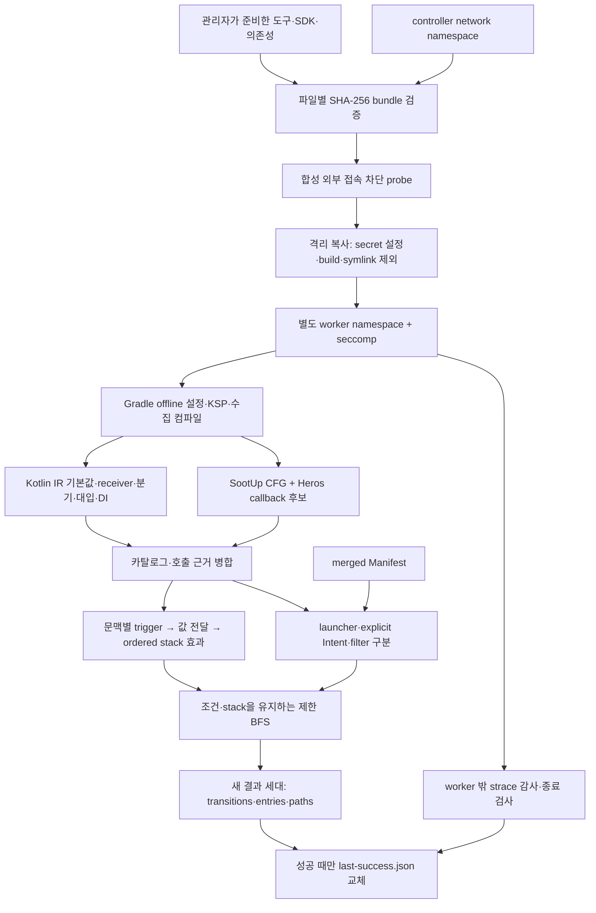

# AI 없는 화면 연결·접근 경로 구현 기록

기준일: 2026-10-15. 전체 목표는 [12번 설계](12-transition-and-access-path-design.md), 보안 계약은 [13번 설계](13-local-analysis-security.md)다. 이 문서는 구현된 범위와 아직 해석하지 못하는 범위를 구분한다.

## 선택 이유

대화에서 요구가 화면 목록 → 누락 원인 → 화면 연결 → 접근 순서로 확장됐다. 연결을 만들려면 함수 이름이나 이벤트 타입이 같다는 사실만으로 부족하다. 클릭에서 전달된 인자, 실제 receiver, collector가 사용하는 stack, 목적지 등록을 같은 문맥에서 이어야 한다. 특히 같은 이벤트 타입을 받는 서로 다른 Channel을 연결하면 존재하지 않는 경로가 만들어진다.

보안 요구에 따라 제품 실행에는 AI 모델·LLM API·embedding·외부 검색·원격 분석 fallback을 추가하지 않았다. 기존 Kotlin IR와 SootUp/Heros를 사용하고 Android/Compose/Hilt/Channel의 제한된 의미 규칙을 직접 작성했다. REA 에이전트나 Ghidra를 실행 의존성으로 넣지 않았다. Ghidra/JADX는 실제 바이너리 미해결 사례가 있을 때 별도 adapter로 검토한다.

호출 후보를 그대로 화면 연결로 바꾸지 않는다. SootUp/Heros의 후보와 소스의 정확한 override signature를 receiver의 구현 클래스와 대조한다. 객체를 입증하지 못한 virtual dispatch는 미해결이다. 채널 이동에는 동일 stream identity, 활성 collector, 같은 host의 stack, 수신 callback의 실제 stack 효과가 필요하다. 전달 성공은 정적 분석으로 관측한 사실이 아니므로 조건으로 남긴다.

## 파이프라인



수집 컴파일은 기존 앱 컴파일과 분리한다. SootUp CFG는 normal/exception successor와 source bridge 상태를 기록한다. 전환 해석기는 source IR 제어 흐름과 프레임워크 요약을 사용한다. JVM CFG를 내보낸다는 사실이 예외·loop·전체 heap을 모두 해석했다는 의미는 아니다.

## 구현 계약

| 영역 | 구현 | 미지원·보수적 처리 |
| --- | --- | --- |
| IR | 기본 인자, 명시 인자 위치, receiver, bound 함수 참조, 클래스/필드/DI annotation, 정확한 override symbol, 대입, 조건·return target·choice·spread | 알 수 없는 IR 종류와 깊이 제한은 UNKNOWN |
| 목적지 | host/provider/registration 문맥, 유한 map의 key 선택 → 저장된 render 실제 호출 확인 | 동적 map, 실행하지 않은 renderer는 확정 목적지 아님 |
| trigger | 알려진 clickable/Button/BackHandler/LaunchedEffect 슬롯, enabled 조건, callback 전달 | 이름만 비슷한 API 자동 연결 금지; 전역 overlay 아직 미지원 |
| 전달 | 직접 호출, 정확한 receiver override, bound callback, 제한된 CompositionLocal, SingletonComponent의 단일 무자격 Hilt Binds/Inject | qualifier·다중 binding·Providers·unscoped 객체·사용자 ViewModel owner/key는 미해결 |
| Channel | 동일 객체와 실제 collector의 stack capture 증거, 경쟁 collector별 대안, send/trySend 요청·수락/전달 조건 | rendezvous·buffer·취소·실패를 성공 관측으로 표시하지 않음 |
| stack | PUSH, CLEAR, APPEND_ALL, POP의 순서 보존, host identity, choice별 상관관계 | indexed insertion, 일반 리스트, 불명확한 host는 확정 이동 아님 |
| 시작점 | merged Manifest의 launcher, alias, explicit Intent, browsable filter 별도 기록; onCreate→root→host | URI parser 존재만으로 외부 진입 생성 금지 |
| 경로 | launcher 초기 stack에서 BFS, 분기 모순 제거, 최대 깊이/상태/경로/stack suffix | 복원·cold/warm·인증 후 pending 소비 전체 상태 머신은 미지원 |
| 상태·예외 | 상태 버전 계약, early/nonlocal return, 미지원 쓰기/try/loop 진단 | 상태 쓰기의 일반 heap/reducer 해석, runtime 관측은 미구현 |

`RESOLVED_IN_MODEL`은 지원 모델 안에서 목적지가 연결됐다는 뜻이다. 조건·비동기 전달·동적 back은 `MAY`, 대상 불명은 `UNRESOLVED`다. 모든 결과의 실행 관측은 `NOT_OBSERVED`다. `PATH_FOUND_IN_STATIC_MODEL`은 실제 로그인이나 서버 응답을 확인한 결과가 아니다. 경로가 없으면 `NO_PATH_FOUND_IN_EXPLORED_MODEL`과 frontier/coverage를 반환한다.

기본 탐색 제한은 depth 20, states 10,000, target별 paths 5, stack suffix 8이다. 한도에 걸리면 `TRUNCATED`를 유지한다. 함수·값 해석도 단계·깊이 상한이 있으며 잘린 분석을 완전한 결과로 표시하지 않는다.

## 태스크와 파일

일반 개발 환경의 실행 예시다. 아래 Gradle 명령 자체에는 외부 통신 차단 보장이 없다.

```bash
./gradlew -p samples/compose-app :app:apmFindDebugAccessPaths
./gradlew -p samples/compose-app :app:apmFindDebugAccessPaths -Papm.accessQuery=query.json
python3 scripts/verify-transitions.py
```

| 태스크 | 산출물 |
| --- | --- |
| `apmLinkDebugTransitions` | `build/reports/android-apm/catalog/debug/transitions.json` |
| `apmCollectDebugEntryPoints` | 같은 디렉터리의 `entry-points.json` |
| `apmFindDebugAccessPaths` | 같은 디렉터리의 `access-paths.json` |
| 내부 근거 | `build/intermediates/android-apm/debug/analysis/{linked-facts,transition-evidence}.json` |

query 예시는 `{"targetContextRefs":["context:…"],"maxDepth":10,"maxPathsPerTarget":3}`다. target을 생략하면 모든 문맥을 조회한다. query만 바꾸면 수집·전환을 재사용한다. 잘못된 query나 다른 catalog fingerprint의 entry 자료는 거부한다. 내부 근거를 새 규칙으로 재해석할 때는 `dev.androidapm.catalog.TransitionMain`을 격리 runner 안에서 실행할 수 있다.

## 외부 통신 차단 실행

지원 backend는 Linux/WSL2 **x86-64**, 비root 사용자, 승인된 user/network/PID namespace, bubblewrap, strace, OpenJDK 17/21이다. Windows 네이티브 backend는 제공하지 않는다. 필요한 도구가 없거나 namespace를 만들 수 없으면 거부한다. runner가 방화벽/OS 설정을 자동 완화하지 않는다.

관리자가 대상 코드가 없는 준비 환경에서 도구·SDK·의존성을 확보한다. bundle에는 `gradle-home/wrapper/dists`, `gradle-home/caches/modules-2`, `sdk`, 선택적인 공개 도구 `toolkit-stage/project`를 둔다. 분석 중 SDK·Gradle·Maven 다운로드는 허용하지 않는다. 사설 artifact를 포함하면 bundle도 고객 내부 자료로 관리한다. license는 관리자가 별도로 승인한 것을 사용한다.

```bash
# private-root와 bundle은 승인된 Linux 로컬 저장소, 사용자 소유 0700이어야 한다.
python3 scripts/runner_bundle.py /private/apm/bundle
python3 scripts/offline_runner.py \
  --private-root /private/apm --source /path/to/public-or-customer/project \
  --bundle /private/apm/bundle --jdk 21 --timeout 2400 \
  -- /usr/bin/python3 /bundle/toolkit-stage/project/scripts/offline_consumer.py
```

`offline_consumer.py`는 현재 Kotlin DSL root settings/build를 가진 소비 프로젝트의 **복사본**에 included build와 플러그인을 연결하는 검증용 adapter다. 원본을 수정하지 않는다. 다른 빌드 구조는 별도 adapter가 필요하다. 샘플은 worker 안에서 `scripts/offline_gradle.py`를 실행한다. 기본 Gradle heap은 8 GiB이며 준비된 RAM과 앱 크기에 맞게 `--heap`을 명시한다.

controller도 별도의 network namespace에 들어간 후에 소스·로그를 읽는다. 신뢰하는 복사 단계만 원본을 read-only mount하고, 실제 build worker에는 원본 경로를 제공하지 않는다. 원본의 local.properties, keystore.properties, google-services.json, 키 파일, host credentials/sockets와 proxy 환경을 제외한다. 복사본의 SDK 경로와 시험용 inert URL만 생성한다.

worker의 네트워크 namespace에는 외부 인터페이스가 없다. 내부 loopback은 Gradle IPC용으로만 사용하며 host loopback relay에는 닿지 않는다. 별도 PID namespace, 최소 mount, 환경 초기화, seccomp로 ptrace/namespace 변경/CLONE_UNTRACED/io_uring 우회를 제한한다. strace는 worker 밖에서 자식을 추적한다. 외부 connect/send 시도는 차단 뒤 실행 실패로 판정하고 결과를 성공 세대로 공개하지 않는다.

모든 실행은 새 probe·audit·runId를 갖는다. 정책은 `linux-bwrap-v3`, bundle과 accepted input snapshot은 SHA-256으로 식별한다. 실패·취소 자료는 private run에 격리 보관하고 `last-success.json`은 성공한 새 세대만 atomic replace한다. audit/log는 worker가 수정할 수 없고 CLI는 상태/runId만 출력한다. OneDrive·symlink·네트워크 파일시스템·알려진 hosted CI controller는 고객 실행에서 거부한다.

### 네이티브 크래시에서 발견한 추가 경계

룰업 진단 재해석에서 Ubuntu OpenJDK 21의 G1 GC가 SIGSEGV로 종료됐다. 이때 WSL의 `kernel.core_pattern=|/wsl-capture-crash …`가 **worker 밖의 Windows 임시 디렉터리**에 덤프를 만들었다. 이 실행을 비전송 검증 성공으로 인정하지 않았고, 해당 JVM 시험이 생성한 덤프는 삭제했다. 대상 코드·로그·덤프를 GitHub에 올리지 않았다.

Linux의 pipe core helper는 초기 host namespace에서 실행되며 `RLIMIT_CORE`만으로는 차단되지 않는다. 따라서 v3는 host pipe/socket crash collector가 설정돼 있으면 입력을 읽기 전에 `HOST_CRASH_COLLECTOR_FORBIDDEN`으로 거부한다. 일반 파일 대상인 승인 환경에서 controller·worker·자식의 core hard limit을 0으로 고정하고 JVM 자체 core 생성도 끈다. 실행 후 host 정책 변경도 검사한다. [Linux core(5)](https://man7.org/linux/man-pages/man5/core.5.html)

runner는 호스트의 core 정책을 자동 변경하지 않는다. 관리자가 승인한 시험 환경을 준비해야 한다. 공개 CI는 폐기되는 runner에서 이를 명시적으로 설정한다. 로컬 WSL의 임시 변경은 별도 승인·복원 절차가 필요하다. 네트워크 namespace만 확인한 이전 실행을 v3 검증으로 재사용하지 않는다. 격리 실행 JVM은 Serial GC를 사용해 발견된 G1 경로를 피하며, JVM 장애 자체가 보안 통과를 의미하지 않는다.

호스트 관리자·커널·system JDK/라이브러리는 신뢰한다. bundle은 실행 전후 해시를 검증하며 외부 host의 악의적인 동시 변경을 하드웨어 수준에서 방어한다고 주장하지 않는다. private 파일의 보존/삭제는 고객 운영 정책에 맡긴다. viewer, Android 테스트 장치, VM snapshot 폐기까지 구현된 기능은 아니다.

## 검증

공개 반례는 `TransitionAnalysisTest`, `CatalogCollectorTest`, `EntryPointsTest`, `test_offline_runner.py`, `verify-offline-gradle.py`에서 재현한다. 정적 모델과 보안 경계는 서로 다른 테스트로 검증한다.

- 일반 리스트/disabled callback/다중 host, 조건부 return, choice 상관관계, reset 후 POP, indexed insertion, 잘못된 시작 조건, 예산 초과.
- map duplicate key의 last-wins, 저장된 renderer의 실제 호출, bound callback과 exact override, Singleton DI와 unscoped 거부, 같은 이벤트의 서로 다른 Channel.
- Manifest parser/filter 구분, alias, XML 외부 엔티티 거부, 다른 catalog의 근거 혼입 거부.
- query-only 캐시, query 실패 시 이전 결과 보존, compiler/Compose 기존 회귀.
- DNS/HTTP/TCP/IPv6/child Python·JVM, host loopback/proxy/socket, secret 파일·symlink·동기화 경로, 감사 우회 syscall, 실패/취소/daemon 자식, bundle 변경, 매 실행 새 감사.
- 실제 Gradle settings/buildSrc/child JVM 전송 시도 3건은 `EGRESS_ATTEMPT_BLOCKED`; cache 누락은 다운로드 없이 `WORKER_FAILED`; 정상 공개 fixture는 `COMPLETED`.

공개 CI는 저장소의 합성 자료만 실행한다. 고객 코드·카탈로그·경로·worker.log/network.trace를 업로드하는 단계는 없다. CI의 OS 설정은 폐기되는 hosted runner의 합성 시험용이며 고객 runner의 보안 정책을 자동 변경하지 않는다.

v3의 공개 CI에서 build와 offline-boundary가 통과했다. 로컬 WSL에서도 관리자가 승인한 임시 core 정책을 적용한 뒤 보안 반례 18개가 통과했으며, 시험 종료 후 기존 WSL 정책 복원을 확인했다. 임시 변경 helper는 제품 runner에 포함하지 않는다.

룰업은 37개 모듈의 수집 후 메모리 부족을 수정했고, v3 진단 재해석에서 SootUp/Heros가 3,586개 클래스·27,648개 메서드·521개 호출 사이트를 연결했다. 해당 재해석은 외부 통신 시도 0건으로 완료됐지만, 화면 전환은 0건이었다. 등록 화면 48개를 찾았다는 수치를 전환 분석 성공으로 사용하지 않는다.

실제 자료에서 두 가지 원인을 확인해 수정했다. Kotlin getter의 special name을 익명 함수처럼 처리해 모듈별 소스 위치를 ID에 넣던 문제는 공개/member accessor의 qualified signature로 교정했다. 인터페이스 getter의 호출·선언·override가 같은 ID를 사용하는 실제 컴파일러 회귀를 추가했다. 또 전역 값 평가 예산이 첫 화면에서 소진되던 문제는 문맥별 예산과 환경·재귀 경로를 구분한 메모화로 수정했다. 한 문맥의 한도 초과는 전체 coverage에 남기되 다음 화면의 계산을 막지 않는다. 환경이 다른 값을 캐시로 섞지 않는 반례도 검사한다. 대용량 fingerprint는 JSON을 버퍼링해 스트리밍하며 전체 문자열 사본을 만들지 않는다.

기본 인자 바인딩은 환경을 순차 갱신하므로 캐시 키에는 평가 시점의 복사본을 사용한다. 큰 앱의 JVM 진단에서는 재귀 검사 중 호출 환경을 반복 직렬화하는 비용을 확인했다. 재귀 검사는 메모리 안의 정확한 구조 동등성으로 수행하고, 동일 환경·closure의 digest는 제한된 캐시에 재사용한다. 출력 근거의 SHA-256 계약은 유지하며 실행 로그에는 문맥 순번만 추가한다.

미연결 진단은 실제 렌더링 증명이 끝난 뒤 생성한다. 단일 content slot의 생성 지점과 후보 ID가 정확히 일치할 때만 해당 후보를 등록된 것으로 처리한다. 같은 경로에서 덮어쓴 후보, 렌더링을 호출하지 않은 후보, 저장 필드가 모호한 후보를 함수 이름만으로 해소하지 않는다.

실제 IR에서는 상속된 `current` getter의 소유자가 `CompositionLocal` 또는 `ProvidableCompositionLocal`로 기록된다. 두 공식 타입을 같은 summary로 처리하되, 정확한 provider identity가 현재 환경에 있을 때만 값을 전달한다. 다른 local이나 provider가 없는 경우는 미해결로 유지한다.

최상위 public 프로퍼티의 backing field도 모듈 간 ID를 일치시킨다. Kotlin이 선언 모듈의 backing field 자체를 private으로 표시하더라도 프로퍼티의 visibility를 기준으로 ID를 선택한다. 공개 프로퍼티는 qualified name을 쓰고 실제 private 프로퍼티는 파일 범위를 유지한다. 두 모듈을 별도로 컴파일하여 선언과 외부 참조가 일치하는지 검증한다. 기존 카탈로그를 이름 유사도로 이어 붙이지 않고 수집기를 갱신한 뒤 다시 빌드한다.

렌더링 중 독립적인 조건문이 끝났는데도 조건이 뒤쪽 UI에 누적되던 문제는 합류 지점에서 교정했다. 모든 분기가 정상 종료하고 반환값·환경·효과가 같을 때만 합류한다. 각 분기 안에서 발견한 버튼의 조건은 남긴다. 이벤트 콜백, 조기 return, 서로 다른 값, 탐색 예산으로 잘린 분기는 합류 대상이 아니다. 이는 트리거의 조합 폭증과 무관한 화면 상태가 뒤쪽 버튼의 필수 조건으로 붙는 오류를 함께 줄인다.

문장 안에서만 쓰인 스타일 인자 choice와 사용하지 않는 호출 결과는 문장 종료 시 제거한다. 그 뒤 환경·효과가 같고 모든 경로가 정상 종료했을 때만 다시 합류한다. choice 결과를 변수에 저장하면 환경 차이가 남으므로 분기를 유지한다. 조건문 안 버튼, 뒤쪽 독립 버튼, 값 저장, 조기 return을 함께 반례로 검사한다.

렌더링 탐색과 클릭·effect 실행은 별도의 호출 스택과 계산 예산을 사용한다. 이벤트를 등록한 UI의 중첩 깊이를 이벤트 실행 깊이에 더하면 복잡한 UI 안의 정상 콜백이 제한에 걸리고, 이벤트 하나가 뒤쪽 버튼 수집 예산까지 소진한다. 각 이벤트는 새 예산과 값 캐시로 분석한 뒤 렌더링의 예산·캐시로 돌아온다. 이벤트의 한도 초과는 전체 coverage와 해당 문맥의 `CONTROL_FLOW_DEPTH_LIMIT`/`CONTROL_FLOW_VISIT_LIMIT` 진단에 남긴다. 깊은 렌더·이벤트 조합과, 한도 초과 이벤트 뒤의 버튼을 함께 검증한다.

이벤트 타입의 동등성은 사용자 정의 `equals`를 존중한다. 서로 다른 구체 타입이고 소스 계층 전체에 사용자 정의 비교가 없다는 근거가 있을 때만 기본·Kotlin 생성 동등성이 false임을 사용한다. 라이브러리 부모나 사용자 정의·상속 비교가 있으면 predicate로 남긴다. 같은 트리거 문맥·콜백·enabled 값·guard 조합은 이미 구한 근거를 재사용하며 enabled 값이 다른 사례는 합치지 않는다.

표현식 안의 제어 흐름도 수집한다. `val route = pending ?: return Empty`를 마지막 값만 남기는 방식으로 평탄화하면 조기 반환 분기가 사라지고 이후 목적지를 잘못 선택한다. `BLOCK_EXPRESSION`은 임시 변수와 평가 순서를, `RETURN_EXPRESSION`/`THROW_EXPRESSION`은 종료 대상과 값을 보존한다. 종료된 인자 뒤의 호출·할당은 실행하지 않는다. 새 capability `EXPRESSION_CONTROL_FLOW_V1`이 없는 스냅샷은 재수집을 요구한다. 실제 Kotlin 컴파일러에서 null/nonnull Elvis 반환과 throw 반례를 검증한다. 예외 catch/finally 전체 모델링을 완료했다는 뜻은 아니다.

경로 탐색은 출발 문맥별 전환 인덱스를 만들고 기존 순서를 유지한다. 매 상태마다 전체 전환 목록을 다시 순회하지 않는다. 한 질의 안의 불변 predicate는 digest를 재사용해 같은 조건을 수백만 번 직렬화하지 않는다. 서로 다른 객체에 담긴 같은 조건은 canonical digest로 비교하고 상태 버전은 별도 키로 유지한다. 캐시는 질의 밖으로 공유하지 않는다. 같은 상태 버전에서 `p`와 `!p`가 동시에 참인 경로는 제거하며, 상태 쓰기로 버전이 달라진 조건은 별개로 유지한다. 탐색 한도와 미발견·도달 불가의 구분은 유지한다.

최종 인수는 수정한 수집기로 만든 새 복사본의 룰업 전환·병합 Manifest 기반 launcher 경로로 판정한다. Home→Detail 전환의 채널 전달 근거, 그 전환을 포함하는 launcher 경로, 동일 실행의 v3 격리 정책 성공·외부 통신 시도 0건을 함께 확인해야 한다. 공개 샘플의 launcher→Home→Detail도 별도로 검증한다. 인수 완료와 최신 CI 통과 전에는 머지하지 않는다. 진단용 raw Manifest, 임시 호환 매핑, 이전 실패 실행을 최종 검증 근거로 승격하지 않는다.

이 구현의 실행별 수치·인수 판정·남은 제한은 [PR #7의 검증 기록](https://github.com/android-apm-tool/android-apm/pull/7)에 기록한다. 원본 소스·카탈로그·감사 로그는 로컬 private 저장소에 남기고 공개 PR에는 집계만 기록한다. 전체 화면/경로 발견률이나 실제 기기 접근 성공률을 이 테스트 수로 대신하지 않는다.
