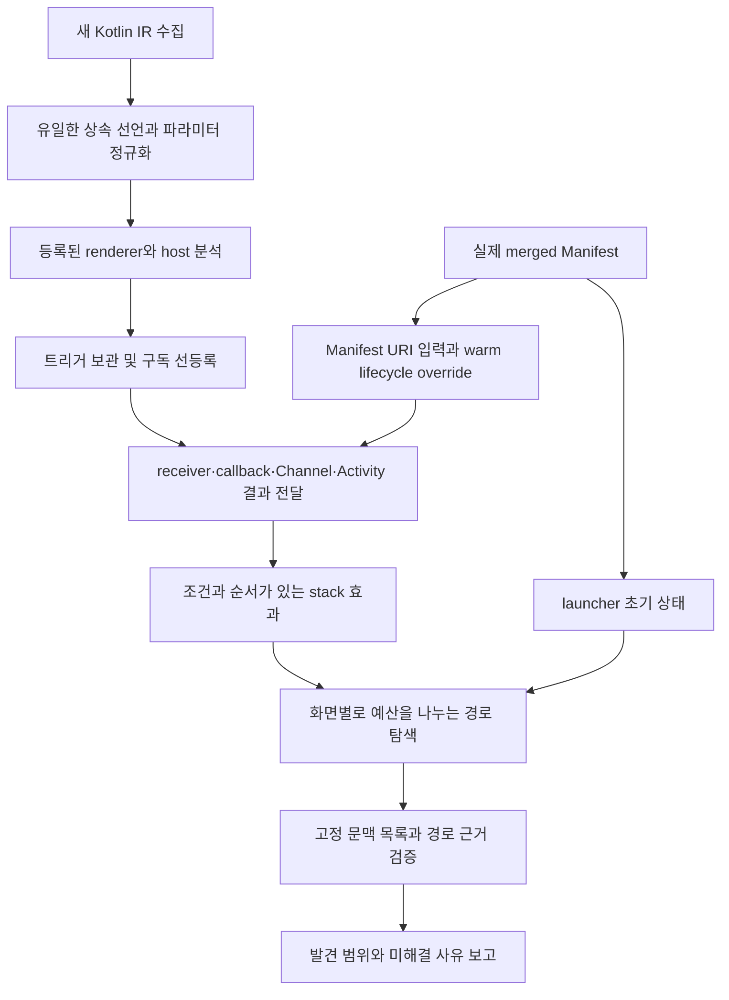

# 접근 경로 발견 범위 개선

## 목표와 분모

룰업의 이전 검증에서는 등록·렌더링이 입증된 화면 문맥 48개 중 25개에 launcher 경로를 제시했다. 52.1%는 정적 모델의 경로 발견 범위이며 정탐률이나 화면 수집 재현율이 아니다. 인수 목표는 같은 48개 문맥 중 최소 46개(95.8%)에 근거를 갖춘 경로를 제시하는 것이다. 외부 초대 링크 전용 화면도 있으므로 사용자와 합의한 전체 지표에는 입증된 외부 링크 경로를 포함한다. launcher만의 발견률과 전체 진입점 발견률은 별도로 집계한다. 미해결 문맥을 분모에서 제외하거나, 디자인 프레임 수와 등록 문맥 수를 혼합하지 않는다.

기존 미발견 23개를 연결 그래프로 점검했을 때 6개는 조건·백스택을 무시한 그래프 연결만 있었고, 12개는 해석된 유입 연결이 없었으며, 5개는 유입 연결이 launcher에서 이어지지 않았다. 조건을 제거한 그래프 연결은 인수 성공으로 계산하지 않는다. 이 분류는 원인을 좁히는 진단이며 실제 접근 불가의 증명이 아니다.

## 손실이 발생한 곳과 수정

### 상속 선언

Kotlin IR의 fake override에는 실행 본문이 없다. 수집기는 해당 선언을 제외했지만 호출 쪽에서는 하위 클래스의 fake override 심벌을 사용했다. 따라서 공통 기반 클래스가 구현한 getter·이벤트 발행 메서드가 소스에 있어도 호출과 본문을 연결하지 못했다.

수집기는 IR의 overriddenSymbols를 따라 유일한 원래 선언을 찾고, 인자도 같은 선언의 파라미터 순서로 식별한다. 이름 검색으로 비슷한 메서드를 연결하지 않는다. 여러 원래 선언이 남는 경우는 합치지 않는다. `INHERITED_CALL_TARGETS_V1` capability가 새 수집 결과를 식별한다. 기존 스냅샷에 이 근거를 소급해서 붙이지 않는다.

호출 해석기는 입증된 receiver의 소스 클래스 계층과 정확한 override 심벌을 사용한다. 적용 가능한 가장 가까운 구현이 유일한 경우에만 호출한다. 다른 하위 클래스나 미입증 receiver의 구현을 가져오지 않는다. 일반 소스의 operator invoke도 함수형 callback과 구분한다.

명시적 `super` 호출은 IR의 superQualifier 근거를 수집하여 지정된 부모 구현으로 연결한다. 이를 일반 virtual 호출처럼 해석하면 부모가 반환할 목적지를 자식의 다른 목적지로 바꾸는 오연결이 생긴다. 실제 컴파일 반례에서 부모 호출과 일반 동적 호출의 목적지가 서로 다르게 유지되는지 검사한다. 이 구분이 없는 예전 snapshot은 `SUPER_CALL_TARGETS_V1` 재수집을 요구하며, 누락된 근거를 추정으로 채우지 않는다.

### UI와 비동기 전달

- Material Button 계열의 정확한 API 심벌에 클릭 슬롯을 추가했다. 동명의 사용자 함수는 자동으로 트리거가 되지 않으며 enabled=false는 이동을 만들지 않는다.
- 이벤트 해석을 렌더링에서 분리하고 composition effect의 구독을 먼저 등록한다. 버튼과 collector의 소스 선언 순서가 연결 결과를 바꾸지 않도록 한다.
- 화면 내부 Channel collector는 동일한 stream identity와 현재 화면 문맥이 필요하다. 다른 화면의 collector는 현재 화면의 송신을 받는 것으로 연결하지 않는다. 전역 collector는 기존 host/stack 소유권 검사를 유지한다.
  필드의 receiver가 미입증이면 화면 문맥으로 소유권을 대체하지 않는다. 로컬 Channel 생성과 객체 필드 Channel의 소유 근거를 구분한다.
- `LocalActivity`의 기본 owner는 Activity의 onCreate → activity.compose.setContent 근거가 있을 때만 제공한다. 명시적 provider가 있으면 그 값을 우선한다. Hilt ViewModel은 증명된 owner와 상수 key로 구분하고, 알 수 없는 owner/key는 미해결이다.
- `runCatching`과 Result의 성공·실패 callback에는 동일 결과에 대한 상반된 조건을 유지한다. 명시적 throw 뒤에 성공 callback을 실행하지 않는다. 지원하지 않는 예외 처리 전체를 해석한다고 주장하지 않는다.
- Activity 결과는 등록된 launcher 객체가 실제 launch 호출의 receiver로 이어져야 전달한다. callback 등록만으로 경로가 생기지 않는다. 외부 Activity의 실행과 결과 전달은 조건이며 `ACTIVITY_RESULT_TRANSFER` 근거를 남긴다.
- 익명 객체 메서드의 자유 변수는 생성 시의 캡처 환경으로 전달한다. 객체별 환경을 구분하여 다른 launcher나 callback을 섞지 않는다.

실제 컴파일 반례에서 추가로 두 손실을 확인했다. immutable 로컬 alias를 거친 callback은 원래 바인딩까지 캡처해야 하며, 익명 클래스의 `<no name provided>`를 제네릭 인자처럼 잘라서는 안 된다. 등록된 클래스 심벌을 먼저 조회하고, 로컬 alias의 참조 근거를 추적한다. 익명 클래스 선언 자체는 객체 생성 실행과 구분하며, 알 수 없는 부작용 문장은 값 평가에서 계속 거부한다.

실제 AndroidX IR의 `LocalActivity`는 getter 호출 또는 backing-field 참조로 나타난다. 두 표현 모두 같은 공식 CompositionLocal 심벌로 해석한다. 필드 이름이 유사한 사용자 구현을 연결하지 않으며 Activity owner 근거가 없거나 명시적 provider가 null이면 공유 ViewModel을 만들지 않는다.

큰 앱에서는 같은 호출 환경을 반복 해시하는 비용도 컸다. immutable 값 레코드의 바인딩 스냅샷에 구조 해시를 보관하고, 원본 맵의 크기와 각 바인딩의 객체 동일성을 확인한 뒤에만 재사용한다. 인자를 순차적으로 채우거나 교체한 맵은 새 스냅샷을 만든다. 재귀 판정도 동일한 구조 동등성을 사용하며 근거의 암호학적 fingerprint를 대체하지 않는다. 캐시는 분석 인스턴스와 문맥 안에서 제한한다. 진행 로그는 문맥·구독·트리거의 단계와 개수만 표시한다.

조건 검사에서도 immutable predicate의 fingerprint만 최대 20,000개 재사용한다. 조건의 참·거짓과 상태 버전, 모순 판정 결과는 각 검사에서 다시 계산한다. 같은 조건이 다른 이벤트나 버전에 등장했다고 이전 판정 결과를 재사용하지 않는다.

격리된 룰업 JVM의 스레드 진단에서는 반복 호출의 캡처 정보를 fingerprint로 만들 때 JSON 문자열을 한 글자씩 쓰는 비용을 확인했다. escaping이 필요 없는 구간은 한 번에 기록하도록 바꿨다. 긴 한글·이모지·제어 문자 문자열의 UTF-8 바이트와 canonical hash를 고정 기대값과 비교한다. JSON 형식과 기존 식별자는 바뀌지 않는다.

### 조건부 콜백과 데이터로 만든 메뉴

`takeIf`/`takeUnless`가 반환하는 callback은 predicate의 결과에 따라 원래 receiver 또는 null이다. predicate를 실제 소스 본문으로 해석하고 두 반환값에 상반된 조건을 붙인다. 이름이 같은 사용자 함수에 이 규칙을 적용하지 않는다. 상수 false 조건과 null callback은 트리거가 되지 않는다. 의미는 [Kotlin takeIf 계약](https://kotlinlang.org/api/core/kotlin-stdlib/kotlin/take-if.html)을 따른다.

`buildList`는 호출마다 별도 builder 상태를 갖는다. 지원하는 `add(element)`를 순서대로 적용하고, 반환된 목록을 `forEach`/`forEachIndexed`에 전달할 때 각 실제 항목과 callback 캡처를 유지한다. 분기·조기 return·빈 목록을 구분한다. 만들기만 하고 렌더링하지 않은 항목은 클릭 가능한 것으로 계산하지 않는다. 미지원 builder 변경(clear, indexed add 등)을 만나면 중단한다. 이전 목록으로 계속 진행하면 이미 지운 메뉴를 접근 가능하다고 오판하기 때문이다.

scope 함수는 callback을 실행하는 것과 반환값을 전달하는 것을 함께 모델링한다. `let`·`run`·`with`는 callback의 결과를, `also`·`apply`는 원래 receiver를 반환한다. 반환값을 버리면 `token.let { Destination(it) }`로 만든 목적지가 Channel에 도달할 때 사라진다. 호출별 평가값에 결과를 저장하고 조기 return·throw는 계속 중단 상태로 전달한다. 실제 컴파일 반례는 다섯 함수의 서로 다른 반환 계약과 종료 뒤 이동이 생기지 않음을 확인한다.

확정된 enum 엔트리는 선언 심벌이 같을 때만 같다. `Enum.equals`는 재정의할 수 없으므로 이 경우의 분기를 미확정으로 늘릴 필요가 없다. 이를 놓치면 스타일이나 화면 모드의 `when`에서 실행 불가능한 분기를 반복해 렌더링 예산을 소진한다. 이름이 같은 다른 enum의 엔트리, 다른 모드에만 등록된 callback은 연결하지 않는 실제 컴파일 반례를 유지한다. symbolic enum 값이나 사용자 클래스의 equals에 이 상수 규칙을 확장하지 않는다.

symbolic enum에는 별도의 모순 규칙을 적용한다. 같은 타입·피연산자·상태 버전이 서로 다른 enum 엔트리와 동시에 같을 수 없다. 비교 대상의 정적 타입이 해당 enum인 경우만 제한하며 Any나 사용자 equals는 추정하지 않는다. 이 배제 관계를 공유 predicate의 `enumConstraint`에도 보관해 보고서 압축 뒤 경로 탐색에서 유지한다. 독립 검증기는 원래 조건식으로부터 제약을 다시 계산해 일치 여부를 검사한다. 다른 변수와 다른 상태 버전은 독립으로 취급한다.

### 입증된 외부 링크 경로

외부 링크를 등록 화면에 직접 연결하지 않는다. 실제 merged Manifest의 VIEW·DEFAULT·BROWSABLE filter에서 구체적인 URI 입력을 만들고, 해당 Activity의 Android lifecycle override인 `onNewIntent` 본문에 Intent 값을 전달한다. URI 파서와 조건 분기를 해석한 결과가 기존 Channel·host 소유권 검사와 순서 있는 stack 효과까지 이어져야 전환이 된다. Manifest 수신 선언이나 파서 반환값만으로는 경로가 생기지 않는다.

현재 지원 범위는 이미 실행 중인 동일 Activity에 전달되는 singleTask/singleTop 입력이다. 시작 상태는 입증된 launcher 경로로 확보한다. `ANDROID_WARM_INTENT_DELIVERED` 조건 및 `EXTERNAL_INTENT_DELIVERY` 근거에 entry, 입력 Intent, lifecycle callback, host를 남긴다. 로그인·계정 상태·서버 성공 조건도 제거하지 않는다. 외부 입력을 포함한 경로는 `LAUNCHER_THEN_WARM_EXTERNAL_INTENT`로 표시하며 cold start 성공으로 표현하지 않는다. Android 전달과 도메인 검증은 관측하지 않았다.

입력 생성은 단순 scheme·host·port·정확한 path·pathPrefix에서 최대 64개로 제한한다. 토큰 위치에는 합성 문자열을 사용하며 실제 초대 토큰을 가져오거나 서버에 요청하지 않는다. wildcard host, MIME, advanced pattern, percent-encoding, query 인자, permission 제한, 미지원 launchMode는 자동 연결하지 않는다. `EXTERNAL_INPUT_DOMAIN_BOUNDED` 진단은 이 입력 집합 밖의 완전성을 보장하지 않음을 나타낸다. 근거는 [Android Intent filter](https://developer.android.com/guide/components/intents-filters)와 [data 요소 규칙](https://developer.android.com/guide/topics/manifest/data-element)이다.

`access-paths.json`은 외부 링크를 포함한 경로를, `launcher-access-paths.json`은 외부 링크 없이 찾은 경로를 기록한다. 동일한 화면 문맥 48개를 두 파일의 분모로 사용한다. 쿼리의 `includeExternalIntents=false`로 외부 전환을 제외할 수 있다.

### 근거 크기와 무손실 공유

큰 앱에서는 동일 조건과 호출 이력이 수많은 효과·전환에 반복되어 JSON이 수 GB가 됐다. `SHARED_CONDITIONS_TRACES_V1`은 조건을 `PREDICATE_REF`로 참조하고 원식을 evidence의 `PREDICATE_DEFINITION`에 한 번 기록한다. Boolean not의 정규화와 expected 값, mutableState 및 version을 함께 보존한다. 상수 조건은 inline으로 남겨 false 조건 제거가 유지된다.

전체 호출 이력은 `traceRef`부터 `TRACE_NODE.previousRef`를 역으로 따라가 복원한다. 순서와 반복을 모두 보존한다. `evidenceRefs`는 직접 호출 및 비동기 전달 근거를 편하게 읽기 위한 일부 참조이며, 전체 이력을 대신하지 않는다. 최종 전환이 참조하지 않는 임시 효과만 제거한다. 미완료 전환의 효과는 진단용으로 유지한다. 테스트는 압축 전후 발견 목적지·경로 단계, 조건 모순, 상태 버전, 전체 이력 복원, 끊어진 참조와 순환 거부를 비교한다.

### 탐색 예산과 완료 조건

렌더링 방문 예산은 문맥당 5,000,000회, 이벤트는 트리거당 100,000회로 분리한다. 이전에는 둘 다 100,000회여서 큰 화면의 후반부 메뉴를 방문하기 전에 렌더링이 중단됐다. 한도 증가는 CPU·메모리 비용을 늘리는 선택이며 완전성을 보장하지 않는다. 깊이 384, 한 단계의 분기 상태 256 제한도 유지하고 실제 제한을 `transitions.json.limits`에 기록한다. 초과 진단은 렌더링인지 특정 트리거인지, 어느 호출 또는 소스 위치에서 처음 초과했는지 구분한다. 이벤트 한도는 렌더링 한도를 높여도 함께 늘어나지 않는다.

방문 한도만 늘리면 안내 문구·스타일의 분기 조합이 같은 출력으로 끝나도 뒤의 UI를 계속 반복한다. 렌더링 함수가 반환할 때 동일한 환경·반환값·heap 상태·효과·종료 상태·불확실성별로 최대 8개의 후속 경로를 유지한다. 남기는 경로의 조건과 호출 근거는 그대로 보존한다. 일부 경로의 조건을 삭제해 합치지 않는다. 이미 함수 안에서 등록한 UI 트리거는 각각의 조건을 유지하고, 이벤트 핸들러에는 이 제한을 적용하지 않는다.

이 선택은 탐색의 축소다. 뒤의 버튼이 생략된 조건에서만 활성화되면 그 경로를 놓칠 수 있다. `RENDER_CONTINUATION_BUDGET_EXCEEDED`와 `TRUNCATED`로 공개하며, `renderContinuationsPerOutcome`에 실제 설정을 기록한다. 반례는 제한 전후를 비교해 남은 경로의 조건이 원래 경로와 일치하고, 다른 반환값이 같은 할당량으로 사라지지 않으며, 새로운 목적지가 만들어지지 않음을 검사한다.

`TransitionMain --diagnostic-context <context-ref> <facts.json> <merged-manifest.xml> <new-output-directory>`는 누락 원인을 좁히는 부분 진단이다. 출력은 `diagnosticOnly=true`이며 경로 보고서를 만들지 않는다. `AccessPaths`도 이 스냅샷을 거부한다. 선택하지 않은 화면의 렌더링·구독 근거가 없으므로 부분 진단의 효과를 최종 발견률에 넣지 않는다. 인수에는 전체 문맥을 같은 입력 세대로 다시 분석한 결과만 사용한다.

기존 단일 BFS 큐는 한 화면의 많은 조건 분기를 먼저 소비해 다른 화면의 확장을 늦췄다. 새 탐색은 현재 보이는 화면 문맥별 큐를 두고 확장 횟수가 적은 큐부터 처리한다. 같은 조건 집합의 나열 순서도 상태의 차이로 계산하지 않는다.

간선, 조건, host, stack 효과, POP 제약은 그대로 검사한다. 모든 경로가 전역 최단 순서로 반환된다고 보장하지 않는다. 예산 내에서 각 목적지에 대한 증거를 확보하는 것을 우선하며 한도 초과는 여전히 `TRUNCATED`다. 조회의 maxDepth/maxStates/maxPathsPerTarget/stackSuffix 제한을 유지한다.

핸들러 해석이 `LIMIT`, `THROW`, `UNSUPPORTED_EFFECT` 등으로 중단된 경우, 그 전에 발견한 stack 효과는 진단용 전환에 보존하되 접근 경로에는 사용하지 않는다. 뒤의 미해석 효과가 목적지를 다시 지울 수 있기 때문이다. `INCOMPLETE_TRANSITION`을 frontier에 남기고 정상 완료된 전환만 인수 집계에 사용한다. 예외 직전 이동이 실제 UI에 나타날 수 있는 경우도 이 모델에서는 미발견으로 남는 보수적 선택이다.

재귀 판정은 함수·이벤트·실제 인자와 receiver·캡처 값을 비교한다. 분석기 내부의 allocation 호출 이력만 비교에서 제외하며 실제 객체 identity는 유지한다. 동일 입력의 재귀를 발견하면 `RECURSION`으로 중단하여 재귀 뒤의 코드를 실행하지 않는다. 입력이 바뀌는 재귀는 계속 해석할 수 있고 기존 깊이·방문 한도는 유지한다. 모델 밖의 heap 상태 변화로 종료되는 재귀는 미해결로 남을 수 있다.

## 파이프라인

## 반례와 인수

공개 합성 테스트는 비활성 버튼, 동명 API, 일반 operator invoke, Result 성공/실패의 모순, 명시적 throw, 미호출 launcher, 다른 launcher, 다른 Channel, 다른 화면의 collector, 서로 다른 ViewModel owner/key, 상속 메서드 인자 바인딩, 고분기 화면의 탐색 독점, false guard를 검사한다. 실제 Kotlin 컴파일 fixture로 상속 심벌이 수집 단계부터 일치하는지도 확인한다.

Result 처리는 실제 표준 라이브러리를 사용하는 Kotlin 컴파일 fixture에서도 검사한다. 일반·확장 `runCatching`의 성공 값이 정확한 목적지까지 전달되는지, 명시적 throw가 성공 경로를 만들지 않는지, 성공의 PUSH와 실패의 CLEAR가 하나의 전환으로 합쳐지지 않는지를 확인한다.

룰업 검증에서는 새 37모듈 수집과 실제 merged Manifest를 사용한다. 화면 문맥의 분모, 성공 실행 정책, 근거 참조, 경로의 시작점·목적지·전환 순서를 확인해야 한다. 95% 도달 여부는 완료된 검증 결과로만 보고한다. 합성 테스트 통과나 CI 성공이 이 수치를 대신하지 않는다.

큰 보고서의 독립 검증은 JSON 레코드를 순차적으로 읽는다. 모든 근거 hash·공유 trace·조건 참조를 검사하고, 저장된 경로에서 참조하는 전환과 효과를 보관해 stack을 처음부터 재생한다. 실제 경로의 조건 집합과 누적 조건, 상태 버전, 외부 Intent와 Manifest 일치도 비교한다. 파일 전체를 메모리에 올릴 수 없다는 이유로 검증을 생략하거나 표본 검사로 대체하지 않는다. 기존에 찾은 25개 launcher 문맥이 유지되는지도 검사한다.

## 보안과 해석 한계

고객 자료는 기존 linux-bwrap-v3 경계 안에서 처리한다. 도구 bundle 준비와 고객 분석을 분리하고, AI·외부 모델·원격 fallback을 사용하지 않는다. 실제 소스·카탈로그·근거·로그는 로컬 private 저장소에 유지한다. GitHub에는 공개 fixture와 집계 결과만 기록한다.

정적 경로는 필요한 로그인·서버 응답·시스템 결과가 실제 발생했다는 뜻이 아니다. 실행 관측은 `NOT_OBSERVED`로 유지한다. 등록 화면 목록 자체의 완전성, 모든 경로의 열거, runtime 접근 성공률과 오연결 정탐률은 별도의 정답·관측 검증이 필요하다.
