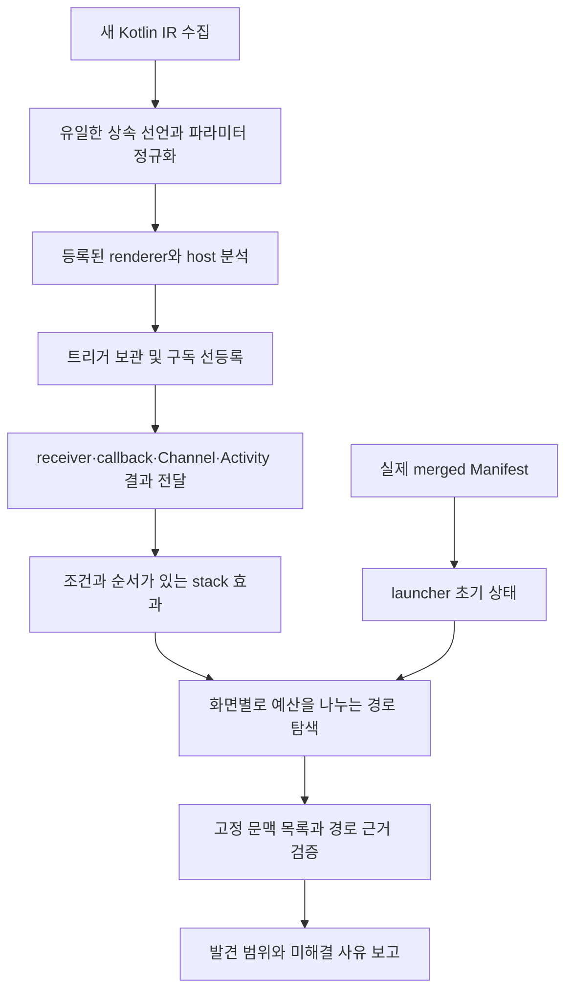

# 접근 경로 발견 범위 개선

## 목표와 분모

룰업의 이전 검증에서는 등록·렌더링이 입증된 화면 문맥 48개 중 25개에 launcher 경로를 제시했다. 52.1%는 정적 모델의 경로 발견 범위이며 정탐률이나 화면 수집 재현율이 아니다. 이번 인수 목표는 같은 48개 문맥 중 최소 46개(95.8%)에 근거를 갖춘 경로를 제시하는 것이다. 미해결 문맥을 분모에서 제외하거나, 디자인 프레임 수와 등록 문맥 수를 혼합하지 않는다.

기존 미발견 23개를 연결 그래프로 점검했을 때 6개는 조건·백스택을 무시한 그래프 연결만 있었고, 12개는 해석된 유입 연결이 없었으며, 5개는 유입 연결이 launcher에서 이어지지 않았다. 조건을 제거한 그래프 연결은 인수 성공으로 계산하지 않는다. 이 분류는 원인을 좁히는 진단이며 실제 접근 불가의 증명이 아니다.

## 손실이 발생한 곳과 수정

### 상속 선언

Kotlin IR의 fake override에는 실행 본문이 없다. 수집기는 해당 선언을 제외했지만 호출 쪽에서는 하위 클래스의 fake override 심벌을 사용했다. 따라서 공통 기반 클래스가 구현한 getter·이벤트 발행 메서드가 소스에 있어도 호출과 본문을 연결하지 못했다.

수집기는 IR의 overriddenSymbols를 따라 유일한 원래 선언을 찾고, 인자도 같은 선언의 파라미터 순서로 식별한다. 이름 검색으로 비슷한 메서드를 연결하지 않는다. 여러 원래 선언이 남는 경우는 합치지 않는다. `INHERITED_CALL_TARGETS_V1` capability가 새 수집 결과를 식별한다. 기존 스냅샷에 이 근거를 소급해서 붙이지 않는다.

호출 해석기는 입증된 receiver의 소스 클래스 계층과 정확한 override 심벌을 사용한다. 적용 가능한 가장 가까운 구현이 유일한 경우에만 호출한다. 다른 하위 클래스나 미입증 receiver의 구현을 가져오지 않는다. 일반 소스의 operator invoke도 함수형 callback과 구분한다.

### UI와 비동기 전달

- Material Button 계열의 정확한 API 심벌에 클릭 슬롯을 추가했다. 동명의 사용자 함수는 자동으로 트리거가 되지 않으며 enabled=false는 이동을 만들지 않는다.
- 이벤트 해석을 렌더링에서 분리하고 composition effect의 구독을 먼저 등록한다. 버튼과 collector의 소스 선언 순서가 연결 결과를 바꾸지 않도록 한다.
- 화면 내부 Channel collector는 동일한 stream identity와 현재 화면 문맥이 필요하다. 다른 화면의 collector는 현재 화면의 송신을 받는 것으로 연결하지 않는다. 전역 collector는 기존 host/stack 소유권 검사를 유지한다.
  필드의 receiver가 미입증이면 화면 문맥으로 소유권을 대체하지 않는다. 로컬 Channel 생성과 객체 필드 Channel의 소유 근거를 구분한다.
- `LocalActivity`의 기본 owner는 Activity의 onCreate → activity.compose.setContent 근거가 있을 때만 제공한다. 명시적 provider가 있으면 그 값을 우선한다. Hilt ViewModel은 증명된 owner와 상수 key로 구분하고, 알 수 없는 owner/key는 미해결이다.
- `runCatching`과 Result의 성공·실패 callback에는 동일 결과에 대한 상반된 조건을 유지한다. 명시적 throw 뒤에 성공 callback을 실행하지 않는다. 지원하지 않는 예외 처리 전체를 해석한다고 주장하지 않는다.
- Activity 결과는 등록된 launcher 객체가 실제 launch 호출의 receiver로 이어져야 전달한다. callback 등록만으로 경로가 생기지 않는다. 외부 Activity의 실행과 결과 전달은 조건이며 `ACTIVITY_RESULT_TRANSFER` 근거를 남긴다.
- 익명 객체 메서드의 자유 변수는 생성 시의 캡처 환경으로 전달한다. 객체별 환경을 구분하여 다른 launcher나 callback을 섞지 않는다.

실제 컴파일 반례에서 추가로 두 손실을 확인했다. immutable 로컬 alias를 거친 callback은 원래 바인딩까지 캡처해야 하며, 익명 클래스의 `<no name provided>`를 제네릭 인자처럼 잘라서는 안 된다. 등록된 클래스 심벌을 먼저 조회하고, 로컬 alias의 참조 근거를 추적한다. 익명 클래스 선언 자체는 객체 생성 실행과 구분하며, 알 수 없는 부작용 문장은 값 평가에서 계속 거부한다.

실제 AndroidX IR의 `LocalActivity`는 getter 호출 또는 backing-field 참조로 나타난다. 두 표현 모두 같은 공식 CompositionLocal 심벌로 해석한다. 필드 이름이 유사한 사용자 구현을 연결하지 않으며 Activity owner 근거가 없거나 명시적 provider가 null이면 공유 ViewModel을 만들지 않는다.

큰 앱에서는 같은 호출 환경을 반복 해시하는 비용도 컸다. immutable 값 레코드의 바인딩 스냅샷에 구조 해시를 보관하고, 원본 맵의 크기와 각 바인딩의 객체 동일성을 확인한 뒤에만 재사용한다. 인자를 순차적으로 채우거나 교체한 맵은 새 스냅샷을 만든다. 재귀 판정도 동일한 구조 동등성을 사용하며 근거의 암호학적 fingerprint를 대체하지 않는다. 캐시는 분석 인스턴스와 문맥 안에서 제한한다. 진행 로그는 문맥·구독·트리거의 단계와 개수만 표시한다.

### 탐색 예산

기존 단일 BFS 큐는 한 화면의 많은 조건 분기를 먼저 소비해 다른 화면의 확장을 늦췄다. 새 탐색은 현재 보이는 화면 문맥별 큐를 두고 확장 횟수가 적은 큐부터 처리한다. 같은 조건 집합의 나열 순서도 상태의 차이로 계산하지 않는다.

간선, 조건, host, stack 효과, POP 제약은 그대로 검사한다. 모든 경로가 전역 최단 순서로 반환된다고 보장하지 않는다. 예산 내에서 각 목적지에 대한 증거를 확보하는 것을 우선하며 한도 초과는 여전히 `TRUNCATED`다. 조회의 maxDepth/maxStates/maxPathsPerTarget/stackSuffix 제한을 유지한다.

핸들러 해석이 `LIMIT`, `THROW`, `UNSUPPORTED_EFFECT` 등으로 중단된 경우, 그 전에 발견한 stack 효과는 진단용 전환에 보존하되 접근 경로에는 사용하지 않는다. 뒤의 미해석 효과가 목적지를 다시 지울 수 있기 때문이다. `INCOMPLETE_TRANSITION`을 frontier에 남기고 정상 완료된 전환만 인수 집계에 사용한다. 예외 직전 이동이 실제 UI에 나타날 수 있는 경우도 이 모델에서는 미발견으로 남는 보수적 선택이다.

## 파이프라인

## 반례와 인수

공개 합성 테스트는 비활성 버튼, 동명 API, 일반 operator invoke, Result 성공/실패의 모순, 명시적 throw, 미호출 launcher, 다른 launcher, 다른 Channel, 다른 화면의 collector, 서로 다른 ViewModel owner/key, 상속 메서드 인자 바인딩, 고분기 화면의 탐색 독점, false guard를 검사한다. 실제 Kotlin 컴파일 fixture로 상속 심벌이 수집 단계부터 일치하는지도 확인한다.

룰업 검증에서는 새 37모듈 수집과 실제 merged Manifest를 사용한다. 화면 문맥의 분모, 성공 실행 정책, 근거 참조, 경로의 시작점·목적지·전환 순서를 확인해야 한다. 95% 도달 여부는 완료된 검증 결과로만 보고한다. 합성 테스트 통과나 CI 성공이 이 수치를 대신하지 않는다.

## 보안과 해석 한계

고객 자료는 기존 linux-bwrap-v3 경계 안에서 처리한다. 도구 bundle 준비와 고객 분석을 분리하고, AI·외부 모델·원격 fallback을 사용하지 않는다. 실제 소스·카탈로그·근거·로그는 로컬 private 저장소에 유지한다. GitHub에는 공개 fixture와 집계 결과만 기록한다.

정적 경로는 필요한 로그인·서버 응답·시스템 결과가 실제 발생했다는 뜻이 아니다. 실행 관측은 `NOT_OBSERVED`로 유지한다. 등록 화면 목록 자체의 완전성, 모든 경로의 열거, runtime 접근 성공률과 오연결 정탐률은 별도의 정답·관측 검증이 필요하다.
